# Istio Service Mesh Engineering Fellowship — Cohort 01 (`FELLOWSHIP_HANDBOOK.md`)

> **[Fellowship Portal](./README.md) · [Progression Dashboard](./PROGRESSION_DASHBOARD.md) · [Version Baseline (`Istio 1.32.0`)](./VERSIONS.md) · [Compatibility Matrix](./COMPATIBILITY.md) · [Start Week 01 ->](./fellowship/week-01-platform-onboarding/WEEK.md)**

Welcome to **Cohort 01** of the **Istio Service Mesh Engineering Fellowship**.

This program is not a passive video course or a collection of isolated command references. It is structured as an intensive, 10-week **Platform Engineering Apprenticeship** where you join the infrastructure engineering team at **NovaPay**, take ownership of production service-mesh tickets, debug live outage simulations, defend your architectural trade-offs in design reviews, and graduate only after demonstrating production-level competency.

---

## 1. The Case Study: Welcome to NovaPay Platform Engineering

**NovaPay** is a high-growth FinTech payment processor handling multi-currency merchant checkout, fraud scoring, and ledger settlement. Over the past 18 months, NovaPay migrated from a monolithic payment core to Kubernetes microservices (`Kubernetes 1.36/1.37`).

While containerization accelerated deployment velocity, it exposed critical distributed-systems failures:
1. **L4 Load-Balancing Skew**: High-throughput gRPC/HTTP2 connections between `order-service` and `payment-service` pin to single pods behind Kubernetes `Services`, overloading individual instances while new replicas sit idle.
2. **Unbounded Retries & Cascading Outages**: Application developers embedded ad-hoc retry loops inside their HTTP clients. A 500ms database hiccup in `payment-service` triggered a $25\times$ retry storm that took down the entire storefront.
3. **Upcoming PCI-DSS Level 1 Audit**: Regulatory auditors require cryptographic proof that all East-West traffic is encrypted in transit (mTLS), that workloads in the general application tier (`orderflow` / `novapay`) cannot access the PCI vault tier (`novapay-pci`) except through explicitly authorized SPIFFE service identities, and that all outbound calls to external banking/credit networks pass through an audited Egress Gateway.
4. **Risky Deployments**: Standard Kubernetes `RollingUpdate` deployments tie traffic percentage directly to pod count, making it impossible to shadow live traffic to `payment-service-v2` or route 1% of canary traffic without running 100 pods.

### Your Role
You have just joined NovaPay as a **Platform Engineer** on the Core Infrastructure team. Over the next **10 weeks**, you will architect, roll out, harden, and operate **Istio `1.32.0`** (with **Envoy `v1.40`** and **Kubernetes Gateway API `v1.6.1`**) across NovaPay's core order subsystem (`orderflow`) and ultimately cut over the multi-namespace PCI production environment (`novapay` + `novapay-pci`).

---

## 2. Meet Your NovaPay Engineering Team

Throughout the fellowship, you will collaborate with—and defend your designs against—four recurring engineers. Each brings distinct technical priorities and architectural perspectives:

| Engineer | Role | Technical Focus & Perspective | Signature Question in Reviews |
| :--- | :--- | :--- | :--- |
| **Alex Morgan** | **Senior Platform Engineer & Primary Mentor** | Your direct mentor. Approachable, technically brilliant, pragmatic, and occasionally humorous. Refuses to treat Istio as a "magic black box." Insists that you inspect Envoy xDS state (`LDS`, `RDS`, `CDS`, `EDS`, `SDS`), Linux `iptables`/CNI packet flows, and control-plane memory scaling before merging any YAML. | *"Don't just tell me the `VirtualService` YAML applied cleanly—what did `istiod` compile it into inside Envoy, and what happens if that CRD is applied in the wrong order?"* |
| **Sarah Chen** | **Site Reliability Engineering (SRE) Lead** | Owns NovaPay's `99.99%` availability SLO, P99 tail latency, incident response, and control-plane upgrades. Deeply skeptical of unbounded retries, un-scoped Envoy memory consumption, and control plane single points of failure. Leads Friday Incident Drills. | *"How does this configuration behave at 3:00 AM when `payment-service-v2` starts returning `503`s under peak load—does it fail fast or trigger a cascading retry storm?"* |
| **Daniel Brooks** | **Staff Backend Engineer** | Leads the Checkout & Payment application teams (`frontend`, `order-service`, `payment-service`). Wants fast releases, clean APIs (prefers **Kubernetes Gateway API** over vendor-specific CRDs), and zero application code changes. Frustrated when sidecars break his batch jobs or cause mysterious `503 UF`/`NR` errors. | *"Why is the mesh rejecting my service's connections, and how much CPU/memory tax are your sidecars adding to my pods compared to Ambient mode?"* |
| **Maya Patel** | **Principal Security Engineer** | Leads NovaPay's PCI-DSS Level 1 certification. Uncompromising on Zero-Trust networking: cryptographic SPIFFE identity (`spiffe://cluster.local/ns/<ns>/sa/<sa>`), `STRICT` mTLS, default-deny (`allow-nothing`) `AuthorizationPolicy`, JWT claim verification, and `REGISTRY_ONLY` egress control. | *"If an attacker compromises the `frontend` container, what mathematically prevents them from calling `payment-service` or exfiltrating card data to an arbitrary external IP?"* |

---

## 3. Our Pedagogical Architecture: The 12-Stage Teaching Flow & Progressive Disclosure

To ensure you develop genuine platform engineering judgment rather than superficial YAML familiarity, every major learning unit in the fellowship follows a structured **12-Stage Apprenticeship Flow**:

1. **Engineering Context**: What is happening right now at NovaPay?
2. **The Challenge**: What production problem, incident, or requirement must be solved?
3. **Alex's Briefing**: Alex Morgan frames the situation, shares a production war story, and challenges your initial assumptions.
4. **Build Intuition**: Introduce the core mechanism using a concrete mental model or systems analogy before diving into API specs.
5. **Technical Explanation**: Explain the Istio/Envoy mechanism accurately using **4-Tier Progressive Disclosure**:
   - **Core Concept**: *What must I understand right now?*
   - **Technical Deep Dive**: *How does it actually work inside Envoy and `istiod`?*
   - **Engineering Insight**: *What subtle edge cases matter at 3:00 AM in production?*
   - **Advanced Exploration**: *What should I investigate next?*
6. **Under the Hood & 6-Part Diagram Walkthroughs**: Every major architecture or sequence diagram includes a step-by-step walkthrough answering: *(1) What initiates the operation? (2) Which component receives it? (3) What information is exchanged? (4) What changes in the system? (5) How can you observe it? (6) What happens if a component fails?*
7. **Guided Implementation**: Build and verify the solution step-by-step in the module's `LAB.md`, using **"Predict Before You Execute"** prompts.
8. **Investigation**: Inspect live Envoy xDS dumps (`istioctl proxy-config`), Envoy Admin `:15000/stats`, Prometheus metrics, and access logs.
9. **Failure Simulation**: Introduce deliberately broken configurations (`INC-01` through `INC-10`) and use **Progressive Hints** before revealing root causes.
10. **Production Review**: Defend trade-offs (latency, memory overhead, blast radius, security) in Saturday Architecture Reviews.
11. **Knowledge Check**: Test mechanism comprehension and behavior prediction rather than rote memorization.
12. **Engineering Deliverable**: Complete an independent engineering assignment (`NP-101` through `NP-110`) with verifiable acceptance criteria.

---

## 4. The 10-Week Cohort Roadmap

```mermaid
flowchart LR
    subgraph P1["Phase 1: Foundation & Architecture"]
        W1["Week 01: Platform Onboarding &<br/>Control Plane Foundation<br/>(Module 00)"]
        W2["Week 02: Envoy xDS Internals,<br/>Interception & Ambient Mode<br/>(Module 01: 4 Lessons)"]
    end

    subgraph P2["Phase 2: Core Service Mesh Engineering"]
        W3["Week 03: Service Discovery,<br/>L7 Routing & Sidecar Scoping<br/>(Module 02: 3 Lessons)"]
        W4["Week 04: Edge Gateways,<br/>Gateway API & Egress Control<br/>(Module 03: 3 Lessons)"]
        W5["Week 05: Zero-Trust Security:<br/>mTLS, JWT & AuthorizationPolicy<br/>(Module 04: 3 Lessons)"]
    end

    subgraph P3["Phase 3: Production Reliability & Operations"]
        W6["Week 06: Resilience Engineering:<br/>Timeouts, Retries & Circuit Breaking<br/>(Module 05: 3 Lessons)"]
        W7["Week 07: Progressive Delivery:<br/>Mirroring, Canary & Blue-Green<br/>(Module 06: 2 Lessons)"]
        W8["Week 08: Observability:<br/>Golden Signals, Telemetry & Tracing<br/>(Module 07: 3 Lessons)"]
    end

    subgraph P4["Phase 4: Advanced Architecture & Graduation"]
        W9["Week 09: War-Room Debugging &<br/>Canary Control Plane Upgrades<br/>(Modules 08 & 09: 3 Lessons)"]
        W10["Week 10: NovaPay PCI Production<br/>Capstone & Graduation Defense<br/>(Module 10)"]
    end

    W1 --> W2 --> W3 --> W4 --> W5 --> W6 --> W7 --> W8 --> W9 --> W10
```

---

## 5. The 7-Day Weekly Cohort Rhythm (Self-Paced)

Because this is a self-paced simulated cohort, "Monday" through "Sunday" represent **seven progressive stages of mastery within each week** rather than rigid calendar dates:

- **Monday — Mentor Briefing & Ticket Assignment**: Meet with Alex Morgan, read the peer engineering debate (`#platform-mesh-arch`), and receive your weekly ticket (`NP-10X`).
- **Tuesday — Modular Technical Lessons**: Work through the focused, 20–30 minute lessons in `0X-.../lessons/` and review the Module Overview Hub (`0X-.../README.md`).
- **Wednesday — Guided Hands-On Lab**: Run pre-flight verification, execute `0X-.../LAB.md`, predict system behavior before running commands, and verify Alex's xDS checkpoints.
- **Thursday — Independent Engineering Assignment**: Solve ticket `NP-10X` independently on your cluster; consult Alex's progressive hint if stuck before opening the reference solution.
- **Friday — Production Incident Simulation (`INC-0X`)**: Respond to Sarah Chen's PagerDuty alert, reproduce the outage, isolate the Envoy response flag and xDS root cause, and write a blameless postmortem.
- **Saturday — Architecture Review & Mentor Office Hours**: Defend your implementation against challenges from Alex, Sarah, Daniel, and Maya, and study Alex's Office Hours Q&A.
- **Sunday — Weekly Assessment & Retrospective**: Complete the 5-question engineering assessment and update [`PROGRESSION_DASHBOARD.md`](./PROGRESSION_DASHBOARD.md).
