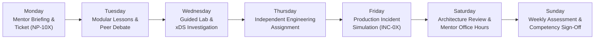

# Istio Service Mesh Engineering Fellowship — Cohort 01

Welcome to **Cohort 01** of the **Istio Service Mesh Engineering Fellowship**—an intensive, 10-week, self-paced Platform Engineering apprenticeship where you join the infrastructure engineering team at **NovaPay**, master **Istio `1.32.0`** from Envoy xDS internals to multi-namespace PCI-DSS production operations, and graduate by defending your architecture before a simulated production review board.

> [!IMPORTANT]
> **Authoritative Version Baseline (November 2026)**
> - **Istio Service Mesh:** **`1.32.0`** *(Latest Stable Release; `1.31.x` used as N-1 in canary upgrade drills)*
> - **Envoy Proxy:** **`v1.40`** (`release/v1.40`)
> - **Kubernetes:** **`v1.36` / `v1.37`** *(Supported window: `1.33` – `1.37`, Native Sidecars GA)*
> - **Kubernetes Gateway API:** **`v1.6.1`** (`standard-install.yaml`, including graduated `TCPRoute` & `UDPRoute`)
> - **Governance Registers:** [**VERSIONS.md**](./VERSIONS.md) · [**COMPATIBILITY.md**](./COMPATIBILITY.md) · [**CHANGELOG.md**](./CHANGELOG.md)

---

## 1. Where Should I Start? (Fellowship Navigation Hub)

If you are new to the fellowship, follow these steps in order:

1. **Read the Program Handbook ([`FELLOWSHIP_HANDBOOK.md`](./FELLOWSHIP_HANDBOOK.md))**: Understand the **NovaPay** engineering storyline, meet your primary mentor **Alex Morgan** and teammates (**Sarah Chen**, **Daniel Brooks**, **Maya Patel**), and learn how our **12-Stage Teaching Flow** and **Monday–Sunday Weekly Cohort Cadence** work.
2. **Verify Your Version Baseline ([`VERSIONS.md`](./VERSIONS.md) & [`COMPATIBILITY.md`](./COMPATIBILITY.md))**: Confirm your workstation and cluster match the **Istio `1.32.0` / Kubernetes `1.36+` / Gateway API `v1.6.1`** baseline.
3. **Open Your Progression Tracker ([`PROGRESSION_DASHBOARD.md`](./PROGRESSION_DASHBOARD.md))**: Track your completed lessons, guided labs, independent engineering tickets (`NP-101`–`NP-110`), incident postmortems (`INC-01`–`INC-10`), and graduation gates.
4. **Begin [Week 01: Platform Onboarding (`fellowship/week-01-platform-onboarding/WEEK.md`)](./fellowship/week-01-platform-onboarding/WEEK.md)**: Start with Alex Morgan's Monday Morning Briefing and Ticket `NP-101`.

| Core Governance & Portfolio Files | Purpose |
| :--- | :--- |
| **[`FELLOWSHIP_HANDBOOK.md`](./FELLOWSHIP_HANDBOOK.md)** | NovaPay case study, character profiles, 12-stage teaching flow, and weekly cohort cadence. |
| **[`PROGRESSION_DASHBOARD.md`](./PROGRESSION_DASHBOARD.md)** | Competency-based progression dashboard, lesson/lab checklist, incident log, and graduation rubric. |
| **[`VERSIONS.md`](./VERSIONS.md)** | Authoritative version baseline (`Istio 1.32.0`, `Envoy 1.40`, `K8s 1.36+`, `Gateway API v1.6.1`) & pre-flight commands. |
| **[`COMPATIBILITY.md`](./COMPATIBILITY.md)** | Kubernetes & CNI compatibility matrices (including mandatory **Cilium** flags), Gateway API vs. Classic API, and Sidecar vs. Ambient matrices. |
| **[`CHANGELOG.md`](./CHANGELOG.md)** | Record of version modernizations, lesson modularization, and Cohort 01 curriculum updates. |
| **[`fellowship/templates/`](./fellowship/templates/)** | [Engineering Ticket](./fellowship/templates/ENGINEERING_TICKET_TEMPLATE.md) · [Incident Postmortem](./fellowship/templates/INCIDENT_POSTMORTEM_TEMPLATE.md) · [Architecture Review RFC](./fellowship/templates/ARCHITECTURE_REVIEW_RFC_TEMPLATE.md) · [Weekly Assessment](./fellowship/templates/WEEKLY_ASSESSMENT_TEMPLATE.md). |

---

## 2. How Each Week Works: The 7-Day Cohort Rhythm

Every week in Cohort 01 follows a consistent, self-paced **Monday–Sunday Platform Engineering cadence** led by your Senior Platform Engineer mentor, **Alex Morgan**:

---

## 3. Complete 10-Week Cohort Roadmap, Modular Lessons & Labs

To prevent cognitive overload, every major module is broken into **focused, 20–30 minute progressive lessons (`lessons/*.md`)**, paired with a **Module Synthesis Hub (`README.md`)**, a **Hands-On Lab (`LAB.md`)**, and a **Weekly Cohort Guide (`WEEK.md`)**.

### Phase 1: Foundation and Architecture (Weeks 1–2)

| Cohort Week (`WEEK.md`) | Required Modular Lessons (`Tuesday`) | Guided Lab (`Wednesday`), Ticket (`Thursday`) & Incident (`Friday`) |
| :--- | :--- | :--- |
| **[Week 01: Platform Onboarding & Control Plane Foundation](./fellowship/week-01-platform-onboarding/WEEK.md)** | • **[Module 00: Environment Setup, Installation Profiles & OrderFlow Topology](./00-environment-setup/README.md)** *(45m)* | • **Lab:** [**Lab 00: Cluster Provisioning & OrderFlow Deployment**](./00-environment-setup/LAB.md) ([`manifests/`](./00-environment-setup/manifests/)) • **Ticket `NP-101`:** Onboard `currency-service-v1` with SPIFFE SA & port naming • **Incident `INC-01`:** Uninjected pods (`1/1`) & 5s protocol-sniffing stall |
| **[Week 02: Data Plane Internals, Envoy xDS & Ambient Mode](./fellowship/week-02-dataplane-internals-and-ambient/WEEK.md)** | • **[Module 01 Overview Hub](./01-architecture-and-internals/README.md)** • **[Lesson 01.1: Control Plane (`istiod`) & Sidecar Injection](./01-architecture-and-internals/lessons/01-control-plane-and-sidecar-injection.md)** *(25m)* • **[Lesson 01.2: Linux Netns & `iptables` Interception](./01-architecture-and-internals/lessons/02-linux-netns-and-iptables-interception.md)** *(30m)* • **[Lesson 01.3: Envoy Proxy Internals & xDS/ADS Pipeline](./01-architecture-and-internals/lessons/03-envoy-xds-pipeline-and-ads.md)** *(30m)* • **[Lesson 01.4: Ambient Mode (`ztunnel`, HBONE & Waypoints)](./01-architecture-and-internals/lessons/04-ambient-mode-ztunnel-and-waypoints.md)** *(30m)* | • **Lab:** [**Lab 01: Dissecting `iptables`, Envoy xDS & Ambient Mode**](./01-architecture-and-internals/LAB.md) ([`manifests/`](./01-architecture-and-internals/manifests/)) • **Ticket `NP-102`:** Enroll `orderflow-batch` in Ambient Mode with L7 Waypoint • **Incident `INC-02`:** `503 UF` on inbound `:15006` due to `127.0.0.1` loopback binding |

---

### Phase 2: Core Service Mesh Engineering (Weeks 3–5)

| Cohort Week (`WEEK.md`) | Required Modular Lessons (`Tuesday`) | Guided Lab (`Wednesday`), Ticket (`Thursday`) & Incident (`Friday`) |
| :--- | :--- | :--- |
| **[Week 03: Service Discovery, L7 Routing & Sidecar Scoping](./fellowship/week-03-service-discovery-and-l7-routing/WEEK.md)** | • **[Module 02 Overview Hub](./02-service-discovery-and-routing/README.md)** • **[Lesson 02.1: Kubernetes L4 Discovery vs. Istio EDS](./02-service-discovery-and-routing/lessons/01-k8s-l4-discovery-vs-istio-eds.md)** *(20m)* • **[Lesson 02.2: `VirtualService`, `DestinationRule` & the Order Trap](./02-service-discovery-and-routing/lessons/02-virtualservice-destinationrule-and-order-trap.md)** *(30m)* • **[Lesson 02.3: Load Balancing & `Sidecar` Memory Scoping](./02-service-discovery-and-routing/lessons/03-load-balancing-and-sidecar-scoping.md)** *(25m)* | • **Lab:** [**Lab 02: L7 Routing, Subsets, Ring Hash & Sidecar Scoping**](./02-service-discovery-and-routing/LAB.md) ([`manifests/`](./02-service-discovery-and-routing/manifests/)) • **Ticket `NP-103`:** Multi-tier VIP routing, `consistentHash` & `Sidecar` scoping • **Incident `INC-03`:** `503 NR` checkout outage from Subset Evaluation Order Trap |
| **[Week 04: Edge Gateways, Gateway API & Controlled Egress](./fellowship/week-04-edge-gateways-and-controlled-egress/WEEK.md)** | • **[Module 03 Overview Hub](./03-gateways-ingress-and-egress/README.md)** • **[Lesson 03.1: North-South Gateways & Edge TLS Modes](./03-gateways-ingress-and-egress/lessons/01-north-south-gateways-and-tls-modes.md)** *(25m)* • **[Lesson 03.2: Kubernetes Gateway API (`v1.6.1`)](./03-gateways-ingress-and-egress/lessons/02-kubernetes-gateway-api.md)** *(25m)* • **[Lesson 03.3: Zero-Trust Egress & TLS Origination](./03-gateways-ingress-and-egress/lessons/03-zero-trust-egress-and-tls-origination.md)** *(30m)* | • **Lab:** [**Lab 03: Edge TLS, Gateway API & Controlled Egress**](./03-gateways-ingress-and-egress/LAB.md) ([`manifests/`](./03-gateways-ingress-and-egress/manifests/)) • **Ticket `NP-104`:** Gateway API `HTTPRoute` canary + external TLS origination • **Incident `INC-04`:** Edge HTTPS outage from wrong TLS Secret namespace |
| **[Week 05: Zero-Trust Security Architecture](./fellowship/week-05-zero-trust-security-architecture/WEEK.md)** | • **[Module 04 Overview Hub](./04-security-mtls-and-authz/README.md)** • **[Lesson 04.1: SPIFFE Identity & SDS Certificate Lifecycle](./04-security-mtls-and-authz/lessons/01-spiffe-identity-and-sds-lifecycle.md)** *(25m)* • **[Lesson 04.2: `PeerAuthentication` & mTLS Migration](./04-security-mtls-and-authz/lessons/02-peer-authentication-and-mtls-migration.md)** *(25m)* • **[Lesson 04.3: JWT Authn & `AuthorizationPolicy`](./04-security-mtls-and-authz/lessons/03-jwt-authn-and-authorization-policy.md)** *(30m)* | • **Lab:** [**Lab 04: SPIFFE Inspection, Strict mTLS, JWT & Authz**](./04-security-mtls-and-authz/LAB.md) ([`manifests/`](./04-security-mtls-and-authz/manifests/)) • **Ticket `NP-105`:** Defense-in-depth `DENY` + `ALLOW` SPIFFE & JWT policies • **Incident `INC-05`:** Authorization bypass from YAML list `AND` vs. `OR` bug |

---

### Phase 3: Production Reliability and Operations (Weeks 6–8)

| Cohort Week (`WEEK.md`) | Required Modular Lessons (`Tuesday`) | Guided Lab (`Wednesday`), Ticket (`Thursday`) & Incident (`Friday`) |
| :--- | :--- | :--- |
| **[Week 06: Resilience Engineering & Chaos Testing](./fellowship/week-06-resilience-and-chaos-engineering/WEEK.md)** | • **[Module 05 Overview Hub](./05-resilience-and-fault-injection/README.md)** • **[Lesson 05.1: Timeouts, Bounded Retries & Retry Storms](./05-resilience-and-fault-injection/lessons/01-timeouts-retries-and-retry-storms.md)** *(25m)* • **[Lesson 05.2: Circuit Breaking & Outlier Detection](./05-resilience-and-fault-injection/lessons/02-circuit-breaking-and-outlier-detection.md)** *(30m)* • **[Lesson 05.3: Chaos Fault Injection & Locality Failover](./05-resilience-and-fault-injection/lessons/03-chaos-fault-injection-and-locality-failover.md)** *(25m)* | • **Lab:** [**Lab 05: Timeouts, Retries, Circuit Breaking & Chaos**](./05-resilience-and-fault-injection/LAB.md) ([`manifests/`](./05-resilience-and-fault-injection/manifests/)) • **Ticket `NP-106`:** Multi-tier timeout budget + `connectionPool` & `outlierDetection` • **Incident `INC-06`:** Premature `504 UT` timeout inversion & double-charges |
| **[Week 07: Progressive Delivery & Safe Releases](./fellowship/week-07-progressive-delivery-and-safe-releases/WEEK.md)** | • **[Module 06 Overview Hub](./06-progressive-delivery/README.md)** • **[Lesson 06.1: Traffic Mirroring (`-shadow`) & Dark Launches](./06-progressive-delivery/lessons/01-traffic-mirroring-and-dark-launches.md)** *(25m)* • **[Lesson 06.2: Weighted Canary, Blue-Green & Argo Rollouts](./06-progressive-delivery/lessons/02-weighted-canary-blue-green-and-argo-rollouts.md)** *(25m)* | • **Lab:** [**Lab 06: Shadowing, Dark Launches & Staged Canary**](./06-progressive-delivery/LAB.md) ([`manifests/`](./06-progressive-delivery/manifests/)) • **Ticket `NP-107`:** Combined VIP dark-launch, 85/15 canary & read-only shadow mirror • **Incident `INC-07`:** Catch-all route precedence ordering bug (`IST0129`) |
| **[Week 08: Observability, Golden Signals & Tracing](./fellowship/week-08-observability-and-golden-signals/WEEK.md)** | • **[Module 07 Overview Hub](./07-observability-and-telemetry/README.md)** • **[Lesson 07.1: Envoy Telemetry & Dual-Reporter Metrics](./07-observability-and-telemetry/lessons/01-envoy-telemetry-and-dual-reporter-metrics.md)** *(25m)* • **[Lesson 07.2: `Telemetry` API & CEL Error-Only Logs](./07-observability-and-telemetry/lessons/02-telemetry-api-metrics-and-cel-access-logs.md)** *(25m)* • **[Lesson 07.3: Distributed Tracing & Context Propagation](./07-observability-and-telemetry/lessons/03-distributed-tracing-and-context-propagation.md)** *(20m)* | • **Lab:** [**Lab 07: `Telemetry` API, Custom Tags, CEL Logs & Jaeger**](./07-observability-and-telemetry/LAB.md) ([`manifests/`](./07-observability-and-telemetry/manifests/)) • **Ticket `NP-108`:** CEL error-only JSON logs, bounded tags & SLO alerts • **Incident `INC-08`:** Fragmented 1-span traces & Prometheus cardinality explosion |

---

### Phase 4: Advanced Architecture and Graduation (Weeks 9–10)

| Cohort Week (`WEEK.md`) | Required Modular Lessons (`Tuesday`) | Guided Lab (`Wednesday`), Ticket (`Thursday`) & Incident (`Friday`) |
| :--- | :--- | :--- |
| **[Week 09: Incident Response & Control Plane Operations](./fellowship/week-09-incident-response-and-control-plane-ops/WEEK.md)** | • **[Module 08 Overview Hub](./08-debugging-and-production-operations/README.md)** • **[Lesson 08.1: 5-Step Debugging & Envoy Response Flags](./08-debugging-and-production-operations/lessons/01-systematic-debugging-and-response-flags.md)** *(30m)* • **[Lesson 08.2: Production Pitfalls & Canary Upgrades (`1-31-0` $\rightarrow$ `1-32-0`)](./08-debugging-and-production-operations/lessons/02-production-pitfalls-and-canary-control-plane-upgrades.md)** *(30m)* • **[Module 09: Production Readiness Checklists & Cheat Sheet](./09-production-checklists-and-reference/README.md)** *(25m)* | • **Lab:** [**Lab 08: 5-Scenario Production War-Room & Canary Upgrade**](./08-debugging-and-production-operations/LAB.md) ([`manifests/`](./08-debugging-and-production-operations/manifests/)) • **Ticket `NP-109`:** Pre-prod checklist audit, Native Sidecar Jobs & zero-downtime pod drain • **Incident `INC-09`:** Conflicting revision labels (`IST0135`) & orphaned `STALE` proxies |
| **[Week 10: NovaPay PCI Capstone & Graduation Defense](./fellowship/week-10-capstone-and-graduation-defense/WEEK.md)** | • **[Module 10: Capstone Project — The NovaPay Multi-Namespace Production Mesh](./10-capstone-project/README.md)** *(60m)* | • **Capstone Implementation:** [`10-capstone-project/manifests/`](./10-capstone-project/manifests/) & [**`verify-capstone.sh`**](./10-capstone-project/verify-capstone.sh) • **Ticket `NP-110`:** Full `novapay` + `novapay-pci` 6-pillar production cutover • **Incident `INC-10`:** Triple-fault graduation chaos drill + **8-Prompt Graduation Defense Board** |
