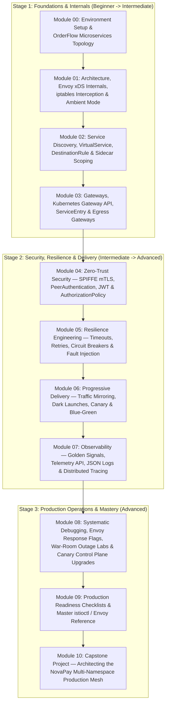

# Mastering Istio in Production: A Concept-First, Lab-Driven Course

Welcome to **Mastering Istio in Production**—an end-to-end engineering curriculum designed to take you from Kubernetes networking fundamentals to architecting, operating, and troubleshooting enterprise-grade Istio service meshes.

Rather than presenting isolated API reference snippets or superficial `hello-world` commands, this course prioritizes **deep mechanical understanding reinforced immediately by hands-on labs**:
- **How It Works Under the Hood**: Every module traces what happens inside **`istiod`**, how **xDS** (`LDS`, `RDS`, `CDS`, `EDS`, `SDS`) configurations are compiled and pushed over gRPC, how **Linux `iptables` / `istio-cni` / eBPF** intercepts packets in the Pod network namespace, and how **Envoy Proxy** (or **`ztunnel` + Waypoint** in Ambient Mode) processes every frame.
- **Why It Exists & When to Use It**: Every Istio custom resource (`VirtualService`, `DestinationRule`, `Gateway`, `ServiceEntry`, `Sidecar`, `PeerAuthentication`, `RequestAuthentication`, `AuthorizationPolicy`, `Telemetry`) is connected directly to the real distributed-systems problem it solves—and the operational trade-offs it introduces.
- **Realistic Multi-Tier Microservices**: Instead of disconnected containers, all modules build upon a realistic multi-service e-commerce & payment architecture (**OrderFlow** in Modules 00–08, culminating in the multi-namespace PCI-DSS **NovaPay** architecture in the Capstone Project).

---

## Course Architecture & Learning Progression

---

## Complete Course Curriculum & Module Index

### Stage 1: Foundations, Internals & Traffic Management

| Module | Core Concepts Covered | Hands-On Lab & Manifests |
| :--- | :--- | :--- |
| **[Module 00: Environment Setup & Reference Architecture](./00-environment-setup/README.md)** | Multi-zone Kubernetes topology (`region`/`zone`), Istio installation profiles (`default` vs `demo` vs `ambient`), `IstioOperator` customization, and the 5-service `OrderFlow` call-graph architecture. | **[Lab 00](./00-environment-setup/LAB.md)** [`manifests/`](./00-environment-setup/manifests/) |
| **[Module 01: Architecture, Envoy Internals & Ambient Mode](./01-architecture-and-internals/README.md)** | Control Plane (`istiod`: Pilot, Citadel, Galley) vs Data Plane (`envoy`). Envoy Listeners (`15001` outbound, `15006` inbound), Filter Chains, Routes, Clusters, Endpoints, xDS API (`LDS`, `RDS`, `CDS`, `EDS`, `SDS`). `istio-init` `iptables` NAT chains (`UID 1337` loop prevention) vs `istio-cni`. **Sidecar Mode vs Ambient Mode** (`ztunnel` L4 + HBONE `:15008` + L7 Waypoint proxies). | **[Lab 01](./01-architecture-and-internals/LAB.md)** [`manifests/`](./01-architecture-and-internals/manifests/) |
| **[Module 02: Service Discovery, Routing & Subsets](./02-service-discovery-and-routing/README.md)** | K8s `Service` + `EndpointSlice` (`kube-proxy` L4 connection LB & gRPC multiplexing flaw) vs Istio Service Registry & Envoy `EDS` L7 LB. `VirtualService` vs `DestinationRule`. **The Evaluation Order Trap** (`503 NR`). Load balancing (`ROUND_ROBIN`, `LEAST_REQUEST`, `consistentHash`). Scaling Envoy memory with the `Sidecar` CRD. | **[Lab 02](./02-service-discovery-and-routing/LAB.md)** [`manifests/`](./02-service-discovery-and-routing/manifests/) |
| **[Module 03: Gateways, Ingress & Egress Traffic Control](./03-gateways-ingress-and-egress/README.md)** | North-South traffic architecture. Istio `Gateway` vs **Kubernetes Gateway API** (`GatewayClass`, `Gateway`, `HTTPRoute`). TLS Termination, mTLS at the Edge, SNI Passthrough. Egress control (`ALLOW_ANY` vs `REGISTRY_ONLY`), `ServiceEntry` (`MESH_EXTERNAL`, DNS capture), TLS Origination, and Egress Gateways. | **[Lab 03](./03-gateways-ingress-and-egress/LAB.md)** [`manifests/`](./03-gateways-ingress-and-egress/manifests/) |

---

### Stage 2: Zero-Trust Security, Resilience, Progressive Delivery & Observability

| Module | Core Concepts Covered | Hands-On Lab & Manifests |
| :--- | :--- | :--- |
| **[Module 04: Zero-Trust Security — mTLS, JWT & AuthorizationPolicy](./04-security-mtls-and-authz/README.md)** | SPIFFE IDs (`spiffe://cluster.local/ns/<ns>/sa/<sa>`), `istio-agent` in-memory key generation, CSR via SDS to `istiod`, X.509 SAN validation. `PeerAuthentication` (`PERMISSIVE` ALPN negotiation vs `STRICT`, `portLevelMtls`). `RequestAuthentication` (JWT/JWKS). `AuthorizationPolicy` evaluation order (`CUSTOM` $\rightarrow$ `DENY` $\rightarrow$ `ALLOW`), `allow-nothing` baseline, and AND/OR rule semantics. | **[Lab 04](./04-security-mtls-and-authz/LAB.md)** [`manifests/`](./04-security-mtls-and-authz/manifests/) |
| **[Module 05: Resilience Engineering & Chaos Fault Injection](./05-resilience-and-fault-injection/README.md)** | Timeouts, Retries (`perTryTimeout`, `retryOn`, retry storms, and the Timeout Math Rule). Circuit Breaking via `DestinationRule` (`connectionPool` `503 UO` overflow & `outlierDetection` passive health checking pod ejection). Chaos testing with `VirtualService` Fault Injection (`delay` & `abort`). Locality-aware load balancing and zone failover. | **[Lab 05](./05-resilience-and-fault-injection/LAB.md)** [`manifests/`](./05-resilience-and-fault-injection/manifests/) |
| **[Module 06: Progressive Delivery — Mirroring, Canary & Blue-Green](./06-progressive-delivery/README.md)** | Decoupling deployment from release. Asynchronous Traffic Mirroring (`-shadow` host header, fire-and-forget duplication). Dark launches via header routing. Weighted Canary rollouts (90/10 $\rightarrow$ 50/50 $\rightarrow$ 100%). Blue-Green instant cutover. Automated metric-gated rollouts with Argo Rollouts. | **[Lab 06](./06-progressive-delivery/LAB.md)** [`manifests/`](./06-progressive-delivery/manifests/) |
| **[Module 07: Observability — Metrics, Logs & Distributed Tracing](./07-observability-and-telemetry/README.md)** | How Envoy generates Golden Signal metrics (`istio_requests_total`, `reporter="source\|destination"` comparison). The `Telemetry` CRD (custom metric dimensions, CEL-filtered structured JSON access logs, trace sampling). Distributed tracing context propagation (`traceparent`, `x-b3-*`) and Kiali/Grafana/Jaeger integration. | **[Lab 07](./07-observability-and-telemetry/LAB.md)** [`manifests/`](./07-observability-and-telemetry/manifests/) |

---

### Stage 3: Production Operations, Troubleshooting & Capstone Project

| Module | Core Concepts Covered | Hands-On Lab & Manifests |
| :--- | :--- | :--- |
| **[Module 08: Debugging, Envoy Response Flags & Production Operations](./08-debugging-and-production-operations/README.md)** | 5-step troubleshooting decision tree. Complete Envoy Response Flags reference (`NR`, `UH`, `UF`, `UO`, `UT`, `UC`, `DC`, `RL`, `UAEX`). Protocol sniffing pitfalls (`http-*`, `grpc-*`, `tcp-*`), K8s Job sidecar termination, pod drain race conditions, `istiod` HA sizing, and **Revision-Based Canary Control Plane Upgrades** (`istio.io/rev`). | **[Lab 08: Production War-Room (5 Mystery Outages + Upgrade)](./08-debugging-and-production-operations/LAB.md)** [`manifests/`](./08-debugging-and-production-operations/manifests/) |
| **[Module 09: Production Readiness Checklists & Reference](./09-production-checklists-and-reference/README.md)** | Pre-production checklists across 7 operational domains (Control Plane HA, Data Plane sizing/lifecycle, Traffic Management, Zero-Trust Security, Resilience, Telemetry cardinality, Day-2 Upgrades) + Master `istioctl` & Envoy Admin API Cheat Sheet. | **[Checklists & Cheat Sheet](./09-production-checklists-and-reference/README.md)** |
| **[Module 10: Capstone Project — The "NovaPay" Production Mesh](./10-capstone-project/README.md)** | End-to-end production implementation combining multi-namespace isolation (`novapay` & `novapay-pci`), `Sidecar` scoping, `STRICT` mTLS, Default-Deny `AuthorizationPolicy`, JWT auth, TLS Ingress & Egress Origination, Circuit Breaking, 80/20 Canary + VIP Routing + Shadow Mirroring, and JSON Telemetry. | **[Capstone Guide](./10-capstone-project/README.md)** [`manifests/`](./10-capstone-project/manifests/) [`verify-capstone.sh`](./10-capstone-project/verify-capstone.sh) |

---

## How to Use This Course

1. **Follow the Modules Sequentially**: Each module builds directly on the mental models and cluster state established in prior modules.
2. **Never Just `kubectl apply`**: In every lab, before and after applying an Istio manifest, run the accompanying `istioctl proxy-config` and Envoy admin inspection commands to see *how* your high-level YAML was compiled into low-level Envoy listeners, routes, clusters, endpoints, and secrets.
3. **Break Things on Purpose**: Complete the **Troubleshooting Exercises** at the end of every lab and the **5 Mystery Outage Scenarios** in [Module 08](./08-debugging-and-production-operations/LAB.md) to build real operational muscle memory.

