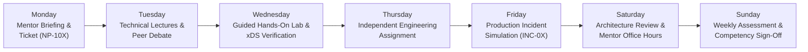

# Istio Service Mesh Engineering Fellowship — Cohort 01

Welcome to **Cohort 01** of the **Istio Service Mesh Engineering Fellowship**—an intensive, 10-week, self-paced Platform Engineering residency where you join the infrastructure engineering team at **NovaPay**, master **Istio `1.32.0`** from Envoy xDS internals to multi-namespace PCI-DSS production operations, and graduate by defending your architecture before a simulated production review board.

> [!IMPORTANT]
> **Authoritative Version Baseline (November 2026)**
> - **Istio Service Mesh:** **`1.32.0`** *(Latest Stable Release; `1.31.x` used as N-1 in canary upgrade drills)*
> - **Envoy Proxy:** **`v1.40`** (`release/v1.40`)
> - **Kubernetes:** **`v1.36` / `v1.37`** *(Supported window: `1.33` – `1.37`, Native Sidecars GA)*
> - **Kubernetes Gateway API:** **`v1.6.1`** (`standard-install.yaml`, including graduated `TCPRoute` & `UDPRoute`)
> - **Governance Registers:** [**VERSIONS.md**](./VERSIONS.md) · [**COMPATIBILITY.md**](./COMPATIBILITY.md) · [**CHANGELOG.md**](./CHANGELOG.md)

---

## 1. Program Navigation & Governance Hub

| Program Document | Purpose |
| :--- | :--- |
| **[`FELLOWSHIP_HANDBOOK.md`](./FELLOWSHIP_HANDBOOK.md)** | **Start Here:** The NovaPay FinTech storyline, your role as Platform Engineer, mentor & character profiles (**Alex Morgan**, **Sarah Chen**, **Daniel Brooks**, **Maya Patel**), and the 7-day weekly rhythm. |
| **[`PROGRESSION_DASHBOARD.md`](./PROGRESSION_DASHBOARD.md)** | **Track Your Competency:** Master checklist of all 10 weekly guided labs, independent engineering tickets (`NP-101`–`NP-110`), incident postmortems (`INC-01`–`INC-10`), phase gates, and graduation criteria. |
| **[`VERSIONS.md`](./VERSIONS.md)** | Authoritative version baseline (`Istio 1.32.0`, `Envoy 1.40`, `K8s 1.36+`, `Gateway API v1.6.1`), CRD API version standards (`v1`), and pre-flight verification commands. |
| **[`COMPATIBILITY.md`](./COMPATIBILITY.md)** | Kubernetes & CNI compatibility matrices (including mandatory **Cilium** `cni.exclusive=false` and `socketLB.hostNamespaceOnly=true` flags), Gateway API vs. Istio Classic API, and Sidecar vs. Ambient matrices. |
| **[`CHANGELOG.md`](./CHANGELOG.md)** | Record of course modernizations, API migrations (`v1`), removal of the in-cluster `IstioOperator`, and Cohort 01 curriculum updates. |
| **[`fellowship/templates/`](./fellowship/templates/)** | Portfolio templates: [Engineering Ticket](./fellowship/templates/ENGINEERING_TICKET_TEMPLATE.md) · [Incident Postmortem](./fellowship/templates/INCIDENT_POSTMORTEM_TEMPLATE.md) · [Architecture Review RFC](./fellowship/templates/ARCHITECTURE_REVIEW_RFC_TEMPLATE.md) · [Weekly Assessment](./fellowship/templates/WEEKLY_ASSESSMENT_TEMPLATE.md). |

---

## 2. How the Fellowship Works: The Weekly Cohort Cadence

Unlike disconnected tutorials, every week in Cohort 01 follows a realistic **Monday–Sunday Platform Engineering cadence** (completely self-paced) led by your Senior Platform Engineer mentor, **Alex Morgan**:

### The NovaPay Engineering Team
- **Alex Morgan (Senior Platform Engineer & Primary Mentor):** Demands deep mechanical understanding of Envoy xDS (`LDS`, `RDS`, `CDS`, `EDS`, `SDS`), Linux `iptables`/CNI packet flows, and blast-radius control.
- **Sarah Chen (SRE Lead):** Owns NovaPay's `99.99%` availability SLO, P99 latency budgets, retry-storm prevention, circuit breaking, and Friday Incident Response Drills.
- **Daniel Brooks (Staff Backend Engineer):** Leads Checkout & Payment microservices (`order-service`, `payment-service`); champions developer velocity, Kubernetes Gateway API, and minimal sidecar overhead.
- **Maya Patel (Principal Security Engineer):** Leads NovaPay's PCI-DSS Level 1 audit; enforces cryptographic SPIFFE identity, `STRICT` mTLS, default-deny `AuthorizationPolicy`, and `REGISTRY_ONLY` egress.

---

## 3. Complete 10-Week Cohort Roadmap & Technical Modules

### Phase 1: Foundation and Architecture (Weeks 1–2)

| Cohort Week (Mon–Sun Guide) | Engineering Ticket & Friday Incident Drill | Core Technical Lecture (`Tuesday`) & Guided Lab (`Wednesday`) |
| :--- | :--- | :--- |
| **[Week 01: Platform Onboarding & Control Plane Foundation](./fellowship/week-01-platform-onboarding/WEEK.md)** | **Ticket `NP-101`:** Provisioning NovaPay's multi-zone cluster, Helm vs. `istioctl` profiles in Istio `1.32.0`, Cilium CNI audit & `currency-service` onboarding. **Incident `INC-01`:** Missing sidecar injection (`1/1`) & 5s protocol-sniffing stall. | **[Module 00: Environment Setup & Reference Architecture](./00-environment-setup/README.md)** [**Lab 00**](./00-environment-setup/LAB.md) · [`manifests/`](./00-environment-setup/manifests/) |
| **[Week 02: Data Plane Internals, xDS & Ambient Mode](./fellowship/week-02-dataplane-internals-and-ambient/WEEK.md)** | **Ticket `NP-102`:** Auditing Envoy xDS listener/cluster pipelines & evaluating Sidecar Mode vs. Ambient Mode (`ztunnel` L4 + HBONE `:15008` + L7 Waypoints) for batch workloads. **Incident `INC-02`:** `503 UF` on inbound `:15006` due to `127.0.0.1` loopback binding. | **[Module 01: Architecture, Envoy Internals & Ambient Mode](./01-architecture-and-internals/README.md)** [**Lab 01**](./01-architecture-and-internals/LAB.md) · [`manifests/`](./01-architecture-and-internals/manifests/) |

---

### Phase 2: Core Service Mesh Engineering (Weeks 3–5)

| Cohort Week (Mon–Sun Guide) | Engineering Ticket & Friday Incident Drill | Core Technical Lecture (`Tuesday`) & Guided Lab (`Wednesday`) |
| :--- | :--- | :--- |
| **[Week 03: Service Discovery, L7 Routing & Mesh Scaling](./fellowship/week-03-service-discovery-and-l7-routing/WEEK.md)** | **Ticket `NP-103`:** Solving L4/gRPC connection skew via Envoy `EDS`, VIP header routing, Ring-Hash session affinity (`consistentHash`), and scoping xDS memory with `Sidecar` CRDs. **Incident `INC-03`:** `503 NR` checkout outage from the Subset Evaluation Order Trap. | **[Module 02: Service Discovery, Routing & Subsets](./02-service-discovery-and-routing/README.md)** [**Lab 02**](./02-service-discovery-and-routing/LAB.md) · [`manifests/`](./02-service-discovery-and-routing/manifests/) |
| **[Week 04: Edge Gateways, Gateway API & Controlled Egress](./fellowship/week-04-edge-gateways-and-controlled-egress/WEEK.md)** | **Ticket `NP-104`:** North-South TLS termination with **Kubernetes Gateway API `v1.6.1`** (`Gateway` + `HTTPRoute`), `REGISTRY_ONLY` egress lock-down, `ServiceEntry` TLS origination & Egress Gateway auditing. **Incident `INC-04`:** Edge HTTPS outage from cross-namespace TLS Secret placement. | **[Module 03: Gateways, Ingress & Egress Traffic Control](./03-gateways-ingress-and-egress/README.md)** [**Lab 03**](./03-gateways-ingress-and-egress/LAB.md) · [`manifests/`](./03-gateways-ingress-and-egress/manifests/) |
| **[Week 05: Zero-Trust Security Architecture](./fellowship/week-05-zero-trust-security-architecture/WEEK.md)** | **Ticket `NP-105`:** SPIFFE/SDS X.509 identity verification, zero-downtime `PERMISSIVE` $\rightarrow$ `STRICT` mTLS migration, JWT `RequestAuthentication`, default-deny `AuthorizationPolicy` & Istio `1.32` `HTTPRoute` `targetRefs`. **Incident `INC-05`:** Security bypass caused by YAML list `AND` vs. `OR` rule semantics. | **[Module 04: Zero-Trust Security — mTLS, JWT & AuthorizationPolicy](./04-security-mtls-and-authz/README.md)** [**Lab 04**](./04-security-mtls-and-authz/LAB.md) · [`manifests/`](./04-security-mtls-and-authz/manifests/) |

---

### Phase 3: Production Reliability and Operations (Weeks 6–8)

| Cohort Week (Mon–Sun Guide) | Engineering Ticket & Friday Incident Drill | Core Technical Lecture (`Tuesday`) & Guided Lab (`Wednesday`) |
| :--- | :--- | :--- |
| **[Week 06: Resilience Engineering & Chaos Testing](./fellowship/week-06-resilience-and-chaos-engineering/WEEK.md)** | **Ticket `NP-106`:** Eliminating multi-tier retry amplification storms, enforcing the Timeout Math Rule, configuring `connectionPool` circuit breakers (`503 UO`) & `outlierDetection` pod ejection. **Incident `INC-06`:** Premature `504 UT` timeout inversion while upstream charges credit cards. | **[Module 05: Resilience Engineering & Chaos Fault Injection](./05-resilience-and-fault-injection/README.md)** [**Lab 05**](./05-resilience-and-fault-injection/LAB.md) · [`manifests/`](./05-resilience-and-fault-injection/manifests/) |
| **[Week 07: Progressive Delivery & Safe Releases](./fellowship/week-07-progressive-delivery-and-safe-releases/WEEK.md)** | **Ticket `NP-107`:** Zero-downtime rollout of `payment-service-v2` via asynchronous Traffic Mirroring (`-shadow`), QA Dark Launch headers, staged `90/10` $\rightarrow$ `50/50` $\rightarrow$ `100%` Canary & Argo Rollouts. **Incident `INC-07`:** Canary traffic bypass caused by `VirtualService` route precedence ordering. | **[Module 06: Progressive Delivery — Mirroring, Canary & Blue-Green](./06-progressive-delivery/README.md)** [**Lab 06**](./06-progressive-delivery/LAB.md) · [`manifests/`](./06-progressive-delivery/manifests/) |
| **[Week 08: Observability, Golden Signals & Tracing](./fellowship/week-08-observability-and-golden-signals/WEEK.md)** | **Ticket `NP-108`:** Production `telemetry.istio.io/v1` pipeline: CEL error-only JSON access logs, custom metric tags, `reporter="source"` vs. `reporter="destination"` PromQL SLOs & W3C trace propagation. **Incident `INC-08`:** Disconnected 1-span traces in Jaeger & Prometheus cardinality explosion. | **[Module 07: Observability — Metrics, Logs & Distributed Tracing](./07-observability-and-telemetry/README.md)** [**Lab 07**](./07-observability-and-telemetry/LAB.md) · [`manifests/`](./07-observability-and-telemetry/manifests/) |

---

### Phase 4: Advanced Architecture and Graduation (Weeks 9–10)

| Cohort Week (Mon–Sun Guide) | Engineering Ticket & Friday Incident Drill | Core Technical Lecture (`Tuesday`) & Guided Lab (`Wednesday`) |
| :--- | :--- | :--- |
| **[Week 09: Incident Response & Control Plane Operations](./fellowship/week-09-incident-response-and-control-plane-ops/WEEK.md)** | **Ticket `NP-109`:** Leading the 5-Scenario Production War-Room (`NR`, `UF`, `UO`, Sidecar Blackhole, Protocol Mismatch), Native Sidecar lifecycle & Revision-Based Canary Upgrade (`1-31-0` $\rightarrow$ `1-32-0`). **Incident `INC-09`:** Orphaned `STALE` proxies & conflicting namespace revision labels during upgrade. | **[Module 08: Debugging, Response Flags & Production Operations](./08-debugging-and-production-operations/README.md)** [**Lab 08 (War-Room)**](./08-debugging-and-production-operations/LAB.md) · [`manifests/`](./08-debugging-and-production-operations/manifests/) **[Module 09: Production Readiness Checklists & Cheat Sheet](./09-production-checklists-and-reference/README.md)** |
| **[Week 10: NovaPay PCI Capstone & Graduation Defense](./fellowship/week-10-capstone-and-graduation-defense/WEEK.md)** | **Ticket `NP-110`:** Full multi-namespace **NovaPay** (`novapay` + `novapay-pci`) production implementation across all 6 architectural pillars + automated verification. **Incident `INC-10`:** Multi-fault production chaos drill before the **Saturday Graduation Defense Board**. | **[Module 10: Capstone Project — The NovaPay Production Mesh](./10-capstone-project/README.md)** [`manifests/`](./10-capstone-project/manifests/) · [**`verify-capstone.sh`**](./10-capstone-project/verify-capstone.sh) |

---

## 4. Getting Started Today

1. Read the **[Fellowship Handbook (`FELLOWSHIP_HANDBOOK.md`)](./FELLOWSHIP_HANDBOOK.md)** to meet your NovaPay teammates and understand the 7-day weekly cohort structure.
2. Review the **[Authoritative Version Baseline (`VERSIONS.md`)](./VERSIONS.md)** and **[Compatibility Matrix (`COMPATIBILITY.md`)](./COMPATIBILITY.md)**.
3. Open **[Week 01: Platform Onboarding (`fellowship/week-01-platform-onboarding/WEEK.md`)](./fellowship/week-01-platform-onboarding/WEEK.md)** for Alex Morgan's Monday Morning Briefing and your first engineering ticket (`NP-101`).
