[Fellowship Portal](../../README.md) · [Handbook](../../FELLOWSHIP_HANDBOOK.md) · [Progression Dashboard](../../PROGRESSION_DASHBOARD.md) · [<- Previous Week](../week-01-platform-onboarding/WEEK.md) · **Week 02 of 10** · [Next Week ->](../week-03-service-discovery-and-l7-routing/WEEK.md)

# Week 02 — Data Plane Internals, Envoy xDS & Ambient Mesh

> **Phase 1: Foundations & Data Plane Internals** | **Cohort 01**
> **Authoritative Baseline**: Istio `1.32.0` | Envoy `v1.40` | Kubernetes `1.36` / `1.37` | Gateway API `v1.6.1`
> **Core Module Mapping**: [Module 01 — Architecture & Internals (`README.md`)](../../01-architecture-and-internals/README.md) & [Guided Lab (`LAB.md`)](../../01-architecture-and-internals/LAB.md)

> [!NOTE]
> ### Where You Are & What You Need Before Starting
> - **Current Phase**: Phase 1 — Foundations & Data Plane Internals (Week 02 of 10)
> - **Prerequisites**: Completed Week 01 (`istio-course` cluster running with Istio `1.32.0` and `orderflow` baseline pods `2/2 READY`)
> - **Estimated Time**: ~6–8 hours
> - **Tangible Weekly Deliverable**: Full 4-layer Envoy xDS trace (`LDS -> RDS -> CDS -> EDS`) for `orderflow` plus a live `orderflow-batch` Ambient Mode namespace with `ztunnel` L4 mTLS and a Gateway API `istio-waypoint` L7 policy (`NP-102`)

---

## Week Metadata & Learning Objectives

| Attribute | Specification |
| :--- | :--- |
| **Fellowship Role** | Platform Engineer — Service Mesh & Cloud-Native Networking Team |
| **Business Context** | NovaPay runs both latency-critical payment APIs (`orderflow`) and high-density nightly settlement Kubernetes `Job` workloads. Leadership wants a rigorous architectural audit of Envoy `iptables` interception, xDS memory overhead, and whether **Istio Ambient Mode (`ztunnel` + Waypoint)** in `1.32.0` should be adopted for high-density/batch namespaces. |
| **Primary Namespace** | `orderflow` (Sidecar Mode) & `ambient-demo` / `orderflow-batch` (Ambient Mode evaluation) |
| **Engineering Ticket** | `NP-102`: Audit Envoy xDS Pipeline, UID `1337` Interception & Benchmark Sidecar vs. Ambient Mode |
| **Incident Simulation** | `INC-02`: `503 UF` Loopback Binding Mismatch (`127.0.0.1` vs `0.0.0.0`) on Inbound `:15006` |

### Learning Objectives
By the end of Week 02, you will be able to:
1. Trace the exact lifecycle of a packet through `iptables` chains (`ISTIO_INBOUND` -> `:15006`, `ISTIO_OUTPUT` -> `:15001`), explaining why UID `1337` is excluded from redirection to prevent infinite loops.
2. Navigate Envoy `v1.40`'s full xDS configuration hierarchy (`Listener` -> `FilterChain` -> `http_connection_manager` -> `RouteConfiguration` -> `Cluster` -> `ClusterLoadAssignment`) using `istioctl proxy-config` and the `:15000` admin API.
3. Contrast **Sidecar Mode** against **Ambient Mode** (`ztunnel` per-node L4 DaemonSet + `HBONE` `:15008` + per-namespace/service L7 `Waypoint` proxy) across resource consumption, blast radius, and Kubernetes `Job` lifecycle compatibility.
4. Enroll a namespace into Ambient Mode (`istio.io/dataplane-mode: ambient`), deploy a Gateway API `istio-waypoint` proxy, and verify L4 vs. L7 authorization enforcement.

### Required Competencies
- Understanding of Linux network namespaces, `iptables` NAT chains, UID process ownership, and loopback (`127.0.0.1` vs `0.0.0.0`) socket binding.
- Ability to trace a request from an Envoy virtual listener (`0.0.0.0_8080`) down to specific upstream pod IP endpoints.

---

## Monday — Mentor Briefing & Ticket Assignment

### Briefing from Alex Morgan (Senior Platform Engineer)
> *"Last week you stood up our Istio `1.32.0` cluster and enrolled `orderflow`. This week, we take the hood off the engine. When an engineer tells me 'Istio broke my service,' 90% of the time they don't know whether the failure happened on the client sidecar's outbound listener (`:15001`), over the wire, or on the server sidecar's inbound listener (`:15006`).*
>
> *We also have a strategic architectural decision to make this week. Daniel's backend team runs nightly merchant settlement `Job` pods—hundreds of short-lived pods per node. In Sidecar Mode, two things hurt them: paying `128Mi` RAM per pod for `istio-proxy`, and Kubernetes `Job` pods failing to terminate cleanly because `istio-proxy` keeps running after the main container exits (`exit 0`). Istio `1.32.0` includes mature support for **Ambient Mode**. Read the debate below and tackle `NP-102`."*

### Peer Engineering Discussion (`#platform-mesh-arch`)

> **Daniel Brooks (Staff Backend Engineer)** `09:30 AM`
> Hey @alex.morgan, two things from our weekend batch settlement run. First, we spun up 150 `settlement-worker` pods across the cluster, and `istio-proxy` ate nearly 18 GB of RAM just sitting beside simple Go workers that only need 32 MB of RAM themselves! Second,even with Kubernetes native sidecar containers (`restartPolicy: Always` in `initContainers`), managing sidecar lifecycle and startup latency on sub-10-second `Job` pods is painful. Can we look at Istio Ambient Mode so we don't have sidecars injected into every pod?

> **Sarah Chen (SRE Lead)** `09:34 AM`
> Hold on, Daniel. I like saving 18 GB of memory as much as anyone, but let's talk about **blast radius**. In Sidecar Mode, if an Envoy proxy crashes or hits an OOM, it only impacts that single pod replica. In Ambient Mode, `ztunnel` runs as a shared DaemonSet on every worker node handling L4 mTLS for *every* ambient pod on that node. If a `ztunnel` pod crashes or gets restarted during an upgrade on Node `worker-1`, doesn't that sever every active TCP connection on that node simultaneously?

> **Alex Morgan (Senior Platform Engineer)** `09:38 AM`
> Both of you are hitting the exact trade-offs we need to quantify in `NP-102`.
> - To Daniel's point: Yes, Kubernetes 1.29+ native sidecars (`ENABLE_NATIVE_SIDECARS=true`, which is standard in Istio `1.32` on K8s `1.36+`) finally fixed the old `Job` hang bug where `istio-proxy` blocked `Job` completion! However, the memory overhead (`N pods * proxy memory`) and startup time of bootstrapping Envoy per pod are still real costs for high-density batch workloads.
> - To Sarah's point: `ztunnel` is written in **Rust** specifically to be ultra-lightweight, memory-safe, and scoped strictly to L4 (`TCP` + `mTLS` + `HBONE` tunneling on port `15008`). It deliberately refuses to parse HTTP/L7 so that complex L7 parsing bugs or memory spikes never happen in the shared node proxy. When a namespace needs L7 features (retries, HTTP header routing, or L7 `AuthorizationPolicy`), we deploy an isolated **Waypoint proxy** using the Kubernetes Gateway API (`gatewayClassName: istio-waypoint`).

> **Maya Patel (Principal Security Engineer)** `09:42 AM`
> My question on Ambient Mode is strictly about **zero-trust identity**. If `ztunnel` is a shared proxy on the node, does it lump all pods on that node into one node-level certificate? Because if `settlement-worker` and `reporting-worker` run on the same node and share a certificate, that violates our PCI-DSS service segmentation rule.

> **Alex Morgan (Senior Platform Engineer)** `09:45 AM`
> Great question, Maya—and the answer is **no**. Even though `ztunnel` runs per-node, `ztunnel` watches the node's local pods, requests separate SPIFFE certificates (`spiffe://cluster.local/ns/<ns>/sa/<sa>`) from `istiod` on behalf of each individual pod `ServiceAccount` on that node, and steps into each pod's Linux network namespace via `istio-cni` to intercept packets with the exact source pod's identity over `HBONE` (`:15008`). We're going to prove this cryptographically in this week's lab and assignment.

---

### Engineering Ticket: `NP-102`

| Field | Details |
| :--- | :--- |
| **Ticket ID** | `NP-102` |
| **Title** | Audit Envoy xDS Pipeline, `iptables` Interception & Evaluate Sidecar vs. Ambient Mode |
| **Reporter** | Alex Morgan (Senior Platform Engineer) |
| **Assignee** | Platform Engineering Fellow |
| **Priority** | P1 — Architecture & Data Plane Foundation |

#### Business Context
Before locking in NovaPay's data plane architecture across both real-time payment microservices (`orderflow`) and high-density batch processing workloads (`orderflow-batch`), Platform Engineering must verify our team's deep operational fluency with Envoy xDS internals and run a live side-by-side proof of concept comparing **Sidecar Mode** and **Ambient Mode** (`ztunnel` + `istio-waypoint`).

#### Technical Requirements
1. **Sidecar `iptables` & xDS Audit**: Inspect the `NAT` table inside an `orderflow` pod to prove how `ISTIO_INBOUND` (`:15006`), `ISTIO_OUTPUT` (`:15001`), and `UID 1337` exclusion work. Trace the complete xDS chain (`LDS` -> `RDS` -> `CDS` -> `EDS`) for `order-service.orderflow.svc.cluster.local:8080`.
2. **Ambient Control/Data Plane Enablement**: Enable `istio-cni` and the `ztunnel` DaemonSet in the cluster while preserving Sidecar Mode in `orderflow`.
3. **Ambient Workload & Waypoint Verification**: Onboard an Ambient namespace (`ambient-demo` / `orderflow-batch`), verify zero sidecar containers (`1/1 Running`) with transparent `HBONE` (`:15008`) mTLS via `ztunnel`, and deploy an L7 `istio-waypoint` `Gateway` to enforce HTTP method/path policies.

#### Constraints
- Coexistence is mandatory: Enabling Ambient Mode components (`istio-cni` + `ztunnel`) must **not** disrupt or restart existing Sidecar Mode pods in `orderflow`.
- Waypoint proxies must be provisioned declaratively using the standard Kubernetes Gateway API `v1.6.1` `Gateway` resource with `gatewayClassName: istio-waypoint`.

#### Acceptance Criteria & Deliverables
- [ ] Documented trace of the 4 xDS layers for `order-service:8080` from `frontend`'s Envoy proxy.
- [ ] Verified `ztunnel` DaemonSet running across all 4 cluster nodes and managing workload certificates for ambient pods.
- [ ] Verified L4-only enforcement in `ztunnel` vs. L7 HTTP enforcement through a `Waypoint` proxy.

---

## Tuesday — Technical Lectures & Architecture Deep-Dive

### Assigned Core Reading & Modular Lessons
Study the complete architectural overview and progressive lessons in Module 01:
- **Core Module Overview**: [**Module 01 — Architecture, xDS Internals & Ambient Mode (`README.md`)**](../../01-architecture-and-internals/README.md)
- **Modular Deep-Dive Lessons**:
  1. [Lesson 01.1: Control Plane (`istiod`) & Sidecar Injection](../../01-architecture-and-internals/lessons/01-control-plane-and-sidecar-injection.md)
  2. [Lesson 01.2: Linux Network Namespaces & `iptables` Interception](../../01-architecture-and-internals/lessons/02-linux-netns-and-iptables-interception.md)
  3. [Lesson 01.3: Envoy Proxy Internals & the xDS/ADS Pipeline](../../01-architecture-and-internals/lessons/03-envoy-xds-pipeline-and-ads.md)
  4. [Lesson 01.4: Ambient Mode (`ztunnel`, HBONE & Waypoints)](../../01-architecture-and-internals/lessons/04-ambient-mode-ztunnel-and-waypoints.md)

### Alex's Guided Study Notes: What to Pay Attention to Under the Hood
1. **Why UID `1337` Is the Linchpin of Sidecar Interception**:
   When `order-service` (running as UID `1000`) sends an outbound TCP packet, the kernel traverses `OUTPUT` -> `ISTIO_OUTPUT` -> `ISTIO_REDIRECT`, rewriting the destination to `127.0.0.1:15001` where Envoy (`istio-proxy`) listens. Envoy then opens a *new* outbound socket to the upstream pod IP. If `ISTIO_OUTPUT` redirected Envoy's own socket back to `127.0.0.1:15001`, the packet would loop infinitely inside the pod! The rule `-A ISTIO_OUTPUT -m owner --uid-owner 1337 -j RETURN` breaks this loop because `istio-proxy` always runs as Linux UID `1337`. **Implication**: If an application container accidentally runs as UID `1337`, its outbound traffic completely bypasses the sidecar!
2. **InboundVirtual (`15006`) vs. OutboundVirtual (`15001`)**:
   Envoy does not open 500 separate OS sockets on the host if there are 500 services in the cluster. Instead, Envoy binds two physical sockets (`0.0.0.0:15001` for outbound, `0.0.0.0:15006` for inbound) and uses `SO_ORIGINAL_DST` to inspect the original IP:Port before `iptables` redirected the packet, dispatching the connection internally to an **in-memory virtual listener** (`useOriginalDst: true`).
3. **Why `ztunnel` Cannot Enforce HTTP Path/Header `AuthorizationPolicy` Rules Alone**:
   `ztunnel` terminates and originates `HBONE` (HTTP/2 CONNECT tunnels over mTLS port `15008`), carrying L4 TCP streams and SPIFFE identities. It intentionally does not terminate or parse the inner application HTTP stream. If you apply an `AuthorizationPolicy` that checks `request.headers` or `operation.methods: ["GET"]` directly to a pod in Ambient Mode **without** a Waypoint proxy, `ztunnel` cannot evaluate the L7 match cleanly—you must deploy a Waypoint proxy for L7 policies.

### Architectural Comparison: Sidecar Mode vs. Ambient Mode (`Istio 1.32.0`)

```mermaid
flowchart TB
    subgraph Sidecar["Sidecar Mode (orderflow)"]
        direction LR
        AppA["order-service\n(UID 1000)"] -->|iptables :15001| ProxyA["istio-proxy (Envoy)\n(UID 1337, L4+L7)"]
        ProxyA -->|mTLS :8080| ProxyB["istio-proxy (Envoy)\n(UID 1337, :15006)"]
        ProxyB -->|127.0.0.1 / PodIP| AppB["payment-service\n(UID 1000)"]
    end

    subgraph Ambient["Ambient Mode (orderflow-batch)"]
        direction LR
        BatchA["settlement-worker\n(1/1 Pod, No Sidecar)"] -->|istio-cni redirect| ZT1["Node 1 ztunnel\n(Rust L4 DaemonSet)"]
        ZT1 -->|HBONE mTLS :15008| WP["istio-waypoint Proxy\n(Envoy L7 Gateway API)"]
        WP -->|HBONE mTLS :15008| ZT2["Node 2 ztunnel\n(Rust L4 DaemonSet)"]
        ZT2 --> BatchB["ledger-writer\n(1/1 Pod, No Sidecar)"]
    end
```



| Dimension | Sidecar Mode (`istio-injection=enabled`) | Ambient Mode (`istio.io/dataplane-mode=ambient`) |
| :--- | :--- | :--- |
| **Proxy Footprint** | 1 Envoy container (`istio-proxy`) per `Pod` (`O(Pods)` memory scaling) | 1 `ztunnel` (Rust) per `Node` (`O(Nodes)`) + optional `Waypoint` per namespace/service |
| **Pod Restart Required to Onboard?** | **Yes** — Mutating webhook must inject `istio-proxy` on Pod creation | **No** — `istio-cni` dynamically wires running pods into `ztunnel` on label change |
| **CVE / Proxy Upgrade Blast Radius** | Rolling restart of **every** application pod in the cluster | Rolling update of `ztunnel` DaemonSet + `Waypoint` Deployment (zero app restarts) |
| **L7 Processing Location** | Performed on **both** client sidecar and server sidecar | Performed **once** at the destination `Waypoint` proxy (or skipped entirely if L4-only) |
| **NovaPay Recommended Use Case** | Core PCI checkout (`orderflow`) requiring strict per-pod blast-radius isolation & custom `EnvoyFilter` / Wasm hooks | High-density batch jobs (`orderflow-batch`), internal analytics services, and rapid zero-restart mesh onboarding |

---

## Wednesday — Guided Labs & Internal Verification

### Step 1: Pre-Flight Check
Verify your `istio-course` cluster and `orderflow` baseline from Week 01 are healthy:

```bash
kubectl get pods -n istio-system
kubectl get pods -n orderflow
istioctl proxy-status
```

### Step 2: Execute the Core Module Guided Lab
Work through all exercises in [**Module 01 — Hands-On Lab (`LAB.md`)**](../../01-architecture-and-internals/LAB.md):
1. Inspect `pilot-agent` and `envoy` processes and `iptables-save` inside an `orderflow` pod.
2. Walk the full xDS hierarchy (`listener` -> `route` -> `cluster` -> `endpoint`).
3. Query the `:15000` Envoy Admin interface (`/stats`, `/clusters`, `/config_dump`).
4. Enable Ambient Mode (`istio-cni` + `ztunnel`), enroll `ambient-demo`, inspect `HBONE` (`:15008`) traffic, and deploy an `istio-waypoint` proxy.

### Step 3: Alex's Internal Verification Checkpoints
Run and verify these exact commands before moving to Thursday's assignment:

```bash
# Checkpoint 1: Prove UID 1337 owns the envoy process inside frontend
FRONTEND_POD=$(kubectl get pod -n orderflow -l app=frontend -o jsonpath='{.items[0].metadata.name}')
kubectl exec -n orderflow "$FRONTEND_POD" -c istio-proxy -- ps -o uid,pid,comm

# Checkpoint 2: Trace the exact outbound Cluster name for payment-service:8080
istioctl proxy-config route "$FRONTEND_POD.orderflow" --name 8080 -o json | jq -r '.[].virtualHosts[] | select(.name=="payment-service.orderflow.svc.cluster.local:8080") | .routes[0].route.cluster'

# Checkpoint 3: Verify ztunnel has fetched distinct SPIFFE certificates for ambient workloads
istioctl ztunnel-config certificates
```

---

## Thursday — Independent Engineering Assignment

### Scenario: Migrating `orderflow-batch` Settlement Workers to Ambient Mode with L7 Waypoint Enforcement
Daniel's team is deploying the nightly settlement subsystem in a new namespace: `orderflow-batch`. It consists of two workloads:
- `settlement-runner` (a client workload that triggers ledger postings)
- `ledger-service` (an HTTP service on port `8080` that accepts settlement records)

Maya Patel has approved running `orderflow-batch` in **Ambient Mode** to eliminate sidecar memory overhead on batch workers, **provided** that:
1. All traffic between `settlement-runner` and `ledger-service` is encrypted with mTLS over `HBONE` (`:15008`) using distinct SPIFFE identities.
2. An L7 **Waypoint Proxy** is deployed specifically for `ledger-service` (or the `orderflow-batch` namespace).
3. An L7 `AuthorizationPolicy` is enforced at the Waypoint so that `settlement-runner-sa` can **only** call `POST /api/v1/settle` on `ledger-service`—any `GET` or `DELETE` request, or any request to `/admin`, must be rejected with `403 Forbidden (RBAC: access denied)`.

### Technical Requirements & Constraints
1. Create namespace `orderflow-batch` and enroll it in Ambient Mode (`istio.io/dataplane-mode: ambient`). Do **not** enable `istio-injection`.
2. Deploy `settlement-runner` (with `ServiceAccount: settlement-runner-sa`) and `ledger-service` (with `ServiceAccount: ledger-service-sa` and `Service` on port `8080` named `http-ledger`). Verify both pods run as **`1/1 Running`** (zero sidecar containers).
3. Provision a Kubernetes Gateway API `Gateway` named `batch-waypoint` in `orderflow-batch` using `gatewayClassName: istio-waypoint` and label the namespace with `istio.io/use-waypoint: batch-waypoint`.
4. Create an `AuthorizationPolicy` named `ledger-l7-policy` in `orderflow-batch` targeting the Waypoint (`targetRefs` pointing to `Gateway/batch-waypoint` or `Service/ledger-service`) that permits **only**:
   - Principal: `cluster.local/ns/orderflow-batch/sa/settlement-runner-sa`
   - Method: `POST`
   - Path: `/api/v1/settle`
5. Verify with `curl` from `settlement-runner` that `POST /api/v1/settle` returns `200 OK` and `GET /api/v1/settle` or `POST /admin` returns `403`.

<details>
<summary>Need a Hint from Alex Morgan? (Click before revealing the full answer)</summary>

> **Alex's Coaching Hints**:
> 1. **Ambient Enrollment Labels**: On `Namespace/orderflow-batch`, set `istio.io/dataplane-mode: ambient` and `istio.io/use-waypoint: batch-waypoint`. Do **not** set `istio-injection: enabled`—ambient pods must remain `1/1 Running`.
> 2. **Waypoint Gateway Listener**: A Waypoint `Gateway` (`gateway.networking.k8s.io/v1`) uses `gatewayClassName: istio-waypoint` and requires a single listener: `name: mesh`, `port: 15008`, `protocol: HBONE`.
> 3. **Why `targetRefs` Instead of `selector` in Ambient L7 `AuthorizationPolicy`?**: In Ambient Mode, pods don't have sidecars to evaluate L7 HTTP rules (`methods: ["POST"]`, `paths: ["/api/v1/settle"]`). Use `spec.targetRefs` pointing to `kind: Service, group: "", name: ledger-service` (or `kind: Gateway, group: gateway.networking.k8s.io, name: batch-waypoint`) so `istiod` programs the L7 RBAC filter onto the Waypoint proxy!

</details>

<details>
<summary>Click to Reveal Reference Solution & Alex's Code Review</summary>

### Reference Solution Manifest (`orderflow-batch-ambient.yaml`)

```yaml
apiVersion: v1
kind: Namespace
metadata:
  name: orderflow-batch
  labels:
    istio.io/dataplane-mode: ambient
    istio.io/use-waypoint: batch-waypoint
---
apiVersion: v1
kind: ServiceAccount
metadata:
  name: settlement-runner-sa
  namespace: orderflow-batch
---
apiVersion: v1
kind: ServiceAccount
metadata:
  name: ledger-service-sa
  namespace: orderflow-batch
---
apiVersion: v1
kind: Service
metadata:
  name: ledger-service
  namespace: orderflow-batch
  labels:
    app: ledger-service
spec:
  ports:
    - port: 8080
      targetPort: 8080
      name: http-ledger
      appProtocol: http
  selector:
    app: ledger-service
---
apiVersion: apps/v1
kind: Deployment
metadata:
  name: ledger-service
  namespace: orderflow-batch
spec:
  replicas: 1
  selector:
    matchLabels:
      app: ledger-service
  template:
    metadata:
      labels:
        app: ledger-service
    spec:
      serviceAccountName: ledger-service-sa
      containers:
        - name: ledger-service
          image: mendhak/http-https-echo:35
          ports:
            - containerPort: 8080
          env:
            - name: HTTP_PORT
              value: "8080"
            - name: SERVICE_NAME
              value: "ledger-service"
---
apiVersion: apps/v1
kind: Deployment
metadata:
  name: settlement-runner
  namespace: orderflow-batch
spec:
  replicas: 1
  selector:
    matchLabels:
      app: settlement-runner
  template:
    metadata:
      labels:
        app: settlement-runner
    spec:
      serviceAccountName: settlement-runner-sa
      containers:
        - name: runner
          image: curlimages/curl:8.12.1
          command: ["/bin/sh", "-c", "sleep 3650d"]
---
apiVersion: gateway.networking.k8s.io/v1
kind: Gateway
metadata:
  name: batch-waypoint
  namespace: orderflow-batch
spec:
  gatewayClassName: istio-waypoint
  listeners:
    - name: mesh
      port: 15008
      protocol: HBONE
---
apiVersion: security.istio.io/v1
kind: AuthorizationPolicy
metadata:
  name: ledger-l7-policy
  namespace: orderflow-batch
spec:
  targetRefs:
    - kind: Service
      group: ""
      name: ledger-service
  action: ALLOW
  rules:
    - from:
        - source:
            principals:
              - "cluster.local/ns/orderflow-batch/sa/settlement-runner-sa"
      to:
        - operation:
            methods: ["POST"]
            paths: ["/api/v1/settle"]
```

### Verification Commands

```bash
# 1. Apply the ambient batch topology
kubectl apply -f orderflow-batch-ambient.yaml
kubectl wait --for=condition=Programmed gateway/batch-waypoint -n orderflow-batch --timeout=90s
kubectl rollout status deployment/ledger-service deployment/settlement-runner -n orderflow-batch

# 2. Verify pods have 1/1 containers (no sidecar!) and are enrolled in ztunnel
kubectl get pods -n orderflow-batch
istioctl ztunnel-config workloads --namespace orderflow-batch

# 3. Test allowed L7 call (POST /api/v1/settle -> 200 OK)
RUNNER_POD=$(kubectl get pod -n orderflow-batch -l app=settlement-runner -o jsonpath='{.items[0].metadata.name}')
kubectl exec -n orderflow-batch "$RUNNER_POD" -- curl -s -o /dev/null -w "%{http_code}\n" -X POST http://ledger-service.orderflow-batch.svc.cluster.local:8080/api/v1/settle

# 4. Test denied L7 calls (GET /api/v1/settle -> 403, POST /admin -> 403)
kubectl exec -n orderflow-batch "$RUNNER_POD" -- curl -s -o /dev/null -w "%{http_code}\n" -X GET http://ledger-service.orderflow-batch.svc.cluster.local:8080/api/v1/settle
kubectl exec -n orderflow-batch "$RUNNER_POD" -- curl -s -o /dev/null -w "%{http_code}\n" -X POST http://ledger-service.orderflow-batch.svc.cluster.local:8080/admin
```

### Alex's Code Review
> *"Look closely at `targetRefs` in your `AuthorizationPolicy`. In Sidecar Mode, `AuthorizationPolicy` uses `selector.matchLabels` to attach policies directly to destination pods. In Ambient Mode (`1.32.0`), L7 policies are evaluated by the **Waypoint proxy**, not inside the pod! Using `targetRefs` pointing to `kind: Service, name: ledger-service` (or `kind: Gateway, name: batch-waypoint`) instructs `istiod` to program the RBAC HTTP filter onto the `batch-waypoint` Envoy instance while `ztunnel` ensures every packet destined for `ledger-service` is hairpinned through `batch-waypoint` first."*

</details>

---

## Friday — Incident Simulation (`INC-02`)

### PagerDuty Alert: `INC-02` — `503 UF,URX` Outage After Security Hardening on `tax-calculator`

> **CRITICAL ALERT — `#inc-02-tax-calculator-503`**
> **Incident Commander**: Sarah Chen (SRE Lead)
> **Symptom**: Daniel's team deployed a new `tax-calculator` service in `orderflow` (Sidecar Mode). The pod is `2/2 Running` and passes readiness probes, and `istioctl proxy-status` shows `SYNCED`. However, every single HTTP request from `order-service` to `http://tax-calculator.orderflow.svc.cluster.local:8080/tax` fails immediately with `HTTP 503 Service Unavailable`:
> `upstream connect error or disconnect/reset before headers. reset reason: remote connection failure, transport failure reason: delayed connect error: 111` (`Connection Refused`, response flags `UF,URX`).
>
> Strangely, when Daniel `kubectl exec`s into the `tax-calculator` container and runs `curl http://127.0.0.1:8080/tax`, it works! Why can't Envoy reach it?

### Step 1: Inject the Broken State
Apply the following manifest to deploy the failing `tax-calculator` service in `orderflow`:

```bash
cat <<'EOF' | kubectl apply -f -
apiVersion: v1
kind: ServiceAccount
metadata:
  name: tax-calculator-sa
  namespace: orderflow
---
apiVersion: v1
kind: Service
metadata:
  name: tax-calculator
  namespace: orderflow
spec:
  ports:
    - port: 8080
      targetPort: 8080
      name: http-tax
      appProtocol: http
  selector:
    app: tax-calculator
---
apiVersion: apps/v1
kind: Deployment
metadata:
  name: tax-calculator-v1
  namespace: orderflow
spec:
  replicas: 1
  selector:
    matchLabels:
      app: tax-calculator
      version: v1
  template:
    metadata:
      labels:
        app: tax-calculator
        version: v1
    spec:
      serviceAccountName: tax-calculator-sa
      containers:
        - name: tax-calculator
          image: python:3.12-alpine
          command:
            - python3
            - -c
            - |
              import http.server, socketserver
              class Handler(http.server.BaseHTTPRequestHandler):
                  def do_GET(self):
                      self.send_response(200)
                      self.end_headers()
                      self.wfile.write(b'{"taxRate": 0.0825}\n')
              # Developer bound to 127.0.0.1 instead of 0.0.0.0!
              with socketserver.TCPServer(("127.0.0.1", 8080), Handler) as httpd:
                  httpd.serve_forever()
          ports:
            - containerPort: 8080
              name: http-tax
EOF
kubectl rollout status deployment/tax-calculator-v1 -n orderflow
```

Reproduce the `503 UF` failure from `client-toolbox`:

```bash
TOOLBOX_POD=$(kubectl get pod -n orderflow -l app=client-toolbox -o jsonpath='{.items[0].metadata.name}')
kubectl exec -n orderflow "$TOOLBOX_POD" -c toolbox -- curl -i http://tax-calculator.orderflow.svc.cluster.local:8080/tax
```

### Step 2: Diagnostic Clues & Investigation Prompts
1. Check the Envoy access logs on the **server side** (`kubectl logs -n orderflow -l app=tax-calculator -c istio-proxy --tail=20`). Do the requests reach `tax-calculator`'s `istio-proxy` on `:15006`? What are the `response_flags` and `upstream_cluster`?
2. Inspect the `InboundPassthroughCluster` or `inbound|8080||` cluster endpoints on `tax-calculator`:
   ```bash
   TAX_POD=$(kubectl get pod -n orderflow -l app=tax-calculator -o jsonpath='{.items[0].metadata.name}')
   istioctl proxy-config endpoint "$TAX_POD.orderflow" --cluster "inbound|8080||"
   ```
   Wait—what IP address does Envoy connect to when forwarding traffic from the `inbound|8080||` cluster to the application container inside the same pod? Is it `127.0.0.1:8080`, or is it the **Pod IP** (or why did `127.0.0.1` vs `0.0.0.0` matter)?
   *(Hint: Check `istioctl proxy-config cluster "$TAX_POD.orderflow" --fqdn "inbound|8080||" -o json` and check how `InboundPassthroughCluster` or `ORIGINAL_DST` behaves, or inspect the endpoint address!)*

<details>
<summary>Need a Hint from Alex Morgan? (Click before revealing the full answer)</summary>

> **Alex's Diagnostic Hints**:
> 1. Look closely at line 409 of the Python server startup command inside `Deployment/tax-calculator-v1`: `socketserver.TCPServer(("127.0.0.1", 8080), Handler)`.
> 2. When a request arrives at `tax-calculator`'s `istio-proxy` on `:15006`, Envoy forwards the decrypted request to the **original destination IP (`<PodIP>:8080`)**, **not** `127.0.0.1:8080`! Because the Python process bound strictly to `127.0.0.1:8080`, the Linux kernel rejects connections addressed to `<PodIP>:8080` with `Connection Refused` (`503 UF`).
> 3. What address should a containerized HTTP server bind to (`0.0.0.0` vs `127.0.0.1`) so Envoy can forward inbound traffic to it?

</details>

<details>
<summary>Click to Reveal Root Cause Analysis (RCA), Remediation & Postmortem</summary>

### Root Cause Analysis (5-Whys)
1. **Why did `order-service` receive `503 UF` (`Upstream Failure: delayed connect error: 111 Connection Refused`)?**
   Because `tax-calculator`'s server-side `istio-proxy` accepted the mTLS connection on `:15006`, decrypted it, and then got a TCP `RST` (`Connection Refused`) when trying to forward the request to the `tax-calculator` application container on port `8080`.
2. **Why did `istio-proxy` get `Connection Refused` when connecting to port `8080` inside the same pod?**
   Because the Python server bound its listening socket strictly to `127.0.0.1:8080` (`("127.0.0.1", 8080)`), whereas in modern Istio, Envoy forwards inbound traffic from `inbound|8080||` to the **Pod's primary interface IP (`<PodIP>:8080`)** (or uses source/destination binding that requires the app to listen on `<PodIP>` or `0.0.0.0`), **not** `127.0.0.1:8080`!
3. **Wait—why doesn't Istio forward inbound traffic to `127.0.0.1:8080`?**
   If an application binds strictly to `127.0.0.1:8080`, standard Kubernetes traffic from outside the pod could **never** have reached it without a sidecar anyway (because external packets arrive on `eth0` with destination `<PodIP>:8080`, and the Linux kernel drops packets addressed to `<PodIP>:8080` if the socket is only bound to `127.0.0.1:8080`). Furthermore, in Istio, Envoy forwards inbound requests to the original destination IP (`<PodIP>:8080`) so that applications that bind only to `127.0.0.1` for private internal admin ports remain unexposed to the network!
4. **Why did `curl http://127.0.0.1:8080` inside the pod succeed when Daniel tested it?**
   Because `ISTIO_OUTPUT` has an explicit rule (`-A ISTIO_OUTPUT -o lo -j RETURN`) that skips `iptables` redirection for loopback calls directly to `127.0.0.1`, hitting the loopback socket directly.
5. **What is the fix?**
   Containerized services exposed via a Kubernetes `Service` must bind to `0.0.0.0:8080` (or the Pod IP), never `127.0.0.1:8080` (unless an explicit `Sidecar` CRD `ingress.defaultEndpoint: 127.0.0.1:8080` override is configured for legacy binaries).

### Remediation Commands

```bash
# Fix the Deployment to bind to 0.0.0.0:8080
kubectl patch deployment tax-calculator-v1 -n orderflow --type='json' \
  -p='[{"op": "replace", "path": "/spec/template/spec/containers/0/command/2", "value": "import http.server, socketserver\nclass Handler(http.server.BaseHTTPRequestHandler):\n    def do_GET(self):\n        self.send_response(200)\n        self.end_headers()\n        self.wfile.write(b\"{\\\"taxRate\\\": 0.0825}\\n\")\nwith socketserver.TCPServer((\"0.0.0.0\", 8080), Handler) as httpd:\n    httpd.serve_forever()\n"}]'

kubectl rollout status deployment/tax-calculator-v1 -n orderflow

# Verify HTTP 200 OK through the mesh
kubectl exec -n orderflow "$TOOLBOX_POD" -c toolbox -- curl -i http://tax-calculator.orderflow.svc.cluster.local:8080/tax

# Clean up Friday incident & Thursday batch resources before Week 03
kubectl delete deployment tax-calculator-v1 -n orderflow
kubectl delete service tax-calculator -n orderflow
kubectl delete sa tax-calculator-sa -n orderflow
kubectl delete namespace orderflow-batch --ignore-not-found
```

</details>

---

## Saturday — Architecture Review & Mentor Office Hours

### Architecture Defense Questions
1. **Alex Morgan (Platform)**: *"Walk me through what happens if a legacy C++ binary in `orderflow` cannot be recompiled and is hardcoded to bind ONLY to `127.0.0.1:8080`. Since Envoy forwards `inbound|8080||` to `<PodIP>:8080` by default, how can we use an Istio CRD to tell that specific pod's Envoy proxy to forward inbound traffic to `127.0.0.1:8080` instead?"*
2. **Sarah Chen (SRE)**: *"In Sidecar Mode, every HTTP call traverses two L7 Envoy proxies (client sidecar + server sidecar). In Ambient Mode with a Waypoint proxy deployed, how many L7 Envoy proxies does an HTTP call traverse? Why?"*
3. **Daniel Brooks (Backend)**: *"What happens if a pod in `orderflow` (Sidecar Mode) makes an HTTP call to `ledger-service` in `orderflow-batch` (Ambient Mode)? Can Sidecar pods and Ambient pods communicate with mutual TLS, or are they isolated islands?"*
4. **Maya Patel (Security)**: *"If an application container is compromised by an RCE vulnerability and the container runs as `root` (`UID 0`) with `CAP_NET_ADMIN`, can the attacker bypass `istio-proxy` and send unencrypted traffic directly out of the pod? How do we prevent that?"*

### Alex's Office Hours Q&A (Deep-Dive Edge Cases)

**Q1: Overriding Inbound Endpoint for `127.0.0.1`-Bound Legacy Apps**
> **Alex's Answer**: You can attach a `Sidecar` custom resource (`networking.istio.io/v1`) to that specific workload with:
> ```yaml
> spec:
>   workloadSelector:
>     labels:
>       app: legacy-cpp-app
>   ingress:
>     - port:
>         number: 8080
>         protocol: HTTP
>         name: http
>       defaultEndpoint: 127.0.0.1:8080
> ```
> When `istiod` sees `defaultEndpoint: 127.0.0.1:8080`, it programs the `inbound|8080||` Envoy cluster on that pod to connect to `127.0.0.1:8080` instead of `<PodIP>:8080`!

**Q2: One-Hop L7 Processing in Ambient Mode**
> **Alex's Answer**: In Ambient Mode, an HTTP request traverses **only ONE** L7 Envoy proxy—the destination's **Waypoint proxy**! The client pod sends traffic through its local node `ztunnel` (L4 Rust) over `HBONE` (`:15008`) to the destination `Waypoint` (L7 Envoy), which evaluates all L7 routing (`VirtualService` / `HTTPRoute`) and L7 security (`AuthorizationPolicy`) before forwarding over `HBONE` to the destination node's `ztunnel` and into the server pod. If no L7 features are needed, it traverses **zero** Envoy proxies (`ztunnel` -> `ztunnel`).

**Q3: Sidecar-to-Ambient Interoperability via `HBONE`**
> **Alex's Answer**: They interoperate seamlessly! `istiod` knows which endpoints belong to Ambient pods vs. Sidecar pods. When a Sidecar pod in `orderflow` calls an Ambient pod in `orderflow-batch`, `istiod` programs the client sidecar's Envoy cluster to encapsulate the traffic in `HBONE` (`:15008`) automatically (and routes it through the Ambient service's Waypoint if one exists). Both sides verify SPIFFE X.509 certificates identically.

**Q4: Preventing `UID 0` / `CAP_NET_ADMIN` Sidecar Bypass**
> **Alex's Answer**: Yes! If an application container runs as `UID 0` with `CAP_NET_ADMIN` (or if it can `setuid(1337)`), an attacker inside the app container can flush the pod's `iptables` rules (`iptables -t nat -F`) or spawn a process as UID `1337` to bypass `ISTIO_OUTPUT` completely. Two controls prevent this:
> 1. **Use `istio-cni`**: Move `iptables` programming out of the per-pod `istio-init` container into the node-level `istio-cni` plugin so the pod never needs `CAP_NET_ADMIN`.
> 2. **Enforce Kubernetes Pod Security Standards (`restricted`)**: Require `runAsNonRoot: true`, `allowPrivilegeEscalation: false`, drop `ALL` capabilities, and disallow `runAsUser: 1337` via admission policy.

---

## Sunday — Weekly Assessment & Reflection

### Competency Assessment

1. **`iptables` Packet Path**:
   Trace an outbound HTTP connection initiated by `order-service` (UID `1000`) to `10.96.45.12:8080` (`payment-service` ClusterIP).
   - *(a)* Which `iptables` table and chains intercept this packet inside the `order-service` pod?
   - *(b)* Which local port on `istio-proxy` receives the redirected packet, and how does `istio-proxy` know the original destination was `10.96.45.12:8080`?

2. **xDS Dependency Graph**:
   Match each Envoy concept to its corresponding xDS API (`LDS`, `RDS`, `CDS`, `EDS`):
   - *(a)* Virtual host matching `Host: payment-service:8080` and path prefix `/api/v1/pay`.
   - *(b)* The list of healthy backend Pod IPs (`10.244.1.15:8080`, `10.244.2.18:8080`).
   - *(c)* Virtual socket `0.0.0.0_8080` containing the `http_connection_manager` network filter.
   - *(d)* Upstream pool `outbound|8080||payment-service.orderflow.svc.cluster.local` defining load balancing algorithm (`ROUND_ROBIN`) and circuit breaker thresholds.

3. **Ambient Mesh `HBONE` Protocol**:
   What is `HBONE`, what port does it use, and why did Istio choose it over raw mTLS on application ports for Ambient Mode?

4. **Envoy Response Flags**:
   During an incident, you see two different `503` lines in Envoy access logs:
   - Log A: `response_code=503 response_flags="NR"`
   - Log B: `response_code=503 response_flags="UO"`
   What do `NR` and `UO` mean, and which xDS layer is involved in each?

5. **Native Sidecars & Kubernetes Jobs**:
   How did Kubernetes 1.29+ native sidecars (`initContainers` with `restartPolicy: Always`, enabled by default in Istio `1.32.0`) solve the historic problem where Kubernetes `Job` pods with `istio-proxy` never reached the `Completed` state?

<details>
<summary>Assessment Answer Key</summary>

1. **`iptables` Packet Path**:
   - *(a)* The `nat` table: `OUTPUT` chain -> `ISTIO_OUTPUT` chain -> `ISTIO_REDIRECT` chain (`-j REDIRECT --to-ports 15001`).
   - *(b)* Port `15001`. Envoy retrieves the original pre-NAT destination (`10.96.45.12:8080`) from the Linux kernel's conntrack table using the `SO_ORIGINAL_DST` socket option.

2. **xDS Dependency Graph**:
   - *(a)* `RDS` (Route Discovery Service)
   - *(b)* `EDS` (Endpoint Discovery Service)
   - *(c)* `LDS` (Listener Discovery Service)
   - *(d)* `CDS` (Cluster Discovery Service)

3. **Ambient Mesh `HBONE` Protocol**:
   - `HBONE` (HTTP-Based Overlay Network Environment) multiplexes TCP streams inside HTTP/2 `CONNECT` tunnels over mTLS on port `15008`. It allows `ztunnel` and Waypoint proxies to pass rich metadata (like original destination address, source/destination SPIFFE identities, and baggage headers) cleanly inside the tunnel headers without colliding with application ports or requiring `iptables` `SO_ORIGINAL_DST` preservation across network hops.

4. **Envoy Response Flags**:
   - `NR` = **No Route configured**: The `http_connection_manager` (`LDS`/`RDS`) could not find a matching VirtualHost or Route for the request's `Host` header or URI path (or the referenced `DestinationRule` subset cluster does not exist).
   - `UO` = **Upstream Overflow** (Circuit Breaker tripped): The upstream Cluster (`CDS`) exceeded its configured `maxConnections` or `maxPendingRequests` circuit breaker limit and rejected the request locally before sending it over the network.

5. **Native Sidecars & Kubernetes Jobs**:
   - Historically, `istio-proxy` was injected as a regular container in `spec.containers`. Kubernetes only marks a `Job` pod `Completed` when **all** regular containers exit `0`, so `istio-proxy` (a long-running daemon) kept the pod running forever. With Kubernetes native sidecars (`initContainers` with `restartPolicy: Always`), `kubelet` recognizes `istio-proxy` as a sidecar lifecycle container: it starts *before* the main `Job` container, stays running while the `Job` runs, and **kubelet automatically sends `SIGTERM` to `istio-proxy`** as soon as the main `Job` container exits `0`!

</details>

---

### Weekly Competency Sign-Off Checklist
- [ ] Inspected `iptables -t nat -S` inside an `orderflow` pod and verified UID `1337` exclusion rules.
- [ ] Walked the 4-layer xDS chain (`listener` -> `route` -> `cluster` -> `endpoint`) for an `orderflow` service.
- [ ] Deployed an Ambient Mode namespace with `ztunnel` and a Gateway API `istio-waypoint` proxy in Thursday's assignment.
- [ ] Diagnosed and fixed the `127.0.0.1` vs `0.0.0.0` binding `503 UF` outage in Friday's `INC-02` simulation.
