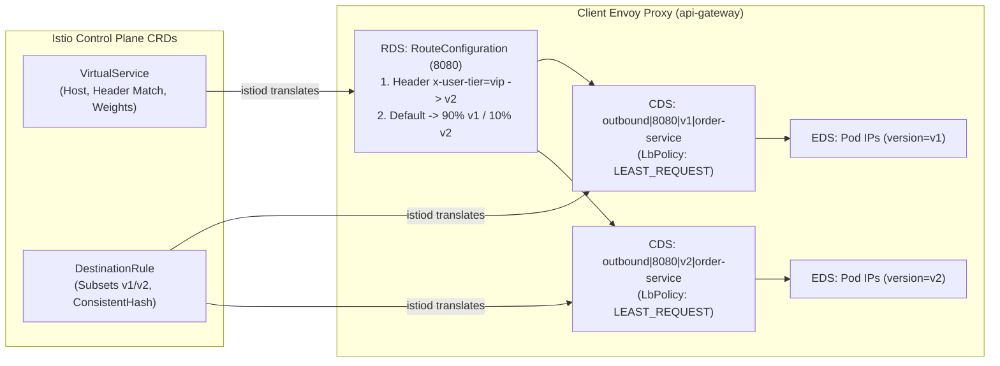

# Week 03 — Service Discovery, L7 Routing & Sidecar Scoping

> **Phase 1: Foundations & Data Plane Internals** | **Cohort 01**
> **Authoritative Baseline**: Istio `1.32.0` | Envoy `v1.40` | Kubernetes `1.36` / `1.37` | Gateway API `v1.6.1`
> **Core Module Mapping**: [Module 02 — Service Discovery & Routing (`README.md`)](../../02-service-discovery-and-routing/README.md) & [Guided Lab (`LAB.md`)](../../02-service-discovery-and-routing/LAB.md)

---

## Week Metadata & Learning Objectives

| Attribute | Specification |
| :--- | :--- |
| **Fellowship Role** | Platform Engineer — Service Mesh & Cloud-Native Networking Team |
| **Business Context** | NovaPay is rolling out `order-service-v2` (a redesigned checkout engine) and `payment-service-v2` (supporting instant RTP rails). However, Daniel's team noticed severe load-balancing skew across gRPC/HTTP2 connections in standard Kubernetes, and Sarah noticed `istio-proxy` memory climbing as new namespaces are added to the cluster. |
| **Primary Namespace** | `orderflow` |
| **Engineering Ticket** | `NP-103`: Implement L7 Subset Routing, Consistent Hash Affinity, and `Sidecar` Egress Scoping |
| **Incident Simulation** | `INC-03`: `503 NR` (`No Route`) Checkout Outage from Unordered `VirtualService` / `DestinationRule` Rollout |

### Learning Objectives
By the end of Week 03, you will be able to:
1. Explain why standard Kubernetes `kube-proxy` (`iptables`/`IPVS`) fails at L7 HTTP/2 and gRPC load balancing (pinning all multiplexed streams to a single pod) and how Envoy solves it at L7.
2. Architect `DestinationRule` subsets, load balancing policies (`LEAST_REQUEST`, `ROUND_ROBIN`, and `consistentHash` ring-hash/maglev session affinity), and connection pool settings.
3. Implement fine-grained `VirtualService` routing rules: weighted canary splits, HTTP header matching (`x-user-tier: vip`), URI rewrites, and cross-namespace rule merging (`exportTo`).
4. Eliminate Envoy `O(N^2)` xDS memory bloat in large clusters by deploying namespace-wide and workload-specific `Sidecar` CRDs (`egress.hosts`).

### Required Competencies
- Fluency with Envoy `RouteConfiguration` (`RDS`) and `Cluster` (`CDS`) inspection via `istioctl proxy-config`.
- Understanding of HTTP/2 connection multiplexing, consistent hashing algorithms (`RingHash` / `Maglev`), and safe GitOps deployment ordering.

---

## Monday — Mentor Briefing & Ticket Assignment

### Briefing from Alex Morgan (Senior Platform Engineer)
> *"Welcome to Week 03. Now that you understand how packets enter Envoy (`:15001` / `:15006`) and traverse the xDS pipeline, we are putting L7 traffic management to work for NovaPay's upcoming `v2` checkout release.*
>
> *Two things bite almost every engineering organization when they adopt Istio for traffic routing:*
> 1. *They split traffic in a `VirtualService` to a subset (`v2`) before the `DestinationRule` defining `v2` has been programmed into Envoy—taking down production with `503 NR` (`No Route`).*
> 2. *They leave Istio's default mesh-wide service discovery wide open, so every single Envoy proxy in `orderflow` holds xDS clusters and endpoints for 2,000 unrelated services in other namespaces. Read the Slack thread below and dive into `NP-103`."*

### Peer Engineering Discussion (`#platform-mesh-arch`)

> **Daniel Brooks (Staff Backend Engineer)** `09:05 AM`
> Question for the platform team. Before we moved `order-service` -> `payment-service` into Istio, we used gRPC over HTTP/2. Whenever `payment-service` scaled from 2 pods to 6 pods during a traffic spike, the 4 new pods sat at 0% CPU because Go's gRPC client kept multiplexing every RPC over the existing TCP connections to the original 2 pods! Does Envoy automatically fix that, and can we also pin requests from the same merchant (`x-merchant-id` header) to the same `payment-service` pod so our in-memory rate-limit cache stays warm?

> **Alex Morgan (Senior Platform Engineer)** `09:09 AM`
> Yes to both, Daniel! Because `istio-proxy` terminates HTTP/2 and gRPC at L7 on the client side, it maintains its own upstream HTTP/2 connection pool to **every** healthy endpoint in the `EndpointSlice` and load-balances individual RPCs/requests across all pods—even if your application only opens a single TCP connection to `localhost`. And for merchant cache locality, we can configure `loadBalancer.consistentHash.httpHeaderName: x-merchant-id` in a `DestinationRule`, which switches the Envoy cluster from `LEAST_REQUEST` to a `RING_HASH` load balancer!

> **Sarah Chen (SRE Lead)** `09:13 AM`
> Speaking of Envoy clusters—I checked Prometheus metrics (`envoy_server_memory_allocated`) on a staging cluster where 40 other teams share the cluster. Each `istio-proxy` in `orderflow` is tracking 1,800 Envoy `Cluster` definitions even though `orderflow` only ever talks to `orderflow` and `istio-system`! Every time a team in `analytics-dev` scales a deployment, `istiod` pushes an EDS update to our `payment-service` proxies. We have to lock down xDS visibility with a `Sidecar` CRD (`spec.egress.hosts`) and `exportTo: ["."]`!

> **Maya Patel (Principal Security Engineer)** `09:16 AM`
> Just keep one distinction clear for the team, Sarah: scoping a `Sidecar` CRD (`egress.hosts: ["./*", "istio-system/*"]`) trims Envoy's xDS memory and routing table, which is great for performance and blast radius—but remember it is **not** a hard cryptographic security boundary on its own unless paired with `outboundTrafficPolicy.mode: REGISTRY_ONLY` (Week 4) and `AuthorizationPolicy` (Week 5). Let's get the `Sidecar` CRD in place now so our xDS footprint is lean.

---

### Engineering Ticket: `NP-103`

| Field | Details |
| :--- | :--- |
| **Ticket ID** | `NP-103` |
| **Title** | Implement L7 Subset Routing, Consistent Hashing & `Sidecar` xDS Memory Scoping in `orderflow` |
| **Reporter** | Alex Morgan (Senior Platform Engineer) |
| **Assignee** | Platform Engineering Fellow |
| **Priority** | P1 — Core Traffic Engineering |

#### Business Context
NovaPay is preparing to test `order-service-v2` and `payment-service-v2` in `orderflow`. We need deterministic L7 routing that:
1. Routes VIP customers (`x-user-tier: vip`) to `order-service-v2` while splitting standard traffic `90% v1 / 10% v2`.
2. Ensures stateful in-memory merchant cache affinity on `payment-service` using consistent hashing on the `x-merchant-id` HTTP header.
3. Restricts Envoy xDS configuration bloat in `orderflow` using a namespace-wide `Sidecar` resource and private `exportTo` visibility.

#### Technical Requirements
1. **`DestinationRule` Subset & Load Balancing Design**:
   - Define `v1` and `v2` subsets for `order-service` (`LEAST_REQUEST`) and `payment-service` (`consistentHash` on `httpHeaderName: x-merchant-id`).
2. **`VirtualService` L7 Routing**:
   - Route `order-service` traffic with header `x-user-tier: vip` `100%` to subset `v2`, and all other requests `90%` to `v1` and `10%` to `v2`.
   - Set `exportTo: ["."]` on internal `VirtualService` and `DestinationRule` objects so they do not pollute other namespaces.
3. **`Sidecar` CRD xDS Scoping**:
   - Deploy a default `Sidecar` resource in `orderflow` restricting `egress.hosts` to `["./*", "istio-system/*"]` and measure the drop in active Envoy clusters via `istioctl proxy-config cluster`.

#### Constraints
- `DestinationRule` resources defining subsets **must** be applied and reconciled *before* any `VirtualService` routes traffic to those subsets.
- Every `VirtualService` match block ordering must place specific header matches *above* catch-all default weighted routes.

#### Acceptance Criteria & Deliverables
- [ ] `istioctl proxy-config cluster` confirms `outbound|8080|v1|order-service...` and `outbound|8080|v2|order-service...` exist with `LEAST_REQUEST` policy.
- [ ] Repeated requests to `payment-service` with `x-merchant-id: merch-9941` consistently hit the exact same pod replica (`RING_HASH`), while varying the header distributes across replicas.
- [ ] Applying the `Sidecar` CRD reduces the number of outbound Envoy clusters in `orderflow` pods solely to `orderflow` and `istio-system` services.

---

## Tuesday — Technical Lectures & Architecture Deep-Dive

### Assigned Core Reading
Read the complete architectural reference in [**Module 02 — Service Discovery, Subsets & L7 Routing (`README.md`)**](../../02-service-discovery-and-routing/README.md).

### Alex's Guided Study Notes: What to Pay Attention to Under the Hood
1. **How `VirtualService` + `DestinationRule` Map to Envoy `RDS` + `CDS`**:
   Beginners often confuse why Istio split routing into two CRDs:
   - **`VirtualService` programs `RDS` (RouteConfiguration)**: It answers *"Given this incoming HTTP request (Host, Path, Headers), which named Envoy Cluster should handle it?"*
   - **`DestinationRule` programs `CDS` (Clusters)**: It answers *"Once a request is routed to Cluster X, what subsets exist (`outbound|8080|v2|...`), how do we load balance across endpoints (`LEAST_REQUEST`, `RING_HASH`), and what TLS/connection pool settings apply?"*
2. **First-Match-Wins in `VirtualService` `http` Arrays**:
   Envoy evaluates `http` route blocks strictly from top to bottom (**first match wins**). If you put a catch-all weighted route (no `match:` block) as the first item in `spec.http`, Envoy will match 100% of traffic on item #1 and **never reach** your header-based VIP match in item #2!
3. **Why `LEAST_REQUEST` Outperforms `ROUND_ROBIN` for Payment Services**:
   In `ROUND_ROBIN`, if one `payment-service` pod experiences a GC pause or a slow downstream database lock, Envoy keeps dealing it every $N$-th request blindly, queuing requests behind the slow pod and spiking P99 latency. `LEAST_REQUEST` (specifically Envoy's $P2C$—Power of Two Random Choices) picks two random healthy endpoints and sends the request to the one with fewer active in-flight requests, naturally routing around slow pods!

### Envoy xDS Translation Diagram: `VirtualService` + `DestinationRule`



---

## Wednesday — Guided Labs & Internal Verification

### Step 1: Pre-Flight Check
Confirm all `orderflow` workloads (`v1` and `v2` deployments for `order-service` and `payment-service`) are running `2/2 READY`:

```bash
kubectl get pods -n orderflow -L app,version
istioctl proxy-status
```

### Step 2: Execute the Core Module Guided Lab
Complete all exercises in [**Module 02 — Hands-On Lab (`LAB.md`)**](../../02-service-discovery-and-routing/LAB.md):
1. Create `DestinationRule` subsets (`v1`, `v2`) for `order-service` and `payment-service`.
2. Configure `VirtualService` weighted canary routing (`90/10`) and header-based VIP routing.
3. Configure `consistentHash` session affinity and verify pod pinning.
4. Deploy a `Sidecar` resource in `orderflow` and measure the xDS cluster count before and after.

### Step 3: Alex's Internal Verification Checkpoints
Run these exact verification commands before moving to Thursday's assignment:

```bash
# Checkpoint 1: Verify subset clusters exist in api-gateway's Envoy CDS
API_GW_POD=$(kubectl get pod -n orderflow -l app=api-gateway -o jsonpath='{.items[0].metadata.name}')
istioctl proxy-config cluster "$API_GW_POD.orderflow" --fqdn order-service.orderflow.svc.cluster.local

# Checkpoint 2: Verify RDS route ordering (VIP header match MUST appear before the catch-all route)
istioctl proxy-config route "$API_GW_POD.orderflow" --name 8080 -o json | \
  jq '.[] | .virtualHosts[] | select(.name=="order-service.orderflow.svc.cluster.local:8080") | .routes'

# Checkpoint 3: Verify Sidecar CRD scoped out non-orderflow/non-istio-system services
istioctl proxy-config cluster "$API_GW_POD.orderflow" | wc -l
```

---

## Thursday — Independent Engineering Assignment

### Scenario: Multi-Tier Payment Routing, Merchant Ring-Hash Affinity & Egress Scoping
Daniel and Sarah have finalized the routing specification for `NP-103` across `order-service` and `payment-service` in the `orderflow` namespace. You must write and apply a unified, production-hardened configuration that satisfies all requirements below.

### Technical Requirements & Constraints
1. **`order-service` Traffic Management**:
   - Define `DestinationRule` `order-service-dr` (`exportTo: ["."]`) with default `LEAST_REQUEST` load balancing and two subsets: `v1` (`version: v1`) and `v2` (`version: v2`).
   - Define `VirtualService` `order-service-vs` (`exportTo: ["."]`) with three ordered routing tiers:
     - **Tier 1 (Internal QA Dark Launch)**: Requests with HTTP header `x-qa-override: v2-only` **AND** URI prefix `/api/v1/orders` route `100%` to `order-service` subset `v2`, and add response header `x-routed-tier: qa-dark-launch`.
     - **Tier 2 (VIP Merchants)**: Requests with HTTP header `x-user-tier: vip` route `100%` to `order-service` subset `v2`, and add response header `x-routed-tier: vip-fast-lane`.
     - **Tier 3 (Default Canary)**: All other requests split `80%` to `v1` and `20%` to `v2`, adding response header `x-routed-tier: standard-canary`.
2. **`payment-service` Merchant Cache Affinity**:
   - Scale `payment-service-v1` to `3` replicas (`kubectl scale deployment payment-service-v1 -n orderflow --replicas=3`) so multiple `v1` pods exist.
   - Define `DestinationRule` `payment-service-dr` (`exportTo: ["."]`) with `consistentHash` based on `httpHeaderName: x-merchant-id` (`minimumRingSize: 1024`), plus subsets `v1` and `v2`.
   - Define `VirtualService` `payment-service-vs` (`exportTo: ["."]`) routing `100%` of default traffic to subset `v1`, except requests with header `x-payment-rail: rtp` which route `100%` to subset `v2`.
3. **Namespace xDS Memory Scoping**:
   - Define a `Sidecar` resource named `orderflow-default-sidecar` in `orderflow` (with no `workloadSelector`, so it applies to the entire namespace) restricting `egress.hosts` to `["./*", "istio-system/*"]`.

<details>
<summary>Click to Reveal Reference Solution & Alex's Code Review</summary>

### Reference Solution Manifest (`np-103-routing-solution.yaml`)

```yaml
apiVersion: networking.istio.io/v1
kind: Sidecar
metadata:
  name: orderflow-default-sidecar
  namespace: orderflow
spec:
  egress:
    - hosts:
        - "./*"
        - "istio-system/*"
---
apiVersion: networking.istio.io/v1
kind: DestinationRule
metadata:
  name: order-service-dr
  namespace: orderflow
spec:
  host: order-service.orderflow.svc.cluster.local
  exportTo:
    - "."
  trafficPolicy:
    loadBalancer:
      simple: LEAST_REQUEST
  subsets:
    - name: v1
      labels:
        version: v1
    - name: v2
      labels:
        version: v2
---
apiVersion: networking.istio.io/v1
kind: VirtualService
metadata:
  name: order-service-vs
  namespace: orderflow
spec:
  hosts:
    - order-service.orderflow.svc.cluster.local
  exportTo:
    - "."
  http:
    - name: qa-dark-launch
      match:
        - headers:
            x-qa-override:
              exact: v2-only
          uri:
            prefix: /api/v1/orders
      headers:
        response:
          set:
            x-routed-tier: qa-dark-launch
      route:
        - destination:
            host: order-service.orderflow.svc.cluster.local
            subset: v2
          weight: 100
    - name: vip-merchants
      match:
        - headers:
            x-user-tier:
              exact: vip
      headers:
        response:
          set:
            x-routed-tier: vip-fast-lane
      route:
        - destination:
            host: order-service.orderflow.svc.cluster.local
            subset: v2
          weight: 100
    - name: standard-canary
      headers:
        response:
          set:
            x-routed-tier: standard-canary
      route:
        - destination:
            host: order-service.orderflow.svc.cluster.local
            subset: v1
          weight: 80
        - destination:
            host: order-service.orderflow.svc.cluster.local
            subset: v2
          weight: 20
---
apiVersion: networking.istio.io/v1
kind: DestinationRule
metadata:
  name: payment-service-dr
  namespace: orderflow
spec:
  host: payment-service.orderflow.svc.cluster.local
  exportTo:
    - "."
  trafficPolicy:
    loadBalancer:
      consistentHash:
        httpHeaderName: x-merchant-id
        minimumRingSize: 1024
  subsets:
    - name: v1
      labels:
        version: v1
    - name: v2
      labels:
        version: v2
---
apiVersion: networking.istio.io/v1
kind: VirtualService
metadata:
  name: payment-service-vs
  namespace: orderflow
spec:
  hosts:
    - payment-service.orderflow.svc.cluster.local
  exportTo:
    - "."
  http:
    - name: rtp-rail-v2
      match:
        - headers:
            x-payment-rail:
              exact: rtp
      route:
        - destination:
            host: payment-service.orderflow.svc.cluster.local
            subset: v2
          weight: 100
    - name: default-v1
      route:
        - destination:
            host: payment-service.orderflow.svc.cluster.local
            subset: v1
          weight: 100
```

### Verification Commands

```bash
# 1. Scale payment-service-v1 to 3 replicas and apply solution
kubectl scale deployment payment-service-v1 -n orderflow --replicas=3
kubectl rollout status deployment/payment-service-v1 -n orderflow
kubectl apply -f np-103-routing-solution.yaml

# 2. Verify Tier 1 (QA dark launch), Tier 2 (VIP), and Tier 3 (Canary)
LOADGEN_POD=$(kubectl get pod -n orderflow -l app=load-generator -o jsonpath='{.items[0].metadata.name}')
kubectl exec -n orderflow "$LOADGEN_POD" -c load-generator -- \
  curl -s -D - -o /dev/null -H "x-qa-override: v2-only" http://order-service.orderflow.svc.cluster.local:8080/api/v1/orders | grep -i "x-routed-tier"

kubectl exec -n orderflow "$LOADGEN_POD" -c load-generator -- \
  curl -s -D - -o /dev/null -H "x-user-tier: vip" http://order-service.orderflow.svc.cluster.local:8080/api/v1/orders | grep -i "x-routed-tier"

# 3. Verify Consistent Hash pinning on payment-service (all 5 requests for merch-9941 hit the SAME pod hostname!)
for i in $(seq 1 5); do
  kubectl exec -n orderflow "$LOADGEN_POD" -c load-generator -- \
    curl -s -H "x-merchant-id: merch-9941" http://payment-service.orderflow.svc.cluster.local:8080/pay | jq -r '.os.hostname'
done

# 4. Return payment-service-v1 to 1 replica after verification
kubectl scale deployment payment-service-v1 -n orderflow --replicas=1
```

### Alex's Code Review
> *"Notice how in `order-service-vs`, putting `headers:` AND `uri:` inside the **same** list item under `match:` created an **AND** condition (`x-qa-override == v2-only` AND `uri startsWith /api/v1/orders`). If you had put two separate `- headers:` and `- uri:` items under `match:`, Envoy would have evaluated them as an **OR** condition! Also, defining `trafficPolicy.loadBalancer.consistentHash` at the top level of `payment-service-dr` ensures that both `v1` and `v2` subsets inherit `RING_HASH` automatically unless overridden inside a specific subset."*

</details>

---

## Friday — Incident Simulation (`INC-03`)

### PagerDuty Alert: `INC-03` — `503 NR` (`No Route`) Total Outage on `fraud-service`

> **CRITICAL ALERT — `#inc-03-fraud-service-503-nr`**
> **Incident Commander**: Sarah Chen (SRE Lead)
> **Symptom**: A developer pushed an urgent hotfix release for `fraud-service` and applied a `VirtualService` to route traffic to `v2-hotfix` and `v1`. Immediately after `kubectl apply`, **100% of calls to `fraud-service` began failing with `HTTP 503 Service Unavailable`**, even though `fraud-service-v1` pods are `2/2 Running` and healthy!
>
> Looking at `order-service`'s Envoy access logs shows:
> `"GET /fraud-check HTTP/1.1" 503 NR via_upstream - "-" 0 0 0 - "-" "curl/8.12.1" ... "outbound|8080|v2-hotfix|fraud-service.orderflow.svc.cluster.local" -`

### Step 1: Inject the Broken State
Run the following command to apply the broken configuration that triggered the outage:

```bash
cat <<'EOF' | kubectl apply -f -
apiVersion: networking.istio.io/v1
kind: DestinationRule
metadata:
  name: fraud-service-dr
  namespace: orderflow
spec:
  host: fraud-service.orderflow.svc.cluster.local
  subsets:
    - name: v1
      labels:
        version: v1
---
apiVersion: networking.istio.io/v1
kind: VirtualService
metadata:
  name: fraud-service-vs
  namespace: orderflow
spec:
  hosts:
    - fraud-service.orderflow.svc.cluster.local
  http:
    - match:
        - headers:
            x-fraud-mode:
              exact: strict
        - uri:
            prefix: /
      route:
        - destination:
            host: fraud-service.orderflow.svc.cluster.local
            subset: v2-hotfix
          weight: 100
    - route:
        - destination:
            host: fraud-service.orderflow.svc.cluster.local
            subset: v1
          weight: 100
EOF
```

Reproduce the outage from `load-generator`:

```bash
LOADGEN_POD=$(kubectl get pod -n orderflow -l app=load-generator -o jsonpath='{.items[0].metadata.name}')
kubectl exec -n orderflow "$LOADGEN_POD" -c load-generator -- curl -i http://fraud-service.orderflow.svc.cluster.local:8080/check
```

### Step 2: Diagnostic Clues & Investigation Prompts
There are **two distinct bugs** in the YAML above that combined to cause a 100% outage instead of only affecting `x-fraud-mode: strict` requests:
1. Run `istioctl analyze -n orderflow`. What error code (`IST0101`) is reported on `fraud-service-vs`?
2. Why did a normal request (`curl http://fraud-service:8080/check` **without** the `x-fraud-mode: strict` header) get routed to `subset: v2-hotfix` instead of falling through to the second route (`subset: v1`)? Look closely at the `match:` array in `fraud-service-vs`!

<details>
<summary>Click to Reveal Root Cause Analysis (RCA), Remediation & Postmortem</summary>

### Root Cause Analysis (5-Whys)
1. **Why did `curl http://fraud-service:8080/check` return `503 NR` (`No Route`)?**
   Because Envoy's `RouteConfiguration` (`RDS`) selected route #1, which directed the request to cluster `outbound|8080|v2-hotfix|fraud-service.orderflow.svc.cluster.local`—a cluster that **does not exist** in Envoy's `CDS` table!
2. **Why did `outbound|8080|v2-hotfix|fraud-service...` not exist in Envoy's `CDS` table?**
   Because `fraud-service-dr` (`DestinationRule`) only defined `subset: v1`. The developer forgot to add `subset: v2-hotfix` (or applied the `VirtualService` before updating the `DestinationRule`). When an `RDS` route points to a non-existent `CDS` cluster, Envoy immediately returns `503 NR`.
3. **Why did a normal request WITHOUT `x-fraud-mode: strict` match route #1 in the first place?**
   Look at the YAML indentation in `match:`:
   ```yaml
      match:
        - headers:
            x-fraud-mode:
              exact: strict
        - uri:
            prefix: /
   ```
   Because `- headers:` and `- uri:` were written as **two separate list items** (two hyphens `-`) under `match:`, Istio evaluated them with boolean **OR** logic (`header == strict` **OR** `uri startsWith /`)! Since every HTTP request URI starts with `/`, **100% of traffic** matched rule #1 and got sent to the missing `v2-hotfix` subset!
4. **How should `AND` logic be written in a `VirtualService` `match` block?**
   Remove the second hyphen so `headers` and `uri` are sibling keys inside the **same** list item object under `match:`.

### Remediation Commands

```bash
# Fix both the AND match condition and route to existing subset v1 (or clean up the broken VS/DR)
cat <<'EOF' | kubectl apply -f -
apiVersion: networking.istio.io/v1
kind: DestinationRule
metadata:
  name: fraud-service-dr
  namespace: orderflow
spec:
  host: fraud-service.orderflow.svc.cluster.local
  subsets:
    - name: v1
      labels:
        version: v1
---
apiVersion: networking.istio.io/v1
kind: VirtualService
metadata:
  name: fraud-service-vs
  namespace: orderflow
spec:
  hosts:
    - fraud-service.orderflow.svc.cluster.local
  http:
    - match:
        - headers:
            x-fraud-mode:
              exact: strict
          uri:
            prefix: /
      route:
        - destination:
            host: fraud-service.orderflow.svc.cluster.local
            subset: v1
          weight: 100
    - route:
        - destination:
            host: fraud-service.orderflow.svc.cluster.local
            subset: v1
          weight: 100
EOF

# Verify istioctl analyze is clean and HTTP 200 OK is restored
istioctl analyze -n orderflow
kubectl exec -n orderflow "$LOADGEN_POD" -c load-generator -- curl -i http://fraud-service.orderflow.svc.cluster.local:8080/check

# Clean up incident resources
kubectl delete vs fraud-service-vs -n orderflow
kubectl delete dr fraud-service-dr -n orderflow
```

</details>

---

## Saturday — Architecture Review & Mentor Office Hours

### Architecture Defense Questions
1. **Alex Morgan (Platform)**: *"In GitOps (ArgoCD / Flux), when we introduce a new subset `v3` in a `DestinationRule` and route 5% of traffic to `v3` in a `VirtualService` inside the same Git commit, why can a brief `503 NR` blip still happen during reconciliation, and how do we prevent it?"*
2. **Sarah Chen (SRE)**: *"Suppose two teams in the same namespace both create a `VirtualService` targeting `host: order-service.orderflow.svc.cluster.local`. How does `istiod` handle multiple `VirtualService` objects for the same host in the same namespace vs. across different namespaces?"*
3. **Daniel Brooks (Backend)**: *"We enabled `consistentHash` on `httpHeaderName: x-merchant-id` for `payment-service`. What happens if a legacy caller sends a request to `payment-service` that is missing the `x-merchant-id` header completely? Does Envoy reject the request, pin all headerless requests to a single pod, or load balance them?"*
4. **Maya Patel (Security)**: *"If a compromised pod in `orderflow` has our `Sidecar` CRD (`egress.hosts: ['./*', 'istio-system/*']`) applied, what happens if the attacker runs `curl http://accounting-service.finance.svc.cluster.local:8080` while our mesh is still in the default `ALLOW_ANY` outbound mode?"*

### Alex's Office Hours Q&A (Deep-Dive Edge Cases)

**Q1: Eliminating `503 NR` Race Conditions in GitOps**
> **Alex's Answer**: Even if `DestinationRule` and `VirtualService` are in the same commit, Envoy applies `RDS` (routes) and `CDS` (clusters) asynchronously over the ADS stream. If Envoy processes the `RDS` update referencing `outbound|8080|v3|...` 50 milliseconds before the `CDS` cluster warm-up completes, requests during that 50ms window get `503 NR`. Furthermore, when scaling down an old subset, removing the `DestinationRule` subset while `VirtualService` still points to it is catastrophic.
> - **Fix**: In ArgoCD, use **Sync Waves**: put `DestinationRule` and `Deployment` in `argocd.argoproj.io/sync-wave: "1"`, and put `VirtualService` in `argocd.argoproj.io/sync-wave: "2"`. Or better yet, use **Kubernetes Gateway API `HTTPRoute`** (where `backendRefs` point directly to separate `Service` objects `order-service-v1` and `order-service-v2`), which avoids dynamic `DestinationRule` subset cluster creation races altogether!

**Q2: Conflicting vs. Merged `VirtualService` Rules**
> **Alex's Answer**: If two standalone `VirtualService` objects target the **same host** (`order-service`) without gateway delegation (`delegate`), `istiod` does **not** deterministically merge arbitrary conflicting routes—the oldest resource wins or routes can be dropped (`IST0109: ConflictingMeshGatewayVirtualServiceHosts`). For large teams sharing a host, either use a root `VirtualService` that uses the `delegate:` field to delegate specific URI prefixes to child `VirtualService` resources, or use Kubernetes Gateway API `HTTPRoute` (which natively defines deterministic conflict resolution and merging rules in the spec!).

**Q3: Consistent Hashing Fallback When the Hash Key Is Missing**
> **Alex's Answer**: Envoy does **not** reject the request, nor does it pin all headerless requests to a single overloaded pod! When a request lacks the configured `httpHeaderName` (or cookie/query param), Envoy's `RING_HASH` / `MAGLEV` load balancer automatically falls back to picking a random healthy endpoint (`uniform random`) for that request.

**Q4: `Sidecar` Egress Scoping vs. `PassthroughCluster` (`ALLOW_ANY`)**
> **Alex's Answer**: This is why Maya raised the warning on Monday! When `meshConfig.outboundTrafficPolicy.mode` is `ALLOW_ANY` (Istio's default), any destination that does **not** match a known Envoy listener/cluster falls through to Envoy's `PassthroughCluster`, which opens a direct TCP connection to the destination IP! So removing `finance/*` via a `Sidecar` CRD hides `finance` services from Envoy's xDS table (saving memory), and calls to `accounting-service` fall back to `PassthroughCluster` (raw TCP without client-side mTLS). To actually **block** unimported egress hosts at the proxy layer, we must set `outboundTrafficPolicy.mode: REGISTRY_ONLY` (which we will do in Week 04) and enforce `AuthorizationPolicy` (Week 05).

---

## Sunday — Weekly Assessment & Reflection

### Competency Assessment

1. **gRPC & HTTP/2 Load Balancing**:
   Why does Kubernetes's default `Service` (`ClusterIP` backed by `kube-proxy` `iptables` or `IPVS`) fail to evenly balance load across 5 pods of a gRPC service when called by a single long-lived gRPC client pod, and how does Envoy solve this?

2. **Boolean Logic in `VirtualService`**:
   Write the exact `match:` YAML snippet for a `VirtualService` that matches requests where:
   `(Header "x-region" == "eu-west" AND URI starts with "/v2/checkout") OR (Header "x-canary-tester" == "true")`.

3. **Envoy xDS Memory Scaling**:
   In a Kubernetes cluster with 1,000 namespaces and 5,000 `Services`, why does an un-scoped Istio mesh experience an $O(N^2)$ control-plane push and proxy memory problem? Name the **three** configuration mechanisms you can combine to restrict service configuration visibility.

4. **`DestinationRule` Inheritance & Precedence**:
   Suppose a `DestinationRule` defines `trafficPolicy.loadBalancer.simple: LEAST_REQUEST` at the top level (`spec.trafficPolicy`), and also defines `subsets[0].name: v1` with no `trafficPolicy` inside `v1`, and `subsets[1].name: v2` with `trafficPolicy.loadBalancer.simple: ROUND_ROBIN`.
   - What load balancing algorithm is used for `v1`?
   - Warning pitfall: If `spec.trafficPolicy` defines `connectionPool` AND `tls`, and inside `subsets[1]` (`v2`) you override `trafficPolicy.loadBalancer`, does `v2` automatically inherit `spec.trafficPolicy.tls` or does defining `subsets[1].trafficPolicy` replace the top-level `trafficPolicy` block?

5. **Consistent Hash Algorithms (`RingHash` vs. `Maglev`)**:
   In Istio's `DestinationRule` `consistentHash`, how does Envoy decide whether to use `RING_HASH` or `MAGLEV`?

<details>
<summary>Assessment Answer Key</summary>

1. **gRPC & HTTP/2 Load Balancing**:
   - gRPC runs over HTTP/2, which multiplexes all concurrent RPC streams over a **single long-lived TCP connection**. Because `kube-proxy` operates purely at L4 (NATing the TCP `SYN` packet when the connection is first opened), that single TCP connection is pinned to whichever backend pod was chosen at connection establishment; subsequent RPCs never trigger new TCP connections, leaving newly scaled pods idle. Envoy terminates HTTP/2 at L7 on the client side, opens separate upstream HTTP/2 connections to every pod in the `EndpointSlice` (`EDS`), and load-balances each individual HTTP/2 stream (RPC) across all healthy pods.

2. **Boolean Logic in `VirtualService`**:
   ```yaml
   match:
     - headers:
         x-region:
           exact: eu-west
       uri:
         prefix: /v2/checkout
     - headers:
         x-canary-tester:
           exact: "true"
   ```

3. **Envoy xDS Memory Scaling**:
   - By default, every `Service`, `VirtualService`, and `DestinationRule` in Istio is exported to all namespaces (`*`), meaning each of the $N$ proxies receives configuration for all $M$ services ($O(N \times M)$ memory and push complexity). The three mechanisms to scope this are:
     1. **`Sidecar` CRD** (`spec.egress.hosts: ["./*", "istio-system/*"]`) to filter what a consumer namespace imports.
     2. **`exportTo: ["."]`** on `VirtualService`, `DestinationRule`, and `ServiceEntry` (or `networking.istio.io/exportTo: "."` annotation on Kubernetes `Service`) to control what a producer namespace exports.
     3. **`meshConfig.discoverySelectors`** to restrict which namespaces `istiod` watches at the cluster level.

4. **`DestinationRule` Inheritance & Precedence**:
   - Subset `v1` inherits `LEAST_REQUEST` from `spec.trafficPolicy`.
   - **Critical Pitfall**: In Istio `DestinationRule`, `subsets[].trafficPolicy` merges top-level fields (`loadBalancer`, `connectionPool`, `outlierDetection`, `tls`) at the sibling level inside `trafficPolicy`, **however** if you redefine a sub-block (e.g., `tls` or `connectionPool`), it overwrites that sub-block completely rather than deep-merging every nested field. Always explicitly specify critical `tls` or `connectionPool` settings inside a subset's `trafficPolicy` if you override it, or verify the resulting Envoy cluster with `istioctl proxy-config cluster -o json`!

5. **Consistent Hash Algorithms (`RingHash` vs. `Maglev`)**:
   - In `DestinationRule.spec.trafficPolicy.loadBalancer.consistentHash`, if you specify `ringHash: { minimumRingSize: ... }` (or `minimumRingSize`), Envoy configures the `RING_HASH` load balancer. If you specify `maglev: { tableSize: ... }`, Envoy configures the `MAGLEV` load balancer (Google's fast consistent-hashing lookup table algorithm).

</details>

---

### Weekly Competency Sign-Off Checklist
- [ ] Configured `DestinationRule` subsets and `VirtualService` weighted + header routing in `orderflow`.
- [ ] Verified `RING_HASH` consistent hash session affinity on `payment-service` using `x-merchant-id`.
- [ ] Deployed `orderflow-default-sidecar` and verified xDS cluster reduction via `istioctl proxy-config cluster`.
- [ ] Resolved Friday's `INC-03` `503 NR` outage and explained `AND` vs `OR` YAML list semantics in `VirtualService`.
