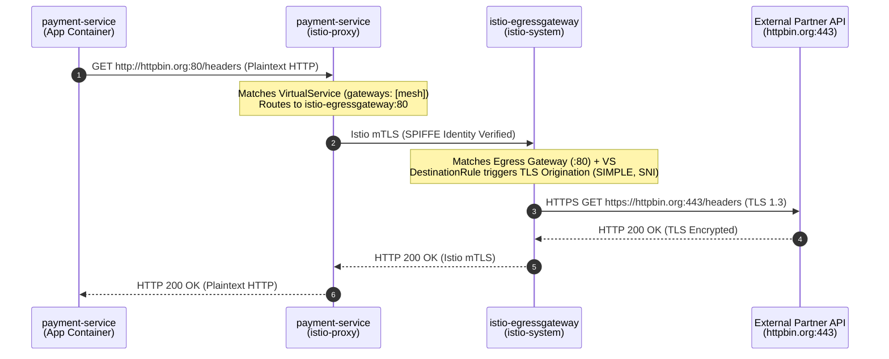

# Week 04 — Edge Gateways, Gateway API & Controlled Egress

> **Phase 2: Traffic Engineering, Security & Resilience** | **Cohort 01**
> **Authoritative Baseline**: Istio `1.32.0` | Envoy `v1.40` | Kubernetes `1.36` / `1.37` | Gateway API `v1.6.1`
> **Core Module Mapping**: [Module 03 — Gateways, Ingress & Egress (`README.md`)](../../03-gateways-ingress-and-egress/README.md) & [Guided Lab (`LAB.md`)](../../03-gateways-ingress-and-egress/LAB.md)

---

## Week Metadata & Learning Objectives

| Attribute | Specification |
| :--- | :--- |
| **Fellowship Role** | Platform Engineer — Service Mesh & Cloud-Native Networking Team |
| **Business Context** | External merchants need HTTPS access to NovaPay's `api-gateway` in `orderflow`, and `payment-service` must call external card network settlement endpoints over HTTPS. For our PCI-DSS Level 1 audit, Maya Patel requires locking down all outbound cluster traffic (`REGISTRY_ONLY`) and funneling external partner calls through a dedicated `istio-egressgateway` with TLS origination. |
| **Primary Namespace** | `orderflow` & `istio-system` |
| **Engineering Ticket** | `NP-104`: Implement Gateway API `v1.6.1` TLS Ingress, Enforce `REGISTRY_ONLY`, and Route Partner Egress via Egress Gateway |
| **Incident Simulation** | `INC-04`: Edge HTTPS Outage from Cross-Namespace TLS Secret Placement (`SDS` Failure) |

### Learning Objectives
By the end of Week 04, you will be able to:
1. Architect North-South ingress traffic using both classic Istio `Gateway`/`VirtualService` and the **Kubernetes Gateway API `v1.6.1`** (`GatewayClass`, `Gateway`, `HTTPRoute`, `ReferenceGrant`) in Istio `1.32.0`.
2. Configure edge TLS termination using Envoy Secret Discovery Service (`SDS`) and understand cross-namespace `Secret` security boundaries.
3. Transition the mesh from `ALLOW_ANY` to `REGISTRY_ONLY` (`502 Bad Gateway` / TCP reset for unregistered external hosts) and onboard approved external dependencies via `ServiceEntry` (`DNS` resolution).
4. Implement **TLS Origination** (`ServiceEntry` + `DestinationRule` `tls.mode: SIMPLE`) so applications send plaintext HTTP on port `80` inside the mesh while Envoy upgrades the connection to HTTPS on port `443` externally, routed through `istio-egressgateway`.

### Required Competencies
- Proficiency with X.509 certificate creation (`openssl`), Kubernetes `kubernetes.io/tls` Secrets, and `curl --resolve` testing against edge load balancers.
- Deep understanding of multi-hop routing (`Pod Sidecar` -> `istio-egressgateway` -> `External Partner API`).

---

## Monday — Mentor Briefing & Ticket Assignment

### Briefing from Alex Morgan (Senior Platform Engineer)
> *"For the past three weeks, all of our traffic lived safely inside the cluster (`East-West`). This week in Phase 2, we open the doors to the outside world (`North-South` Ingress and Egress)—and in a FinTech environment like NovaPay, the perimeter is where audits are won or lost.*
>
> *Pay special attention to two architectural shifts this week:*
> 1. *First, how **Kubernetes Gateway API `v1.6.1`** works in Istio `1.32.0`. When you create a `gateway.networking.k8s.io/v1` `Gateway` resource with `gatewayClassName: istio`, `istiod` automatically deploys and manages a dedicated Gateway `Deployment` and `Service` right in that namespace!*
> 2. *Second, how we lock down outbound traffic. By default, if a pod in `orderflow` gets compromised via a supply-chain vulnerability (like Log4Shell or a rogue npm package), it can connect to any command-and-control server on the internet because Istio defaults to `ALLOW_ANY`. This week we flip the mesh to `REGISTRY_ONLY` and build an auditable Egress Gateway pipeline."*

### Peer Engineering Discussion (`#platform-mesh-arch`)

> **Daniel Brooks (Staff Backend Engineer)** `09:20 AM`
> Quick question on Ingress for `NP-104`. My backend engineers already know the standard Kubernetes Gateway API (`HTTPRoute`) from our non-Istio clusters. Can we use standard `gateway.networking.k8s.io/v1` `Gateway` and `HTTPRoute` resources in `orderflow` instead of writing Istio-proprietary `networking.istio.io/v1` `Gateway` and `VirtualService` CRDs at the edge?

> **Alex Morgan (Senior Platform Engineer)** `09:24 AM`
> Yes! In Istio `1.32.0`, Kubernetes Gateway API (`v1.6.1`) is the recommended, first-class API for ingress and mesh traffic management. Even better: Gateway API splits responsibilities cleanly by role. Platform Engineering owns the `GatewayClass` and `Gateway` (ports, TLS certificates, load balancer IP), while Daniel's team owns the `HTTPRoute` in `orderflow` and attaches it via `parentRefs`. You should still know classic Istio `Gateway` + `VirtualService` because we support existing workloads using it and use `VirtualService` for advanced multi-hop Egress Gateway routing, so we'll validate both in `NP-104`.

> **Maya Patel (Principal Security Engineer)** `09:28 AM`
> Let's talk about the **Egress** half of `NP-104`. For PCI-DSS Requirement 1.3, we must prohibit direct outbound connections from cardholder data workloads to untrusted external networks, and our external banking partner requires NovaPay's outbound requests to originate from a **fixed, whitelisted NAT IP** with strong TLS 1.3/1.2 ciphers and centralized audit logs.
>
> Here is what I need:
> 1. Flip `meshConfig.outboundTrafficPolicy.mode` to `REGISTRY_ONLY`.
> 2. Register our external partner (`httpbin.org` in staging) via a `ServiceEntry`.
> 3. Route outbound calls from `orderflow` pods through `istio-egressgateway` in `istio-system`, and let `istio-egressgateway` perform **TLS Origination** (`HTTP :80` inside the mesh over mTLS -> `HTTPS :443` from the egress gateway to the external partner).

> **Sarah Chen (SRE Lead)** `09:32 AM`
> One huge operational win of Envoy TLS Origination at the Egress Gateway: Daniel's apps don't have to manage external CA bundles or TLS handshakes in application code, AND our sidecar/egress proxies can still inspect the L7 HTTP headers, inject timeouts/retries, and log the exact HTTP status code and URI path before encrypting it to the external bank!

---

### Engineering Ticket: `NP-104`

| Field | Details |
| :--- | :--- |
| **Ticket ID** | `NP-104` |
| **Title** | Configure TLS Edge Ingress (`Gateway API v1.6.1`), Enforce `REGISTRY_ONLY`, and Build Egress Gateway TLS Origination |
| **Reporter** | Maya Patel (Principal Security Engineer) & Alex Morgan |
| **Assignee** | Platform Engineering Fellow |
| **Priority** | P0 — PCI-DSS Perimeter Compliance |

#### Business Context
NovaPay must expose `api-gateway` in `orderflow` over HTTPS (`https://orderflow.novapay.internal`) while locking down all unauthorized outbound internet access from the cluster and channeling external partner API traffic (`httpbin.org`) through `istio-egressgateway` with TLS origination.

#### Technical Requirements
1. **North-South Edge Ingress**:
   - Provision a TLS X.509 certificate and Kubernetes `Secret` for `orderflow.example.com` / `orderflow.novapay.internal`.
   - Expose `api-gateway:8080` via HTTPS using **both** classic Istio `Gateway` (on `istio-ingressgateway`) and Kubernetes Gateway API `v1.6.1` (`Gateway` + `HTTPRoute`).
2. **Outbound Lockdown (`REGISTRY_ONLY`)**:
   - Reconfigure `istiod` with `meshConfig.outboundTrafficPolicy.mode=REGISTRY_ONLY` and verify that unregistered external domains (`example.com`) are blocked with `502 Bad Gateway` (`UF,URX`).
3. **Controlled Egress & TLS Origination via `istio-egressgateway`**:
   - Create a `ServiceEntry` for `httpbin.org` exposing port `80` (`HTTP`) and port `443` (`TLS`).
   - Configure a multi-hop `Gateway` + `VirtualService` + `DestinationRule` pipeline so `orderflow` pods call `http://httpbin.org/headers` on port `80`, route over mTLS to `istio-egressgateway`, and `istio-egressgateway` originates TLS (`SIMPLE` mode, `sni: httpbin.org`) to `httpbin.org:443`.

#### Constraints
- TLS Secrets for `istio-ingressgateway` must reside in `istio-system` (or in the same namespace as the Gateway API `Gateway` resource unless a `ReferenceGrant` is configured).
- Do **not** use `resolution: NONE` for external hostname-based `ServiceEntry` objects requiring TLS origination (`resolution: DNS` is required).

#### Acceptance Criteria & Deliverables
- [ ] External HTTPS requests to `/api/v1/orders` succeed with TLS verified (`HTTP 200 OK`).
- [ ] Outbound `curl` from `orderflow` to any unregistered domain fails with `502 Bad Gateway`.
- [ ] Outbound `curl http://httpbin.org/headers` from `orderflow` returns `200 OK` with JSON showing `"X-Forwarded-Proto": "https"` (proving TLS origination occurred) and logs appearing in `istio-egressgateway`!

---

## Tuesday — Technical Lectures & Architecture Deep-Dive

### Assigned Core Reading
Read the complete architectural reference in [**Module 03 — Gateways, Ingress, Gateway API & Controlled Egress (`README.md`)**](../../03-gateways-ingress-and-egress/README.md).

### Alex's Guided Study Notes: What to Pay Attention to Under the Hood
1. **How Istio `1.32.0` Automates Gateway Deployment for Kubernetes Gateway API**:
   In classic Istio, you first deploy a `Deployment` + `Service` (`istio-ingressgateway` in `istio-system`), and then write an Istio `Gateway` CRD that matches its pods via `selector: { istio: ingressgateway }`.
   In **Kubernetes Gateway API `v1.6.1`**, when you apply a `gateway.networking.k8s.io/v1` `Gateway` resource with `gatewayClassName: istio` in namespace `orderflow`, `istiod` acts as the Gateway controller and **automatically creates** a `<gateway-name>-istio` `Deployment` and `Service` inside `orderflow`! (Or you can attach to an existing gateway service via `spec.addresses`).
2. **What Happens in Envoy When You Flip `ALLOW_ANY` to `REGISTRY_ONLY`**:
   Inspect Envoy's outbound listeners (`0.0.0.0_80`) or `virtualOutbound` (`15001`) before and after changing `outboundTrafficPolicy.mode`:
   - In **`ALLOW_ANY`**, unmatched HTTP `Host` headers and unmatched TCP destination IPs are routed to `PassthroughCluster` (which connects directly to the original destination IP).
   - In **`REGISTRY_ONLY`**, `istiod` replaces the fallback target with **`BlackHoleCluster`**! Any request to an unregistered host hits `BlackHoleCluster`, which immediately drops TCP connections or returns `HTTP 502 Bad Gateway`.
3. **The Two-Hop Egress Gateway Pipeline**:
   When routing `Pod -> istio-egressgateway -> External Partner`:
   - **Hop 1 (`Pod Sidecar -> istio-egressgateway`)**: The pod's `VirtualService` (`gateways: [mesh]`) intercepts `http://httpbin.org:80` and routes it to `istio-egressgateway.istio-system.svc.cluster.local:80` (encrypted in Istio mTLS inside the cluster).
   - **Hop 2 (`istio-egressgateway -> httpbin.org:443`)**: The egress gateway's `VirtualService` (`gateways: [httpbin-egress-gateway]`) receives the request and routes it to `httpbin.org:443`, where a `DestinationRule` attached to `httpbin.org:443` instructs `istio-egressgateway` to originate external TLS (`tls.mode: SIMPLE, sni: httpbin.org`)!

### Architectural Flow: Two-Hop Egress Gateway with TLS Origination



---

## Wednesday — Guided Labs & Internal Verification

### Step 1: Pre-Flight Check
Verify both `istio-ingressgateway` and `istio-egressgateway` pods are running in `istio-system`:

```bash
kubectl get pods -n istio-system -l 'app in (istio-ingressgateway, istio-egressgateway)'
kubectl get gatewayclass
```

### Step 2: Execute the Core Module Guided Lab
Work through all exercises in [**Module 03 — Hands-On Lab (`LAB.md`)**](../../03-gateways-ingress-and-egress/LAB.md):
1. Generate TLS certificates and expose `orderflow` via classic Istio `Gateway` + `VirtualService`.
2. Expose `orderflow` using Kubernetes Gateway API `v1.6.1` (`Gateway` + `HTTPRoute`).
3. Switch `outboundTrafficPolicy.mode` to `REGISTRY_ONLY` and verify `BlackHoleCluster` blocking.
4. Create a `ServiceEntry` + `DestinationRule` for external TLS origination and route it through `istio-egressgateway`.

### Step 3: Alex's Internal Verification Checkpoints
Verify these three internal Envoy states before moving to Thursday's assignment:

```bash
# Checkpoint 1: Verify SDS loaded the TLS certificate into istio-ingressgateway
INGRESS_POD=$(kubectl get pod -n istio-system -l app=istio-ingressgateway -o jsonpath='{.items[0].metadata.name}')
istioctl proxy-config secret "$INGRESS_POD.istio-system"

# Checkpoint 2: Verify BlackHoleCluster is active on orderflow pods when REGISTRY_ONLY is enabled
LOADGEN_POD=$(kubectl get pod -n orderflow -l app=load-generator -o jsonpath='{.items[0].metadata.name}')
istioctl proxy-config route "$LOADGEN_POD.orderflow" --name 80 -o json | grep -A 3 "BlackHoleCluster"

# Checkpoint 3: Verify istio-egressgateway has the outbound|443||httpbin.org cluster with TLS context
EGRESS_POD=$(kubectl get pod -n istio-system -l app=istio-egressgateway -o jsonpath='{.items[0].metadata.name}')
istioctl proxy-config cluster "$EGRESS_POD.istio-system" --fqdn httpbin.org -o json | jq '.[0].transportSocket'
```

---

## Thursday — Independent Engineering Assignment

### Scenario: Gateway API Canary Edge Routing & External Fraud-Scoring TLS Origination
Daniel and Maya have signed off on the edge and egress design for `orderflow`:
1. **North-South Edge (Gateway API `v1.6.1`)**:
   - Provision a Kubernetes Gateway API `Gateway` named `novapay-edge-gw` in `orderflow` (`gatewayClassName: istio`) terminating HTTPS on port `443` for hostname `api.novapay.internal` using a TLS Secret named `novapay-edge-tls` in `orderflow`.
   - Create an `HTTPRoute` named `novapay-orders-route` in `orderflow` attached to `novapay-edge-gw` for hostname `api.novapay.internal`:
     - Requests matching path prefix `/api/v2/orders` OR carrying header `x-canary-edge: v2` must route directly to `order-service` (port `8080`) with request header `x-user-tier: vip` injected at the gateway!
     - All other requests matching `/api/v1/orders` route to `api-gateway` (port `8080`).
2. **External Fraud Bureau Egress (`ServiceEntry` + TLS Origination)**:
   - Under `REGISTRY_ONLY`, `fraud-service` needs to call an external fraud-scoring endpoint (`postman-echo.com`) using plaintext `http://postman-echo.com/get?merchant=novapay` on port `80`, while Envoy transparently originates HTTPS (`TLS SIMPLE`) to `postman-echo.com:443`.
   - Scope both the `ServiceEntry` and `DestinationRule` with `exportTo: ["."]` inside `orderflow` so other namespaces cannot use this external exception.

<details>
<summary>Click to Reveal Reference Solution & Alex's Code Review</summary>

### Step 1: Generate the Edge TLS Certificate & Secret in `orderflow`

```bash
openssl req -x509 -nodes -days 365 -newkey rsa:2048 \
  -subj "/CN=api.novapay.internal/O=NovaPay Inc" \
  -addext "subjectAltName=DNS:api.novapay.internal" \
  -keyout /tmp/novapay-edge.key -out /tmp/novapay-edge.crt

kubectl create secret tls novapay-edge-tls -n orderflow \
  --key=/tmp/novapay-edge.key --cert=/tmp/novapay-edge.crt \
  --dry-run=client -o yaml | kubectl apply -f -
```

### Step 2: Reference Solution Manifest (`np-104-edge-and-egress.yaml`)

```yaml
apiVersion: gateway.networking.k8s.io/v1
kind: Gateway
metadata:
  name: novapay-edge-gw
  namespace: orderflow
spec:
  gatewayClassName: istio
  listeners:
    - name: https
      hostname: "api.novapay.internal"
      port: 443
      protocol: HTTPS
      tls:
        mode: Terminate
        certificateRefs:
          - kind: Secret
            name: novapay-edge-tls
      allowedRoutes:
        namespaces:
          from: Same
---
apiVersion: gateway.networking.k8s.io/v1
kind: HTTPRoute
metadata:
  name: novapay-orders-route
  namespace: orderflow
spec:
  parentRefs:
    - name: novapay-edge-gw
      sectionName: https
  hostnames:
    - "api.novapay.internal"
  rules:
    - matches:
        - path:
            type: PathPrefix
            value: /api/v2/orders
        - headers:
            - name: x-canary-edge
              value: v2
      filters:
        - type: RequestHeaderModifier
          requestHeaderModifier:
            set:
              - name: x-user-tier
                value: vip
      backendRefs:
        - name: order-service
          port: 8080
    - matches:
        - path:
            type: PathPrefix
            value: /api/v1/orders
      backendRefs:
        - name: api-gateway
          port: 8080
---
apiVersion: networking.istio.io/v1
kind: ServiceEntry
metadata:
  name: external-fraud-bureau-se
  namespace: orderflow
spec:
  hosts:
    - postman-echo.com
  exportTo:
    - "."
  location: MESH_EXTERNAL
  ports:
    - number: 80
      name: http-port
      protocol: HTTP
      targetPort: 443
    - number: 443
      name: https-port
      protocol: TLS
  resolution: DNS
---
apiVersion: networking.istio.io/v1
kind: DestinationRule
metadata:
  name: external-fraud-bureau-dr
  namespace: orderflow
spec:
  host: postman-echo.com
  exportTo:
    - "."
  trafficPolicy:
    portLevelSettings:
      - port:
          number: 80
        tls:
          mode: SIMPLE
          sni: postman-echo.com
```

### Verification Commands

```bash
# 1. Apply the Gateway API and Egress manifests
kubectl apply -f np-104-edge-and-egress.yaml
kubectl wait --for=condition=Programmed gateway/novapay-edge-gw -n orderflow --timeout=90s

# 2. Test the Gateway API HTTPS endpoint via port-forward to the dynamically created gateway pod
GW_POD=$(kubectl get pod -n orderflow -l gateway.networking.k8s.io/gateway-name=novapay-edge-gw -o jsonpath='{.items[0].metadata.name}')
kubectl port-forward -n orderflow "$GW_POD" 8443:443 &
PF_PID=$!
sleep 2

curl -s --cacert /tmp/novapay-edge.crt --resolve api.novapay.internal:8443:127.0.0.1 \
  -H "x-canary-edge: v2" https://api.novapay.internal:8443/api/v1/orders | jq '{service: .env.SERVICE_NAME, version: .env.SERVICE_VERSION, tierHeader: .headers["x-user-tier"]}'

kill $PF_PID

# 3. Verify external TLS origination from fraud-service (calling http:// on port 80, receiving x-forwarded-proto: https!)
FRAUD_POD=$(kubectl get pod -n orderflow -l app=fraud-service -o jsonpath='{.items[0].metadata.name}')
kubectl exec -n orderflow "$FRAUD_POD" -c istio-proxy -- \
  curl -s http://postman-echo.com/get?merchant=novapay | jq '{url: .url, proto: .headers["x-forwarded-proto"]}'
```

### Alex's Code Review
> *"Look how clean that `ServiceEntry` + `DestinationRule` trick is: by setting `targetPort: 443` on port `80` of the `ServiceEntry` and applying `tls.mode: SIMPLE` on port `80` in the `DestinationRule`, the application calls `http://postman-echo.com:80` in plaintext, and Envoy automatically rewrites the destination port to `443` and wraps the request in TLS with `SNI: postman-echo.com`! And in `HTTPRoute`, two separate entries under `matches:` gave us clean `OR` logic between `/api/v2/orders` and `x-canary-edge: v2`."*

</details>

---

## Friday — Incident Simulation (`INC-04`)

### PagerDuty Alert: `INC-04` — Edge HTTPS Handshake Failures (`SSL_ERROR_SYSCALL` / Connection Reset)

> **CRITICAL ALERT — `#inc-04-edge-tls-outage`**
> **Incident Commander**: Sarah Chen (SRE Lead)
> **Symptom**: An engineer just configured a classic Istio `Gateway` (`partner-webhook-gw`) on `istio-ingressgateway` to expose `partner-webhooks.novapay.internal` on port `443`. However, every external HTTPS client attempting to connect gets an immediate TLS handshake reset or timeout!
>
> Even worse, `istioctl proxy-status` shows `LDS: STALE` or `istioctl proxy-config secret` on `istio-ingressgateway` shows the secret is stuck in **`WARMING`** state forever and never becomes `ACTIVE`!

### Step 1: Inject the Broken State
Run the following commands to reproduce the broken TLS edge configuration:

```bash
# Engineer creates the TLS Secret in 'orderflow' instead of 'istio-system'
openssl req -x509 -nodes -days 365 -newkey rsa:2048 \
  -subj "/CN=partner-webhooks.novapay.internal" \
  -addext "subjectAltName=DNS:partner-webhooks.novapay.internal" \
  -keyout /tmp/webhook.key -out /tmp/webhook.crt 2>/dev/null

kubectl create secret tls partner-webhook-tls -n orderflow \
  --key=/tmp/webhook.key --cert=/tmp/webhook.crt \
  --dry-run=client -o yaml | kubectl apply -f -

cat <<'EOF' | kubectl apply -f -
apiVersion: networking.istio.io/v1
kind: Gateway
metadata:
  name: partner-webhook-gw
  namespace: orderflow
spec:
  selector:
    istio: ingressgateway
  servers:
    - port:
        number: 443
        name: https-webhook
        protocol: HTTPS
      tls:
        mode: SIMPLE
        credentialName: partner-webhook-tls
      hosts:
        - "partner-webhooks.novapay.internal"
EOF
```

### Step 2: Diagnostic Clues & Investigation Prompts
1. Run `istioctl analyze -n orderflow`. What exact error code (`IST0103` / `Referenced secret not found`) does `istioctl analyze` output?
2. Inspect the SDS secrets on the `istio-ingressgateway` pod in `istio-system`:
   ```bash
   INGRESS_POD=$(kubectl get pod -n istio-system -l app=istio-ingressgateway -o jsonpath='{.items[0].metadata.name}')
   istioctl proxy-config secret "$INGRESS_POD.istio-system"
   ```
   Why can't `istio-ingressgateway` load `kubernetes://partner-webhook-tls` even though the `Gateway` CR and the `Secret` are both in the `orderflow` namespace?

<details>
<summary>Click to Reveal Root Cause Analysis (RCA), Remediation & Postmortem</summary>

### Root Cause Analysis (5-Whys)
1. **Why did HTTPS handshakes to `partner-webhooks.novapay.internal` fail?**
   Because Envoy (`istio-ingressgateway`) will not activate a TLS filter chain (`LDS`) whose SDS (`Secret Discovery Service`) certificate is still in `WARMING` (unfetched) state.
2. **Why was `kubernetes://partner-webhook-tls` stuck in `WARMING` on `istio-ingressgateway`?**
   Because `istiod` refused to read `Secret/partner-webhook-tls` from the `orderflow` namespace on behalf of `istio-ingressgateway`.
3. **Why did `istiod` look for `partner-webhook-tls` in `istio-system` instead of `orderflow` (where the `Gateway` CRD was created)?**
   In classic Istio (`networking.istio.io/v1` `Gateway`), `credentialName` is resolved strictly in the **namespace where the Gateway workload pod runs** (`istio-system` for `istio-ingressgateway`), **NOT** the namespace where the `Gateway` CRD YAML is applied! (This prevents an unprivileged tenant in `orderflow` from referencing and exfiltrating arbitrary TLS secrets from other namespaces).
4. **How does Kubernetes Gateway API (`gateway.networking.k8s.io/v1`) handle this differently?**
   In Kubernetes Gateway API, `Gateway` deploys its proxy pod directly into the `Gateway`'s own namespace (`orderflow`), so the `Secret` lives in `orderflow` alongside the `Gateway` (or across namespaces only if explicitly authorized by a `ReferenceGrant` resource in the target Secret's namespace).

### Remediation Commands

```bash
# 1. Create the TLS Secret in istio-system (where istio-ingressgateway runs)
kubectl create secret tls partner-webhook-tls -n istio-system \
  --key=/tmp/webhook.key --cert=/tmp/webhook.crt \
  --dry-run=client -o yaml | kubectl apply -f -

# 2. Delete the misplaced Secret in orderflow
kubectl delete secret partner-webhook-tls -n orderflow

# 3. Verify SDS secret transitions from WARMING to ACTIVE immediately on istio-ingressgateway
INGRESS_POD=$(kubectl get pod -n istio-system -l app=istio-ingressgateway -o jsonpath='{.items[0].metadata.name}')
istioctl proxy-config secret "$INGRESS_POD.istio-system"
istioctl analyze -n orderflow

# 4. Clean up incident resources andThursday Gateway API resources
kubectl delete gateway.networking.istio.io partner-webhook-gw -n orderflow
kubectl delete secret partner-webhook-tls -n istio-system
kubectl delete -f np-104-edge-and-egress.yaml --ignore-not-found
```

</details>

---

## Saturday — Architecture Review & Mentor Office Hours

### Architecture Defense Questions
1. **Alex Morgan (Platform)**: *"In Kubernetes Gateway API `v1.6.1`, suppose Platform Engineering puts the shared `Gateway` CR in `istio-system`, and Daniel's team puts their `HTTPRoute` in `orderflow`. What two fields must match on the `Gateway` and `HTTPRoute` to allow cross-namespace route attachment? And what if a `Gateway` in `istio-system` needs to reference a TLS `Secret` stored in `secops-certs` namespace?"*
2. **Sarah Chen (SRE)**: *"We routed external calls to `httpbin.org` through `istio-egressgateway`. What if a compromised pod in `orderflow` simply ignores `istio-egressgateway` and sends a direct HTTPS call to `httpbin.org:443` from the pod itself? Does our `ServiceEntry` + `VirtualService` stop that by itself?"*
3. **Daniel Brooks (Backend)**: *"Why did our `ServiceEntry` for `httpbin.org` use `resolution: DNS` instead of `resolution: STATIC` or `resolution: NONE`? What breaks if someone sets `resolution: NONE` on a `ServiceEntry` that performs Envoy TLS Origination?"*
4. **Maya Patel (Security)**: *"When `order-service` calls `http://httpbin.org/headers` and Envoy originates TLS to `https://httpbin.org:443`, how do we ensure Envoy actually **verifies** `httpbin.org`'s X.509 server certificate against a trusted CA bundle so we aren't vulnerable to a Man-in-the-Middle attack on the internet?"*

### Alex's Office Hours Q&A (Deep-Dive Edge Cases)

**Q1: Gateway API Cross-Namespace Attachment & `ReferenceGrant`**
> **Alex's Answer**:
> - For **`HTTPRoute` (`orderflow`) -> `Gateway` (`istio-system`)**: The `Gateway` listener must set `allowedRoutes.namespaces.from: All` (or `from: Selector` matching a label on the `orderflow` namespace), and the `HTTPRoute` must include `namespace: istio-system` inside its `parentRefs` entry.
> - For **`Gateway` (`istio-system`) -> `Secret` (`secops-certs`)**: You must create a **`ReferenceGrant`** (`gateway.networking.k8s.io/v1beta1`) inside the **`secops-certs`** namespace explicitly granting `from: [{group: gateway.networking.k8s.io, kind: Gateway, namespace: istio-system}]` permission to access `to: [{group: "", kind: Secret}]`.

**Q2: Preventing Egress Gateway Bypass at the Network Layer**
> **Alex's Answer**: This is one of the most important security architecture questions in Istio!
> 1. Even with `REGISTRY_ONLY` and a `VirtualService` routing `httpbin.org` to `istio-egressgateway`, remember that a compromised container running with raw socket tricks or calling an IP directly if `ServiceEntry` exposes port `443` directly to the mesh could try to bypass the egress gateway unless locked down.
> 2. **First control**: Scope the external `443` `ServiceEntry` / `DestinationRule` with `exportTo: ["istio-system"]` (or via a `Sidecar` CRD) so only `istio-egressgateway` knows how to resolve the external endpoint on `443`, while `orderflow` only sees the internal port `80` virtual route to the egress gateway.
> 3. **Second (Hard) control**: Enforce a Kubernetes **`NetworkPolicy`** (or Cilium `CiliumNetworkPolicy`) on `orderflow` that denies all egress to `0.0.0.0/0` (external internet IPs) directly from `orderflow` pods and **only** allows egress from `orderflow` to internal cluster CIDRs (`istio-egressgateway`), while only the `istio-egressgateway` pods in `istio-system` are permitted by the cloud firewall/NAT gateway to reach the internet!

**Q3: Why `resolution: NONE` Is Incompatible with Secure TLS Origination**
> **Alex's Answer**: With `resolution: NONE` (`ORIGINAL_DST`), Envoy blindly trusts whatever destination IP address the client application put on the TCP packet (`SO_ORIGINAL_DST`). If a malicious pod does `curl -H "Host: httpbin.org" http://198.51.100.66:80`, a `resolution: NONE` cluster would connect to `198.51.100.66` (the attacker's IP) instead of resolving `httpbin.org` via trusted DNS! With `resolution: DNS`, Envoy ignores the client's destination IP and resolves `httpbin.org` asynchronously using its own trusted DNS resolver.

**Q4: Validating External Server Certificates During TLS Origination**
> **Alex's Answer**: In `DestinationRule.spec.trafficPolicy.tls` (`mode: SIMPLE`), always set **`caCertificates: /etc/ssl/certs/ca-certificates.crt`** (or `credentialName` pointing to a CA secret via SDS) and **`subjectAltNames: ["httpbin.org"]`**. In recent Istio releases (`1.32.0`), `VERIFY_CERTIFICATE_AT_CLIENT=true` is enabled by default so Envoy uses the OS CA bundle automatically, but explicitly setting `subjectAltNames` guarantees strict SAN pinning against rogue certificates!

---

## Sunday — Weekly Assessment & Reflection

### Competency Assessment

1. **`ALLOW_ANY` vs. `REGISTRY_ONLY` Internals**:
   When you change `meshConfig.outboundTrafficPolicy.mode` from `ALLOW_ANY` to `REGISTRY_ONLY`:
   - *(a)* Which internal Envoy fallback Cluster replaces `PassthroughCluster`?
   - *(b)* What HTTP status code does Envoy return when an application makes an HTTP request to an unregistered external host under `REGISTRY_ONLY`?

2. **Kubernetes Gateway API vs. Classic Istio CRDs**:
   Map each classic Istio concept to its Kubernetes Gateway API `v1.6.1` equivalent:
   - *(a)* `networking.istio.io/v1` `Gateway`
   - *(b)* `networking.istio.io/v1` `VirtualService` (for HTTP routing)
   - *(c)* Cross-namespace Secret access permission

3. **TLS Modes at the Edge and Egress**:
   Explain the exact difference between these four Istio `tls.mode` values:
   - *(a)* `PASSTHROUGH` (on a `Gateway`)
   - *(b)* `SIMPLE` (on an Ingress `Gateway` vs. on an Egress `DestinationRule`)
   - *(c)* `MUTUAL` (on an Ingress `Gateway`)
   - *(d)* `ISTIO_MUTUAL` (on a `DestinationRule`)

4. **Multi-Hop Egress Gateway Debugging**:
   You configured `order-service -> istio-egressgateway -> external-bank.com`. When `order-service` calls `http://external-bank.com/pay`, it fails with `503`. How do you determine in 10 seconds whether the failure happened on Hop 1 (`order-service -> istio-egressgateway`) or Hop 2 (`istio-egressgateway -> external-bank.com`)?

5. **DNS Capture (`ISTIO_META_DNS_CAPTURE`)**:
   Why is enabling Istio DNS capture (`proxyMetadata.ISTIO_META_DNS_CAPTURE: "true"`) required when creating a `ServiceEntry` for an external TCP/TLS service that has **no** `addresses` (VIPs) specified and shares port `443` with five other external `ServiceEntry` hosts?

<details>
<summary>Assessment Answer Key</summary>

1. **`ALLOW_ANY` vs. `REGISTRY_ONLY` Internals**:
   - *(a)* `BlackHoleCluster`.
   - *(b)* `HTTP 502 Bad Gateway` (for HTTP listeners routed to `BlackHoleCluster`) or immediate TCP connection termination/reset for raw TCP listeners.

2. **Kubernetes Gateway API vs. Classic Istio CRDs**:
   - *(a)* `gateway.networking.k8s.io/v1` `Gateway` (paired with `GatewayClass: istio`).
   - *(b)* `gateway.networking.k8s.io/v1` `HTTPRoute`.
   - *(c)* `gateway.networking.k8s.io/v1beta1` `ReferenceGrant`.

3. **TLS Modes at the Edge and Egress**:
   - *(a)* `PASSTHROUGH`: The gateway does not terminate TLS; it inspects the plaintext `SNI` header in the `ClientHello` and forwards the encrypted TLS stream directly to the backend.
   - *(b)* `SIMPLE`: Standard one-way TLS. On an Ingress `Gateway`, Envoy terminates incoming HTTPS using a server certificate. On an Egress `DestinationRule`, Envoy originates an outbound TLS connection as a client and verifies the remote server's certificate.
   - *(c)* `MUTUAL`: Two-way mTLS using custom externally provided X.509 certificates/CA bundles (e.g., external partner mTLS).
   - *(d)* `ISTIO_MUTUAL`: Two-way mTLS using Istio's internal SPIFFE X.509 workload certificates managed automatically by `istiod` and `pilot-agent`.

4. **Multi-Hop Egress Gateway Debugging**:
   - Check the Envoy access logs on **`istio-egressgateway`** (`kubectl logs -n istio-system -l app=istio-egressgateway`).
     - If the request **does not appear** in `istio-egressgateway` logs (and `order-service` proxy logs show `upstream_cluster="outbound|80||istio-egressgateway..."`), the failure is on **Hop 1**.
     - If the request **appears** in `istio-egressgateway` logs with `upstream_cluster="outbound|443||external-bank.com"`, the failure is on **Hop 2**.

5. **DNS Capture (`ISTIO_META_DNS_CAPTURE`)**:
   - Without VIPs (`addresses`), all external `ServiceEntry` hosts resolve to public internet IPs. For HTTP on port `80`, Envoy can distinguish hosts via the `Host` header. For raw TCP (or before TLS `SNI` is parsed), Envoy matches outbound listeners by **destination IP:Port**. With `ISTIO_META_DNS_CAPTURE: "true"` and `ISTIO_META_DNS_AUTO_ALLOCATE: "true"`, `pilot-agent` intercepts the pod's DNS query inside the pod and allocates a deterministic synthetic Class E IP (`240.240.0.x`) for each `ServiceEntry` hostname so Envoy's `:15001` listener knows immediately which `ServiceEntry` host the TCP connection targets!

</details>

---

### Weekly Competency Sign-Off Checklist
- [ ] Exposed `orderflow` over HTTPS using both classic Istio `Gateway` and Kubernetes Gateway API `v1.6.1` (`Gateway` + `HTTPRoute`).
- [ ] Switched `outboundTrafficPolicy.mode` to `REGISTRY_ONLY` and verified `BlackHoleCluster` blocking.
- [ ] Configured `ServiceEntry` + `DestinationRule` TLS origination (`HTTP :80 -> HTTPS :443`) through `istio-egressgateway`.
- [ ] Diagnosed and resolved Friday's `INC-04` SDS cross-namespace TLS Secret failure.
