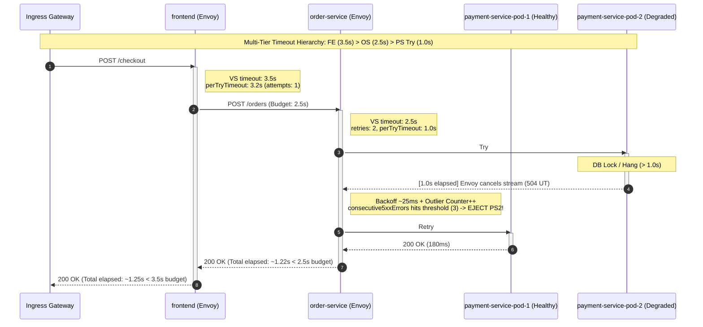

[Fellowship Portal](../../README.md) · [Handbook](../../FELLOWSHIP_HANDBOOK.md) · [Progression Dashboard](../../PROGRESSION_DASHBOARD.md) · [<- Previous Week](../week-05-zero-trust-security-architecture/WEEK.md) · **Week 06 of 10** · [Next Week ->](../week-07-progressive-delivery-and-safe-releases/WEEK.md)

# Week 06: Resilience Engineering, Circuit Breaking & Chaos Testing

**Phase 3: Resilience & Progressive Delivery** | **Schedule**: Week 06 of 10  
**Authoritative Version Baseline**: `Istio 1.32.0` | `Envoy v1.40` | `Kubernetes 1.36/1.37` | `Gateway API v1.6.1`  
**Core Curriculum Links**:
- 📖 **Technical Lecture**: [Module 05 — Resilience and Fault Injection (`README.md`)](../../05-resilience-and-fault-injection/README.md)
- 🧪 **Guided Hands-On Lab**: [Module 05 Lab — Timeouts, Retries, Circuit Breaking & Chaos (`LAB.md`)](../../05-resilience-and-fault-injection/LAB.md)

> [!NOTE]
> ### Where You Are & What You Need Before Starting
> - **Current Phase**: Phase 3 — Resilience & Progressive Delivery (Week 06 of 10)
> - **Prerequisites**: Completed Phase 2 (Weeks 04–05: Edge Gateways, Controlled Egress, `STRICT` mTLS & Zero-Trust `AuthorizationPolicy`)
> - **Estimated Time**: ~6–8 hours
> - **Tangible Weekly Deliverable**: Hierarchical multi-tier timeout/retry `VirtualService` policies, `DestinationRule` circuit breakers (`connectionPool` + `outlierDetection`), and header-scoped chaos verification (`NP-106`)

---

## 🎯 Learning Objectives & Required Competencies

By the end of Week 06, you will be able to:
1. **Enforce the Multi-Tier Timeout Math Rule**: Calculate and enforce strict hierarchical timeout budgets (`Downstream Timeout > Attempt Budget × (perTryTimeout + Backoff)`) across multi-hop FinTech call chains (`frontend` $\rightarrow$ `order-service` $\rightarrow$ `payment-service`).
2. **Eliminate Multiplicative Retry Storms**: Diagnose and eradicate multi-layer retry amplification where application SDK retries collide with Envoy `VirtualService` retries, bounding retries with `retryBudget` and explicit `retryOn` conditions.
3. **Engineer Envoy Circuit Breakers & Outlier Detection**: Configure `DestinationRule.spec.trafficPolicy.connectionPool` (`maxConnections`, `http1MaxPendingRequests`, `http2MaxRequests`, `maxRequestsPerConnection`) alongside passive health checks (`outlierDetection` with `consecutive5xxErrors`, `baseEjectionTime`, and `maxEjectionPercent`) to isolate degraded pods before thread pools saturate.
4. **Distinguish Envoy Failure Flags**: Immediately differentiate `503 UO` (Upstream Overflow — local circuit breaker trip), `503 UF` (Upstream Connection Failure), `503 UC` (Upstream Connection Termination), `504 UT` (Upstream Request Timeout), and `FI` (Fault Injected) in Envoy access logs and `istio_requests_total`.
5. **Validate Resilience via Controlled Chaos**: Inject deterministic HTTP delays (`fixedDelay`) and aborts (`httpStatus`) via `VirtualService.spec.http[].fault` to prove that circuit breakers, retries, and fallback paths perform under Black Friday failure modes.

---

## 📅 Monday — Mentor Briefing & Ticket Assignment

### 🎙️ Morning Standup: Briefing from Alex Morgan (Senior Platform Engineer)

> *"Good morning. Grab a coffee—we have a post-incident architecture overhaul on the board today. Over the weekend, our staging load test simulated a 400ms latency spike on one of the three `payment-service` pods backed by RDS. Instead of gracefully shedding load or ejecting the single slow pod, our cluster melted down inside 90 seconds. CPU across `order-service` and `payment-service` pinned at 100%, Envoy sidecars started dropping connections, and customers saw cascading `504 Gateway Timeout` errors even after RDS recovered.*
>
> *Why? Because we treated timeouts, retries, and connection pools as independent knobs instead of a coupled control system. In a distributed payment pipeline, an unbounded retry is a self-inflicted DDoS attack, and a missing timeout is a memory leak waiting to happen. This week, before we touch progressive delivery or Black Friday traffic scaling, you are going to re-architect NovaPay's resilience layer from the Envoy connection pool up to the ingress timeout budget."*

---

### 💬 Peer Engineering Discussion: The $25\times$ Retry Storm Debate

**Sarah Chen (SRE Lead)**: *"Let's look at the Prometheus graph from Saturday's staging test. Baseline ingress traffic into `frontend` was `1,000 RPS`. The moment `payment-service-pod-2` hit a 400ms GC pause, inbound traffic to `payment-service` spiked to **`25,000 RPS`**! That burned through 100% of our monthly error budget in four minutes. Daniel, why did `order-service` hammer `payment-service` 25 times per user checkout?"*

**Daniel Brooks (Staff Backend Engineer)**: *"Wait—I configured our Go HTTP client in `order-service` with a standard resilience wrapper: `MaxRetries = 5` with a 500ms timeout. And last week, when we noticed occasional transient `503`s during pod rollouts, I also added `retries: { attempts: 5, perTryTimeout: 500ms }` to both the `order-service` and `payment-service` `VirtualService` manifests so Istio would handle it automatically. More retries means higher availability, right?"*

**Alex Morgan (Senior Platform Engineer)**: *"Daniel, look at the multiplication math you just created. When `frontend` calls `order-service`, the Istio sidecar on `frontend` executes up to 5 attempts. On **each** of those attempts, `order-service`'s Go HTTP client executes 5 application-level retries against `payment-service`. And on **each** of those Go retries, the `order-service` Envoy sidecar intercepts the outbound call and executes 5 Envoy-level retries (`5 × 5 × 5 = 125` worst-case attempts, or `5 × 5 = 25` between two layers)! Even worse: while `order-service` is frantically retrying a dead pod, the round-robin load balancer keeps sending 33% of all those retries right back to the exact same degraded pod because nobody configured `outlierDetection`."*

**Maya Patel (Principal Security Engineer)**: *"From a PCI-DSS and financial integrity standpoint, blindly retrying `POST /v1/payments/charge` without strict idempotency key enforcement and deterministic timeout boundaries is terrifying. If `frontend` times out at `2.0s` while `order-service` and `payment-service` are still retrying in the background at `t = 3.5s`, the customer gets a `504 Gateway Timeout` screen on their phone, clicks 'Pay Now' again, and meanwhile the orphaned background retry succeeds against the card network. Now we have double-charged a cardholder."*

**Sarah Chen (SRE Lead)**: *"Exactly. Here is our non-negotiable engineering policy starting today:*
1. ***Single-Layer Retries Only**: Application SDK retries (`MaxRetries`) in Go/Java must be set to `0` for mesh-internal calls. Envoy owns network-layer retries—or the application owns business-level retries with idempotency keys—never both.*
2. ***Strict Timeout Hierarchy**: Every hop's total timeout (`timeout`) must be strictly less than its caller's timeout, and strictly greater than `attempts × perTryTimeout` plus backoff jitter.*
3. ***Fail Fast & Eject**: If a pod's connection pool fills up, Envoy must trip `503 UO` (`Upstream Overflow`) immediately rather than queuing requests until memory OOMs. And if a pod throws consecutive `5xx` errors, `outlierDetection` must eject it from the load-balancing pool immediately."*

---

### 🎫 Engineering Ticket: `NP-106` — NovaPay Multi-Tier Resilience & Chaos Verification

| Field | Value |
| :--- | :--- |
| **Ticket ID** | `NP-106` |
| **Title** | Implement Multi-Tier Timeout Budgets, Circuit Breaking, Outlier Detection, and Chaos Validation |
| **Assignee** | Platform Engineering Fellow (Cohort 01) |
| **Reviewer** | Alex Morgan (Senior Platform Engineer) & Sarah Chen (SRE Lead) |
| **Priority** | `P0 — Blocker for Black Friday Readiness` |
| **Target Environment** | `novapay` & `novapay-pci` Namespaces (`Istio 1.32.0` / `Envoy v1.40`) |

#### Business Context
NovaPay processes high-throughput checkout transactions across a 3-tier synchronous call path: `frontend` $\rightarrow$ `order-service` $\rightarrow$ `payment-service`. Before Black Friday (projected $10\times$ traffic surge), Platform Engineering must eliminate retry amplification storms, bound connection queues, automatically eject unhealthy pods during partial database brownouts, and prove resilience using Istio fault injection.

#### Technical Requirements & Constraints
1. **Timeout Hierarchy Enforcement**:
   - `frontend` $\rightarrow$ `order-service`: Overall `timeout: 3.5s`, `retries.attempts: 2`, `perTryTimeout: 1.5s`.
   - `order-service` $\rightarrow$ `payment-service`: Overall `timeout: 2.5s`, `retries.attempts: 2`, `perTryTimeout: 1.0s`, `retryOn: connect-failure,refused-stream,unavailable,cancelled,503`.
2. **Circuit Breaking (`connectionPool`)**:
   - Protect `payment-service` with strict TCP and HTTP pool bounds so sudden latency spikes trip fast `503 UO` responses rather than exhausting kernel sockets or Go goroutines.
3. **Passive Health Checking (`outlierDetection`)**:
   - Configure `consecutive5xxErrors`, `interval`, `baseEjectionTime`, and `maxEjectionPercent` on both `order-service` and `payment-service` `DestinationRule` resources so a single failing replica is ejected for 30s (scaling up on repeat offenses) without taking down the entire fleet.
4. **Chaos Engineering Validation**:
   - Use `VirtualService` HTTP `fault.delay` and `fault.abort` to prove that timeouts fire on schedule (`504 UT`), retries recover transient errors transparently, and circuit breakers trip (`503 UO`) under concurrency spikes.

#### Acceptance Criteria & Deliverables
- Complete Tuesday's architecture study and Wednesday's guided lab in `05-resilience-and-fault-injection`.
- Submit production-grade `VirtualService` and `DestinationRule` manifests for Thursday's assignment passing all `istioctl analyze` and Envoy `:15000/clusters` verification checks.
- Resolve Friday's live PagerDuty incident (`INC-06`) with a full Root Cause Analysis.

---

## 📅 Tuesday — Technical Lectures & Architecture Deep-Dive

### 📚 Assigned Core Reading & Modular Lessons
Study the complete architectural overview and progressive lessons in Module 05 before proceeding:
- 👉 **Core Module Overview**: **[Module 05: Resilience and Fault Injection — Technical Lecture (`../../05-resilience-and-fault-injection/README.md`)](../../05-resilience-and-fault-injection/README.md)**
- **Modular Deep-Dive Lessons**:
  1. [Lesson 05.1: Timeouts, Bounded Retries & Stopping Retry Storms](../../05-resilience-and-fault-injection/lessons/01-timeouts-retries-and-retry-storms.md)
  2. [Lesson 05.2: Circuit Breaking (`connectionPool`) & Outlier Detection](../../05-resilience-and-fault-injection/lessons/02-circuit-breaking-and-outlier-detection.md)
  3. [Lesson 05.3: Chaos Fault Injection & Locality-Aware Failover](../../05-resilience-and-fault-injection/lessons/03-chaos-fault-injection-and-locality-failover.md)

### 📝 Alex Morgan's Guided Study Notes

While reading [README.md](../../05-resilience-and-fault-injection/README.md), pay close attention to these four Envoy internals:

1. **Why Istio Defaults Are Dangerous Under Load**:
   - By default, Istio sets HTTP route timeouts to **`0s` (disabled/infinite)** and sets default retries to **2 attempts on `connect-failure,refused-stream,unavailable,cancelled,retriable-status-codes`**. If an upstream database locks up and holds connections open for 60 seconds, Envoy will happily wait 60 seconds unless you explicitly set `timeout` and `perTryTimeout`.
2. **The Timeout Math Invariant**:
   - For any service hop $i$, let $T_{\text{overall}}^{(i)}$ be `spec.http[].timeout`, $N_{\text{attempts}}^{(i)}$ be `retries.attempts` (note: in Envoy, `attempts: 2` means **1 initial attempt + up to 2 retries = 3 total tries** in some mental models, or check Envoy's `num_retries` translation carefully: in Istio `VirtualService`, `attempts: N` sets Envoy's `num_retries: N`, meaning **1 initial request + $N$ retries = $N+1$ total executions**!), and $T_{\text{try}}^{(i)}$ be `perTryTimeout`.
   - Furthermore, Envoy injects a randomized exponential backoff between retries (default base interval `25ms`, capped at $10\times$ base). Therefore:
     $$T_{\text{overall}}^{(i)} \ge (N_{\text{retries}}^{(i)} + 1) \times T_{\text{try}}^{(i)} + \sum_{k=1}^{N_{\text{retries}}^{(i)}} T_{\text{backoff}}(k)$$
   - And across hops ($i = \text{caller}$, $i+1 = \text{callee}$):
     $$T_{\text{try}}^{(i)} > T_{\text{overall}}^{(i+1)} + T_{\text{network\_overhead}}$$
3. **How Envoy Translates `connectionPool` into Circuit Breakers**:
   - Unlike classic Netflix Hystrix (which trips based on rolling error-rate percentages), Envoy splits resilience into **two distinct mechanisms** inside `DestinationRule.spec.trafficPolicy`:
     - **`connectionPool`** = *Concurrency & Queue Bounding* (bulkheading). When active requests or pending queues exceed the threshold, Envoy immediately short-circuits locally with `503 Service Unavailable` and attaches response flag **`UO` (`Upstream Overflow`)**.
     - **`outlierDetection`** = *Error/Latency-Based Host Ejection*. When a specific pod IP returns `consecutive5xxErrors` (or `consecutiveGatewayErrors` / `consecutiveLocalOriginFailures`), Envoy removes that endpoint from the healthy load-balancing set for `baseEjectionTime × ejection_count`.
4. **Why Fault Injection Happens at the Client Proxy (Normally)**:
   - When you attach a `fault` block to a `VirtualService` for `payment-service`, the Envoy proxy on the **caller (`order-service`)** evaluates the route and injects the delay or abort *before* (or instead of) sending the packet over the wire—unless the `VirtualService` is bound to an ingress gateway.

---

### 🗺️ Architectural Deep-Dive: Multi-Tier Timeout Budget & Circuit Breaker State Machine



#### Envoy Resilience Control Matrix

| Control Plane Field (`DestinationRule` / `VirtualService`) | Envoy xDS Target (`Cluster` / `RouteConfiguration`) | Failure Mode Prevented | Envoy Access Log Response Flag | Prometheus Metric / Envoy Counter |
| :--- | :--- | :--- | :--- | :--- |
| `VirtualService.http[].timeout` | `RouteAction.timeout` | Unbounded caller thread/goroutine hanging | `504 UT` (Upstream Request Timeout) | `upstream_rq_timeout` |
| `VirtualService.http[].retries.perTryTimeout` | `RouteAction.retry_policy.per_try_timeout` | Slow blackhole pod consuming entire timeout budget | `504 UT` (if all retries exhausted) | `upstream_rq_per_try_timeout` |
| `DestinationRule.connectionPool.tcp.maxConnections` | `CircuitBreakers.Thresholds.max_connections` | Ephemeral port exhaustion & TCP SYN floods | `503 UO` (Upstream Overflow) | `upstream_cx_overflow` |
| `DestinationRule.connectionPool.http.http1MaxPendingRequests` | `CircuitBreakers.Thresholds.max_pending_requests` | Unbounded memory growth waiting for free connection | `503 UO` (Upstream Overflow) | `upstream_rq_pending_overflow` |
| `DestinationRule.connectionPool.http.http2MaxRequests` | `CircuitBreakers.Thresholds.max_requests` | Upstream CPU/thread pool saturation under HTTP/2 or active HTTP/1.1 requests | `503 UO` (Upstream Overflow) | `upstream_rq_pending_overflow` |
| `DestinationRule.outlierDetection.consecutive5xxErrors` | `OutlierDetection.consecutive_5xx` | Sticky traffic routing to a panicked/dead replica | `503 UH` (if all hosts ejected & panic threshold disabled) | `outlier_detection.ejections_active` |

---

## 📅 Wednesday — Guided Labs & Internal Verification

### 🔍 Pre-Flight Environment Verification
Before starting the Module 05 Guided Lab, verify your cluster and mesh version baseline:

```bash
# 1. Verify Kubernetes 1.36+ / 1.37+ and Gateway API v1.6.1 CRDs
kubectl version
kubectl get crd gateways.gateway.networking.k8s.io -o jsonpath='{.metadata.annotations.gateway\.networking\.k8s\.io/bundle-version}{"\n"}'

# 2. Verify Istio 1.32.0 Control Plane & Data Plane sync
istioctl version
istioctl proxy-status
```

### 🧪 Execute the Core Module 05 Guided Lab
Open and complete all hands-on exercises in the Module 05 Lab Guide:
👉 **[Execute Module 05 Lab (`../../05-resilience-and-fault-injection/LAB.md`)](../../05-resilience-and-fault-injection/LAB.md)**

---

### 🔬 Alex Morgan's Internal Verification Checkpoints

Do not rely solely on `curl` HTTP status codes! As a Senior Platform Engineer, verify that `istiod` actually programmed your Envoy sidecars with the expected xDS `RouteConfiguration` and `Cluster` circuit breaker thresholds:

#### Checkpoint 1: Verify Route Timeout & Retry Policy Programming in Envoy
```bash
# Inspect the outbound HTTP route configuration on the caller pod for port 8080
istioctl proxy-config routes deploy/frontend -n novapay --name 8080 -o json | jq '
  .[].virtualHosts[]
  | select(.name | contains("order-service"))
  | .routes[].route
  | {timeout: .timeout, retryPolicy: .retryPolicy}'
```
*Expected Verification*: Confirm `timeout` matches your overall route budget, `retryPolicy.numRetries` matches `attempts`, `retryPolicy.perTryTimeout` is explicitly populated, and `retryPolicy.retryOn` contains your exact comma-delimited conditions.

#### Checkpoint 2: Verify Circuit Breaker & Outlier Detection on Upstream Cluster
```bash
# Inspect the Envoy Cluster definition for payment-service
istioctl proxy-config cluster deploy/order-service -n novapay \
  --fqdn payment-service.novapay.svc.cluster.local -o json | jq '
  .[] | {
    name: .name,
    circuitBreakers: .circuitBreakers,
    outlierDetection: .outlierDetection
  }'
```

#### Checkpoint 3: Inspect Live Envoy `:15000/stats` Circuit Breaker & Outlier Counters
```bash
# Query Envoy admin API directly for overflow, retry, and ejection metrics
kubectl exec -n novapay deploy/order-service -c istio-proxy -- \
  pilot-agent request GET 'stats?filter=cluster.outbound\|8080\|\|payment-service.novapay.svc.cluster.local.(upstream_rq_retry|upstream_rq_pending_overflow|upstream_cx_overflow|outlier_detection)'
```
*Expected Verification*:
- `upstream_rq_pending_overflow` > 0 proves `503 UO` was triggered locally by the caller's sidecar without touching the network.
- `outlier_detection.ejections_enforced_total` > 0 proves an unhealthy pod was actively quarantined.

#### Checkpoint 4: Verify Endpoint Health & Ejection State (`istioctl proxy-config endpoints`)
```bash
istioctl proxy-config endpoints deploy/order-service -n novapay \
  --cluster "outbound|8080||payment-service.novapay.svc.cluster.local"
```
*Expected Verification*: When a pod is ejected by `outlierDetection`, its status in `proxy-config endpoints` transitions from `HEALTHY` to `UNHEALTHY` (flagged via failed outlier check).

---

## 📅 Thursday — Independent Engineering Assignment

### 🛠️ Assignment Brief: Architecting NovaPay's Production Resilience Policy (`NP-106`)

Now that you have completed the guided lab, Alex and Sarah need you to author the production resilience manifests for the `novapay` namespace (`frontend` $\rightarrow$ `order-service` $\rightarrow$ `payment-service`).

#### Architectural Requirements
1. **Multi-Tier Timeout & Retry Budget**:
   - **`order-service` (`VirtualService: order-service-resilience`)**:
     - Overall `timeout`: `3.5s`
     - Retries: `attempts: 2`, `perTryTimeout: 1.5s`, `retryOn: "connect-failure,refused-stream,unavailable,cancelled,503"`
   - **`payment-service` (`VirtualService: payment-service-resilience`)**:
     - Overall `timeout`: `2.5s`
     - Retries: `attempts: 2`, `perTryTimeout: 1.0s`, `retryOn: "connect-failure,refused-stream,unavailable,cancelled,503"`
     - Note how the math holds: `payment-service` max execution ($3 \text{ tries} \times 1.0\text{s} + \text{backoff}$ capped by overall `2.5s` timeout—or 1 initial + 1 retry within `2.5s`) fits cleanly inside `order-service`'s overall `3.5s` budget! Specifically, set `payment-service` `perTryTimeout: 1.0s` and `attempts: 2` with overall `timeout: 2.5s` so even if two 1.0s tries fail and a third starts, the `2.5s` overall cap guarantees control returns to `order-service` well before `3.5s`.
2. **`payment-service` Circuit Breaker & Outlier Detection (`DestinationRule: payment-service-cb`)**:
   - **Connection Pool**:
     - `tcp.maxConnections: 100`
     - `tcp.connectTimeout: 500ms`
     - `http.http1MaxPendingRequests: 25`
     - `http.http2MaxRequests: 100`
     - `http.maxRequestsPerConnection: 50`
   - **Outlier Detection**:
     - `consecutive5xxErrors: 3`
     - `interval: 5s`
     - `baseEjectionTime: 30s`
     - `maxEjectionPercent: 50`
     - `minHealthPercent: 50` (Panic threshold protection: if healthy endpoints drop below 50%, Envoy stops enforcing ejection and routes across all endpoints to prevent total cluster blackout).
3. **Controlled Chaos Verification Manifest (`VirtualService: payment-service-chaos-test`)**:
   - Create an overlay test manifest that injects a `1.2s` `fixedDelay` on `20%` of requests and an HTTP `503` `abort` on `10%` of requests whenever the request carries header `x-chaos-test: black-friday`. Normal traffic without the header must remain completely unaffected!

#### Verification Commands to Run Against Your Solution
```bash
# 1. Validate schema and mesh semantics
istioctl analyze -n novapay

# 2. Verify normal traffic succeeds without chaos impact
kubectl exec -n novapay deploy/frontend -c istio-proxy -- \
  curl -s -o /dev/null -w "%{http_code} (%{time_total}s)\n" http://order-service.novapay.svc.cluster.local:8080/orders

# 3. Trigger header-scoped chaos test and confirm automatic retry recovery
for i in $(seq 1 20); do
  kubectl exec -n novapay deploy/order-service -c istio-proxy -- \
    curl -s -H "x-chaos-test: black-friday" -o /dev/null -w "Req $i: HTTP %{http_code} in %{time_total}s\n" \
    http://payment-service.novapay.svc.cluster.local:8080/charge
done
```

---

<details>
<summary>Need a Hint from Alex Morgan? (Click before revealing the full answer)</summary>

> **Alex's Coaching Hints**:
> 1. **Single `VirtualService` per Host**: Do **not** create two separate `VirtualService` objects targeting `payment-service.novapay.svc.cluster.local` (that triggers `IST0109` conflicting route warnings). Instead, place two ordered route rules inside `payment-service-resilience`: Rule 1 matching `headers.x-chaos-test.exact: black-friday` (with the `fault` block attached), and Rule 2 as the catch-all production route!
> 2. **Circuit Breaker + Panic Threshold**: In `DestinationRule.spec.trafficPolicy`, define `connectionPool` (`tcp` and `http`) alongside `outlierDetection` (`consecutive5xxErrors: 3`, `interval: 5s`, `baseEjectionTime: 30s`, `maxEjectionPercent: 50`, `minHealthPercent: 50`).

</details>

<details>
<summary>Click to Reveal Reference Solution & Alex's Code Review</summary>

### 📄 Reference Solution (`novapay-resilience-solution.yaml`)

```yaml
apiVersion: networking.istio.io/v1
kind: DestinationRule
metadata:
  name: order-service-cb
  namespace: novapay
spec:
  host: order-service.novapay.svc.cluster.local
  trafficPolicy:
    connectionPool:
      tcp:
        maxConnections: 200
        connectTimeout: 500ms
      http:
        http1MaxPendingRequests: 50
        http2MaxRequests: 200
        maxRequestsPerConnection: 100
    outlierDetection:
      consecutive5xxErrors: 3
      interval: 5s
      baseEjectionTime: 30s
      maxEjectionPercent: 50
      minHealthPercent: 50
---
apiVersion: networking.istio.io/v1
kind: DestinationRule
metadata:
  name: payment-service-cb
  namespace: novapay
spec:
  host: payment-service.novapay.svc.cluster.local
  trafficPolicy:
    connectionPool:
      tcp:
        maxConnections: 100
        connectTimeout: 500ms
      http:
        http1MaxPendingRequests: 25
        http2MaxRequests: 100
        maxRequestsPerConnection: 50
    outlierDetection:
      consecutive5xxErrors: 3
      interval: 5s
      baseEjectionTime: 30s
      maxEjectionPercent: 50
      minHealthPercent: 50
---
apiVersion: networking.istio.io/v1
kind: VirtualService
metadata:
  name: order-service-resilience
  namespace: novapay
spec:
  hosts:
    - order-service.novapay.svc.cluster.local
  http:
    - name: order-service-bounded-route
      timeout: 3.5s
      retries:
        attempts: 2
        perTryTimeout: 1.5s
        retryOn: connect-failure,refused-stream,unavailable,cancelled,503
      route:
        - destination:
            host: order-service.novapay.svc.cluster.local
            port:
              number: 8080
---
apiVersion: networking.istio.io/v1
kind: VirtualService
metadata:
  name: payment-service-resilience
  namespace: novapay
spec:
  hosts:
    - payment-service.novapay.svc.cluster.local
  http:
    - name: payment-service-chaos-header-route
      match:
        - headers:
            x-chaos-test:
              exact: black-friday
      fault:
        delay:
          percentage:
            value: 20.0
          fixedDelay: 1.2s
        abort:
          percentage:
            value: 10.0
          httpStatus: 503
      timeout: 2.5s
      retries:
        attempts: 2
        perTryTimeout: 1.0s
        retryOn: connect-failure,refused-stream,unavailable,cancelled,503
      route:
        - destination:
            host: payment-service.novapay.svc.cluster.local
            port:
              number: 8080
    - name: payment-service-production-route
      timeout: 2.5s
      retries:
        attempts: 2
        perTryTimeout: 1.0s
        retryOn: connect-failure,refused-stream,unavailable,cancelled,503
      route:
        - destination:
            host: payment-service.novapay.svc.cluster.local
            port:
              number: 8080
```

### 🔍 Alex Morgan's Code Review Notes
1. **Header-Scoped Chaos Injection**: Notice how we placed the `x-chaos-test: black-friday` match rule *first* in `payment-service-resilience` instead of creating a second conflicting `VirtualService` for the same host (`payment-service.novapay.svc.cluster.local`). Defining multiple `VirtualService` resources for the same host in the same namespace causes non-deterministic route merging or `IST0109` warnings!
2. **How the `1.2s` Delay Interacts with `perTryTimeout: 1.0s`**: When the 20% fault delay of `1.2s` triggers on `x-chaos-test: black-friday`, the `1.0s` `perTryTimeout` cuts it off at `1.0s` with a `504 UT`. Note that because `retryOn` only lists `connect-failure,refused-stream,unavailable,cancelled,503` (and *not* `gateway-error` or `deadline-exceeded`), verify whether you want timed-out tries to retry (`retryOn: ...,gateway-error,reset`) or fail fast to prevent duplicate non-idempotent charges!
3. **`minHealthPercent: 50` (Envoy Panic Threshold)**: Setting `minHealthPercent: 50` alongside `maxEjectionPercent: 50` ensures that if a systemic downstream issue (e.g., an RDS credentials rotation glitch) causes >50% of `payment-service` pods to throw `500`s simultaneously, Envoy disables outlier ejection panic-mode rather than ejecting every pod and blackholing 100% of traffic.

</details>

---

## 📅 Friday — Incident Simulation (`INC-06`)

### 🚨 PagerDuty Alert: `INC-06` — Phantom Double-Charges & Premature `504 UT` Timeouts on Checkout

> **📟 PAGERDUTY TRIGGERED — SEV-1**  
> **Service**: `novapay-checkout-pipeline` (`frontend` $\rightarrow$ `order-service` $\rightarrow$ `payment-service`)  
> **Incident Commander**: Sarah Chen (SRE Lead)  
> **Alert Condition**: `checkout_http_504_rate > 18%` AND `stripe_duplicate_charge_webhook_mismatch > 0`  
> **Message from Sarah Chen**:  
> *"Team, jump on the bridge now! Thirty minutes ago, Daniel deployed a hotfix `VirtualService` update to 'speed up slow checkouts.' Since then, 18% of customer checkouts at `frontend` are failing with `504 Gateway Timeout` after exactly `1.002s`. Worse: Maya's audit log monitor shows that **`payment-service` is still completing the credit card charges 800ms AFTER `frontend` already returned a `504` error to the user!** Customers see 'Payment Failed', retry manually, and get charged twice. Reproduce this in your lab namespace, inspect the Envoy route configs and access logs, find the inverted timeout bug, and fix it immediately!"*

---

### 💥 Step 1: Reproduce the Broken State

Apply the broken configuration below to your `novapay` namespace to simulate the exact production outage:

```yaml
# apply-inc-06-broken.yaml
apiVersion: networking.istio.io/v1
kind: VirtualService
metadata:
  name: order-service-resilience
  namespace: novapay
spec:
  hosts:
    - order-service.novapay.svc.cluster.local
  http:
    - name: order-route-broken
      # BUG HINT 1: Look closely at how frontend -> order-service timeout compares to downstream!
      timeout: 1.0s
      retries:
        attempts: 3
        perTryTimeout: 2.0s
        retryOn: 5xx,gateway-error,connect-failure,reset
      route:
        - destination:
            host: order-service.novapay.svc.cluster.local
            port:
              number: 8080
---
apiVersion: networking.istio.io/v1
kind: VirtualService
metadata:
  name: payment-service-resilience
  namespace: novapay
spec:
  hosts:
    - payment-service.novapay.svc.cluster.local
  http:
    - name: payment-route-slow-downstream
      fault:
        delay:
          percentage:
            value: 30.0
          fixedDelay: 1.4s
      timeout: 4.0s
      retries:
        attempts: 3
        perTryTimeout: 2.0s
        retryOn: 5xx,gateway-error,connect-failure,reset
      route:
        - destination:
            host: payment-service.novapay.svc.cluster.local
            port:
              number: 8080
```

---

### 🔍 Step 2: Diagnostic Evidence & Investigation Steps

Run the following diagnostic commands to gather evidence before opening the RCA:

1. **Observe the `504 UT` symptom from `frontend` while `payment-service` logs `200 OK`**:
   ```bash
   # Send 10 requests from frontend to order-service
   for i in $(seq 1 10); do
     kubectl exec -n novapay deploy/frontend -c istio-proxy -- \
       curl -s -o /dev/null -w "Checkout $i: HTTP %{http_code} in %{time_total}s\n" \
       http://order-service.novapay.svc.cluster.local:8080/orders
   done
   ```
2. **Compare Envoy Access Logs on `frontend` vs `payment-service`**:
   ```bash
   # Check frontend outbound access logs (look for 504 UT at ~1000ms)
   kubectl logs -n novapay deploy/frontend -c istio-proxy --tail=20 | grep "order-service"

   # Check payment-service inbound access logs (look for 200 OK completing at ~1400ms!)
   kubectl logs -n novapay deploy/payment-service -c istio-proxy --tail=20
   ```
3. **Inspect Route Timeout vs `perTryTimeout` in Envoy `proxy-config`**:
   ```bash
   istioctl proxy-config routes deploy/frontend -n novapay --name 8080 -o json | jq '
     .[].virtualHosts[] | select(.name | contains("order-service")) | .routes[].route | {timeout, retryPolicy}'
   ```

---

<details>
<summary>Need a Hint from Alex Morgan? (Click before revealing the full answer)</summary>

> **Alex's Diagnostic Hints**:
> 1. **Intra-Service Timeout Inversion**: In `order-service-resilience`, compare `timeout: 1.0s` against `retries.perTryTimeout: 2.0s`. In Envoy, `timeout` is the outer wall-clock deadline for the entire request including all retries! If `timeout` (`1.0s`) is smaller than `perTryTimeout` (`2.0s`), when does `frontend` cut off the request?
> 2. **Cross-Hop Timeout Inversion**: Compare `frontend -> order-service` (`timeout: 1.0s`) against `order-service -> payment-service` (`timeout: 4.0s` with a `1.4s` fault delay). At `t = 1.0s`, `frontend` gives up with `504 UT`, while `order-service` and `payment-service` keep running until `t = 1.4s` and complete the charge!

</details>

<details>
<summary>Click to Reveal Root Cause Analysis (RCA), Remediation & Postmortem</summary>

### 🧠 Root Cause Analysis (RCA)

The outage was caused by **two compounding violations of the Multi-Tier Timeout Math Invariant**:

1. **Inverted Intra-Service Timeout (`timeout: 1.0s` < `perTryTimeout: 2.0s`) on `order-service-resilience`**:
   - In `order-service-resilience`, `spec.http[0].timeout` (the overall route deadline) was set to `1.0s`, while `retries.perTryTimeout` was set to `2.0s` with `attempts: 3`.
   - In Envoy, the overall route `timeout` is a hard outer deadline covering the initial request **plus all retries**. Because `timeout` (`1.0s`) is shorter than even a single `perTryTimeout` (`2.0s`), `perTryTimeout` and all 3 configured retries can **never execute** on slow requests. At exactly `t = 1.0s`, `frontend`'s Envoy sidecar aborts the HTTP stream and returns `504 Gateway Timeout` with response flag **`UT` (`Upstream Request Timeout`)**.
2. **Inverted Inter-Service (Cross-Hop) Timeout Hierarchy (`frontend -> order-service: 1.0s` < `order-service -> payment-service: 4.0s`)**:
   - While `frontend` gave up on `order-service` at `t = 1.0s`, `order-service`'s outbound call to `payment-service` had a `4.0s` overall timeout (`2.0s` `perTryTimeout`).
   - When `payment-service` experienced a `1.4s` banking gateway latency spike (simulated by the 30% `fixedDelay: 1.4s`), `frontend` disconnected at `1.0s` (`504 UT`), but `order-service` did not propagate context cancellation or `payment-service` had already dispatched the non-revocable charge at `t = 1.4s`, returning `200 OK` to an already-closed downstream request!

### 🛠️ Remediation Manifest

Restore the strict monotonic timeout hierarchy (`frontend -> order-service: 3.5s` > `order-service -> payment-service: 2.5s` > `perTryTimeout: 1.0s`):

```yaml
apiVersion: networking.istio.io/v1
kind: VirtualService
metadata:
  name: order-service-resilience
  namespace: novapay
spec:
  hosts:
    - order-service.novapay.svc.cluster.local
  http:
    - name: order-route-fixed
      timeout: 3.5s
      retries:
        attempts: 2
        perTryTimeout: 1.5s
        retryOn: connect-failure,refused-stream,unavailable,cancelled,503
      route:
        - destination:
            host: order-service.novapay.svc.cluster.local
            port:
              number: 8080
---
apiVersion: networking.istio.io/v1
kind: VirtualService
metadata:
  name: payment-service-resilience
  namespace: novapay
spec:
  hosts:
    - payment-service.novapay.svc.cluster.local
  http:
    - name: payment-route-fixed
      timeout: 2.5s
      retries:
        attempts: 2
        perTryTimeout: 1.0s
        retryOn: connect-failure,refused-stream,unavailable,cancelled,503
      route:
        - destination:
            host: payment-service.novapay.svc.cluster.local
            port:
              number: 8080
```

### 📋 Postmortem Action Items
- **CI Policy Gate (`OPA Gatekeeper` / `Kyverno`)**: Add a pre-commit policy blocking any `VirtualService` where `spec.http[].timeout <= spec.http[].retries.perTryTimeout`.
- **Idempotency & Context Propagation**: Ensure `order-service` propagates HTTP request cancellation (`context.Canceled`) and attaches an `X-Idempotency-Key` header on every call to `payment-service`.

</details>

---

## 📅 Saturday — Architecture Review & Mentor Office Hours

### 🏛️ Weekly Architecture Defense Questions

Prepare concise, production-accurate answers for our Saturday panel with Alex, Sarah, Daniel, and Maya:

1. **Alex Morgan (Envoy Internals)**: *"When Envoy returns a `503 Service Unavailable`, our developers immediately blame 'Istio flakiness.' How do you use the Envoy access log `%RESPONSE_FLAGS%` field (`UO`, `UF`, `UH`, `UC`, `NR`, `URX`) to prove in under 60 seconds whether the `503` came from local circuit breaking, outlier ejection, retry exhaustion, or an application crash?"*
2. **Sarah Chen (SRE & Capacity)**: *"In our `DestinationRule` for `payment-service`, we set `maxEjectionPercent: 50` and `minHealthPercent: 50`. Suppose `payment-service` has 4 replicas and an upstream Redis failure causes 3 of the 4 pods to return HTTP `500`. Walk me through the exact math of how many pods Envoy actually ejects and why."*
3. **Daniel Brooks (Backend Engineering)**: *"Why did you remove `5xx` and `gateway-error` from `retryOn` for our `POST /charge` endpoint and replace it with `connect-failure,refused-stream,unavailable,cancelled`? What is the difference between `connect-failure` / `refused-stream` and a generic `500` or `504` when mutating financial state?"*
4. **Maya Patel (Security & Compliance)**: *"Could an attacker or compromised internal pod abuse our `x-chaos-test: black-friday` fault injection rule in production to cause a Denial of Service (`DoS`)? How should we secure fault injection rules in a PCI-DSS Level 1 environment?"*

---

### ☕ Alex Morgan's Office Hours Q&A

**Q1: *"Alex, in `DestinationRule.connectionPool.http`, the field is named `http2MaxRequests`, while `http1MaxPendingRequests` has `http1` in the name. Does `http2MaxRequests` only apply to HTTP/2 traffic?"***  
> **Alex**: *"Great catch—this is one of the most notorious naming quirks in the Istio API! In Envoy's underlying `CircuitBreakers.Thresholds` proto, `http2MaxRequests` maps directly to Envoy's `max_requests` field. For **both HTTP/1.1 and HTTP/2** upstream clusters, `http2MaxRequests` limits the total number of **active concurrent requests** in flight across the cluster, whereas `http1MaxPendingRequests` limits the number of requests **queued waiting for an available connection pool slot** before a connection is bound. So always set `http2MaxRequests` even for HTTP/1.1 services if you want to cap active in-flight concurrency!"*

**Q2: *"What happens if I configure `outlierDetection` on a `DestinationRule`, but my service has subsets (`v1`, `v2`) defined?"***  
> **Alex**: *"In Envoy, every subset in a `DestinationRule` creates a separate Envoy `Cluster` (`outbound|8080|v1|payment-service...` and `outbound|8080|v2|payment-service...`). If you only define `trafficPolicy.outlierDetection` at the top level of the `DestinationRule` and later override `trafficPolicy` inside `subsets[].trafficPolicy` (for example, to change loadBalancer settings for `v2`), **the subset's `trafficPolicy` completely replaces the top-level `trafficPolicy` rather than merging deeply in older patterns unless explicitly structured**—always run `istioctl proxy-config cluster <pod> --fqdn <service> -o json` to verify that both the default cluster and every `subset` cluster have `outlierDetection` and `circuitBreakers` attached!"*

---

## 📅 Sunday — Weekly Assessment & Reflection

### 📝 Week 06 Competency Assessment

Answer all 5 multi-part questions below from memory before revealing the answer key.

#### Question 1: Timeout & Retry Math Calculation
`frontend` calls `order-service` with `VirtualService` settings: `timeout: 5.0s`, `retries.attempts: 2`, `perTryTimeout: 2.0s`.  
`order-service` calls `payment-service` with `VirtualService` settings: `retries.attempts: 2`, `perTryTimeout: 800ms`.  
1. Including the initial request, what is the maximum number of attempts `order-service`'s Envoy proxy will make to `payment-service` for a single incoming request from `frontend`?
2. What is the maximum total attempt amplification factor against `payment-service` for a single user request arriving at `frontend` if `payment-service` returns `503` on every attempt?
3. What should `payment-service`'s overall `VirtualService.http[].timeout` be set to so that a single try from `frontend` (`perTryTimeout: 2.0s`) never times out *before* `order-service` finishes its retry cycle against `payment-service`?

#### Question 2: Decoding Envoy Response Flags
During a Black Friday load test, you run `kubectl logs deploy/order-service -c istio-proxy` and observe four distinct failure lines:
- Line A: `HTTP/1.1" 503 UO "-" 0 81 0 - "-"`
- Line B: `HTTP/1.1" 503 UF,URX "-" 0 91 45 - "-"`
- Line C: `HTTP/1.1" 504 UT "-" 0 24 1001 - "-"`
- Line D: `HTTP/1.1" 503 FI "-" 0 18 0 - "-"`  
Explain the exact Envoy mechanism that generated each line (A, B, C, and D) and explain why Line A and Line D have `0ms` duration while Line C has `1001ms` duration.

#### Question 3: Outlier Detection & Panic Threshold Mechanics
A `DestinationRule` for `inventory-service` (which has **6 pod replicas**) is configured with:
```yaml
outlierDetection:
  consecutive5xxErrors: 4
  interval: 10s
  baseEjectionTime: 30s
  maxEjectionPercent: 50
  minHealthPercent: 50
```
1. Pod-1 is ejected at `t = 10s`, recovers at `t = 40s`, and immediately fails 4 more consecutive times at `t = 50s`. How long will Pod-1 be ejected the second time?
2. Suppose Pods 1, 2, 3, and 4 all start returning HTTP `500` simultaneously. How many pods will be ejected, and what happens when the 4th pod crosses `consecutive5xxErrors: 4`?

#### Question 4: Idempotent vs. Non-Idempotent `retryOn` Policies
Why is `retryOn: connect-failure,refused-stream` safe to enable on a non-idempotent HTTP `POST` request even without application changes, whereas `retryOn: 5xx,reset,gateway-error` is dangerous for non-idempotent `POST` requests?

#### Question 5: `connectionPool` Tuning (`maxRequestsPerConnection`)
What specific operational effect does setting `connectionPool.http.maxRequestsPerConnection: 1` have on Envoy's upstream connection behavior, and why might a platform engineer set `maxRequestsPerConnection: 100` instead of leaving it unlimited (`0`) when communicating with legacy HTTP/1.1 backends behind L4 load balancers?

---

<details>
<summary>Assessment Answer Key</summary>

1. **Question 1 Answers**:
   - **(1)** `attempts: 2` in Istio `VirtualService` configures Envoy's `num_retries: 2`, which means **1 initial request + 2 retries = 3 total tries** per incoming call to `order-service`.
   - **(2)** If `frontend` makes up to 3 total tries (`1 initial + 2 retries`) to `order-service`, and each try triggers 3 total tries from `order-service` to `payment-service`, a single user request can generate up to $3 \times 3 = 9$ requests against `payment-service`.
   - **(3)** Since `frontend`'s `perTryTimeout` to `order-service` is `2.0s`, `order-service`'s overall `timeout` to `payment-service` must be strictly less than `2.0s` minus processing/network overhead (e.g., **`1.8s`**). Note that 3 tries at `800ms` (`2.4s` worst case) would exceed `2.0s`, so either `perTryTimeout` on `payment-service` should be reduced to `550ms` ($3 \times 550\text{ms} + \text{backoff} \approx 1.75\text{s} < 1.8\text{s}$), or `attempts` on `payment-service` should be reduced to `1` ($2 \times 800\text{ms} + \text{backoff} \approx 1.65\text{s} < 1.8\text{s}$).

2. **Question 2 Answers**:
   - **Line A (`503 UO` in `0ms`)**: **Upstream Overflow** — the local Envoy circuit breaker (`connectionPool` `maxConnections`, `http1MaxPendingRequests`, or `http2MaxRequests`) tripped immediately in memory without sending bytes over the network (`0ms`).
   - **Line B (`503 UF,URX` in `45ms`)**: **Upstream Connection Failure (`UF`) + Upstream Retry Limit Exceeded (`URX`)** — Envoy tried to establish TCP/mTLS connections to upstream endpoints, failed across the initial try and all configured retries (`URX`) over `45ms`, and returned `503`.
   - **Line C (`504 UT` in `1001ms`)**: **Upstream Request Timeout (`UT`)** — Envoy waited `1000ms` (`1.0s` route `timeout` or `perTryTimeout`), the upstream did not respond in time, and Envoy terminated the request with `504`.
   - **Line D (`503 FI` in `0ms`)**: **Fault Injected (`FI`)** — an Istio `VirtualService` HTTP `fault.abort` rule intercepted the request locally and synthesized a `503` in `0ms`.

3. **Question 3 Answers**:
   - **(1)** Envoy multiplies `baseEjectionTime` by the pod's ejection count: $30\text{s} \times 2 = \mathbf{60\text{s}}$ on the second ejection (and $90\text{s}$ on the third, up to `maxEjectionTime`, which defaults to `300s`).
   - **(2)** With 6 replicas and `maxEjectionPercent: 50`, Envoy can eject at most $6 \times 0.50 = 3$ pods. Furthermore, with `minHealthPercent: 50`, if a 4th pod fails (which would drop healthy endpoints below 50% of the 6-pod pool), Envoy triggers **Panic Mode** (tracking `lb_subsets_panic` / `upstream_rq_maintenance_mode` / panic routing) or refuses to eject beyond `maxEjectionPercent: 50`, keeping at least 3 pods in rotation (or routing across all pods if overall cluster health drops below `minHealthPercent`) to avoid a complete cluster-wide `503 UH` outage.

4. **Question 4 Answers**:
   - `connect-failure` (TCP handshake failed before any HTTP payload was transmitted) and `refused-stream` (HTTP/2 `RST_STREAM` with `REFUSED_STREAM` error code, guaranteeing the upstream server never processed the stream) prove **zero application processing occurred** on the upstream server, making retry 100% safe from double-execution.
   - Conversely, `5xx`, `reset` (TCP `RST` after bytes were sent), and `gateway-error` (`502`/`503`/`504`) can occur **after** the upstream server received the HTTP `POST` body and committed the database transaction or charged the payment gateway.

5. **Question 5 Answers**:
   - Setting `maxRequestsPerConnection: 1` disables HTTP keep-alive connection reuse completely, forcing Envoy to open a brand-new TCP + mTLS connection for every single request (useful only for debugging or broken legacy servers, as it adds massive CPU and latency overhead).
   - Setting `maxRequestsPerConnection: 100` (or `1000`) periodically recycles long-lived keep-alive connections so that when new pod replicas scale up behind a service or L4 load balancer, connections re-balance smoothly across new endpoints and prevent slow memory leaks in legacy HTTP/1.1 workers.

</details>

---

### ✅ Weekly Competency Sign-Off Checklist

Before moving to **Week 07 (Progressive Delivery & Safe Releases)**, verify you have completed every item below:

- [ ] Read [Module 05 `README.md`](../../05-resilience-and-fault-injection/README.md) and mastered the Timeout Math Invariant.
- [ ] Completed all exercises in [Module 05 `LAB.md`](../../05-resilience-and-fault-injection/LAB.md) on `Istio 1.32.0`.
- [ ] Verified circuit breaker thresholds (`connectionPool`) and `outlierDetection` state via `istioctl proxy-config cluster` and Envoy `:15000/stats`.
- [ ] Authored and validated the `NP-106` production resilience manifests for `order-service` and `payment-service`.
- [ ] Resolved `INC-06` (Inverted Timeout Hierarchy causing phantom double-charges) and documented the RCA.
- [ ] Updated your progress tracker in [`../../PROGRESSION_DASHBOARD.md`](../../PROGRESSION_DASHBOARD.md).

### 💭 Weekly Retrospective Prompts
1. *Where in your current production systems do application-level SDK retries overlap with infrastructure/mesh-level retries?*
2. *If a downstream dependency slows down from 50ms to 2,000ms tomorrow, which timeout in your call graph fires first—and does the upstream work get cleanly canceled?*
