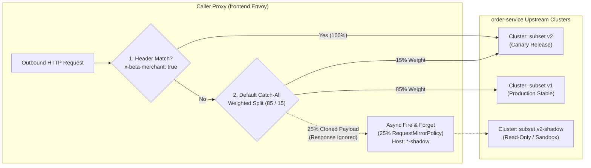

# Week 07: Progressive Delivery, Traffic Mirroring & Safe Releases

**Phase 3: Resilience & Progressive Delivery** | **Schedule**: Week 07 of 10  
**Authoritative Version Baseline**: `Istio 1.32.0` | `Envoy v1.40` | `Kubernetes 1.36/1.37` | `Gateway API v1.6.1`  
**Core Curriculum Links**:
- 📖 **Technical Lecture**: [Module 06 — Progressive Delivery (`README.md`)](../../06-progressive-delivery/README.md)
- 🧪 **Guided Hands-On Lab**: [Module 06 Lab — Traffic Mirroring, Dark Launches & Automated Canary Rollouts (`LAB.md`)](../../06-progressive-delivery/LAB.md)

---

## 🎯 Learning Objectives & Required Competencies

By the end of Week 07, you will be able to:
1. **Decouple Deployment from Release**: Architect multi-stage progressive delivery pipelines (Shadow Mirroring $\rightarrow$ Header-Based Dark Launch $\rightarrow$ Weighted Canary `90/10` $\rightarrow$ `50/50` $\rightarrow$ `100%`) using Istio `VirtualService`, `DestinationRule` subsets, and `HTTPRoute` `backendRefs` weights.
2. **Engineer Fire-and-Forget Traffic Mirroring safely**: Configure `VirtualService.spec.http[].mirror` and `mirrorPercentage` (`Envoy` shadow routing with `-shadow` `Host` header rewriting), while isolating stateful side-effects (database mutations, third-party payment webhooks).
3. **Guarantee Zero-503 Subset Transitions**: Prevent race conditions during new subset creation by enforcing strict ordering (`Deployment` Ready $\rightarrow$ `DestinationRule` Subset Propagated $\rightarrow$ `VirtualService` Route Shift).
4. **Enforce Deterministic Route Rule Ordering**: Structure `VirtualService.spec.http[]` match blocks from most-specific (exact header/URI matches for VIP/QA dark launches) to least-specific (catch-all weighted canary splits).
5. **Integrate Automated Flagger / Argo Rollouts Canary Loops**: Design closed-loop `Rollout` and `AnalysisTemplate` specifications that query Prometheus Istio golden signals (`istio_requests_total` success rate and `istio_request_duration_milliseconds_bucket` P99) to auto-promote or auto-abort releases.

---

## 📅 Monday — Mentor Briefing & Ticket Assignment

### 🎙️ Morning Standup: Briefing from Alex Morgan (Senior Platform Engineer)

> *"Welcome to Week 07. Last week you hardened NovaPay's resilience layer so a bad pod gets ejected within seconds. This week, we solve the #1 cause of self-inflicted production outages in FinTech: **deploying new code**.*
>
> *Tomorrow morning, Daniel's team is shipping `payment-service-v2`—our rewritten Multi-Currency Settlement Engine supporting EUR, GBP, and JPY conversions alongside USD. In the old days, we ran `kubectl set image` with a Kubernetes `RollingUpdate` strategy and prayed. With 3 replicas, replacing 1 pod immediately dumps **33.3% of all live customer payments** onto untested code with zero ability to route by merchant tier or compare responses side-by-side.*
>
> *With Istio `1.32.0`, pod count no longer dictates traffic percentage. We can run a single `v2` pod and send it `0%` of live traffic while mirroring `10%` of read/validation payloads to it asynchronously, then open `100%` of traffic solely for internal QA (`x-dark-launch: v2`), and finally ramp live customer traffic at `1%` $\rightarrow$ `10%` $\rightarrow$ `50%` $\rightarrow$ `100%` gated by automated Prometheus SLO checks."*

---

### 💬 Peer Engineering Discussion: The "Mirroring `POST /charge`" Near-Miss

**Daniel Brooks (Staff Backend Engineer)**: *"I love the traffic mirroring feature in Istio! Before we expose `payment-service-v2` to real customers, I want to add `mirror: { host: payment-service, subset: v2 }` and `mirrorPercentage: { value: 100.0 }` on the `payment-service` `VirtualService` for 24 hours. That way, every live `POST /v1/payments/charge` request hits `v1` for the real response AND gets replayed to `v2` in the background so I can verify `v2` handles peak production load!"*

**Maya Patel (Principal Security Engineer)**: *"Hold everything, Daniel! What database and what outbound Stripe/banking API credentials is `payment-service-v2` configured to use in production right now?"*

**Daniel Brooks (Staff Backend Engineer)**: *"The same production PostgreSQL cluster (`novapay-ledger-prod`) and the live Stripe production API key, of course—it's running in the `novapay-pci` production namespace."*

**Maya Patel (Principal Security Engineer)**: *"Think about what Envoy traffic mirroring actually does! Envoy clones the HTTP request payload, appends `-shadow` to the `Host`/`:authority` header, dispatches it asynchronously to `payment-service-v2`, and discards the HTTP response from `v2`. Envoy has **zero magical ability to roll back database `INSERT`s or stop `v2` from calling Stripe over the internet!** If you mirror `100%` of `POST /v1/payments/charge` to `v2` connected to live backends, `v1` will charge the customer's credit card \$100, and 5 milliseconds later `v2` will charge the customer's credit card **a second \$100** and insert a duplicate ledger row!"*

**Sarah Chen (SRE Lead)**: *"Maya just saved us from a career-ending incident. Here is our strict **NovaPay Traffic Mirroring Standard**:*
1. ***Idempotent / Read-Only Endpoints by Default**: Traffic mirroring is unconditionally safe for `GET` / read-only quote and FX-rate calculation endpoints (`GET /v1/fx/quote`, `POST /v1/payments/validate-dry-run`).*
2. ***Shadow-Aware Mutation Fencing**: If we ever mirror mutating `POST` requests (`POST /charge`), the shadow deployment (`v2-shadow`) **must** either inspect the `Host: ...-shadow` header to route writes to an isolated ephemeral sandbox DB + mock payment gateway, or only mirror to an isolated shadow service backed by sandbox mocks.*
3. ***For Live Stateful Mutations, Use Dark Launch + Low-Weight Canary**: For real `POST /charge` transactions against live Stripe, we start with header-based Dark Launch (`x-qa-canary: true` using test cards), followed by a `5%` $\rightarrow$ `10%` weighted Canary monitored by an Argo Rollout `AnalysisTemplate` that aborts inside 30 seconds if `5xx` > `0.5%` or P99 > `400ms`."*

**Alex Morgan (Senior Platform Engineer)**: *"One more operational gotcha to watch out for: remember that `VirtualService.spec.http[]` rules are evaluated **top-to-bottom, first-match-wins**. Last month, an engineer put the catch-all `90/10` weighted split at index `0` of `spec.http[]` and the `x-qa-canary: true` match rule at index `1`. Because the catch-all had no `match` block, it matched 100% of requests first, and the QA header rule was completely dead code!"*

---

### 🎫 Engineering Ticket: `NP-107` — Multi-Stage Progressive Delivery for `order-service-v2` & `payment-service-v2`

| Field | Value |
| :--- | :--- |
| **Ticket ID** | `NP-107` |
| **Title** | Implement Shadow Mirroring, Header Dark Launch, Weighted Canary & Argo Rollout Automation |
| **Assignee** | Platform Engineering Fellow (Cohort 01) |
| **Reviewer** | Alex Morgan (Senior Platform Engineer) & Sarah Chen (SRE Lead) |
| **Priority** | `P0 — Release Pipeline Architecture` |
| **Target Environment** | `novapay` Namespace (`Istio 1.32.0` / `Gateway API v1.6.1`) |

#### Business Context
NovaPay is rolling out `order-service-v2` and `payment-service-v2`. Platform Engineering must provide a repeatable, zero-downtime progressive delivery template that supports:
1. Asynchronous shadow traffic mirroring (`25%`) for safe read/validation endpoints.
2. Deterministic `100%` routing to `v2` for internal QA and Beta Merchants (`x-beta-merchant: true`).
3. Fine-grained weighted canary traffic shifting (`85% v1` / `15% v2`) for general production traffic.
4. Automated metric-driven promotion/rollback design using Argo Rollouts + Prometheus.

#### Technical Requirements & Constraints
1. **`DestinationRule` Subset Readiness**: Define `v1` (`version: v1`) and `v2` (`version: v2`) subsets while preserving the `connectionPool` and `outlierDetection` policies built in Week 06.
2. **Rule Ordering Invariant**: Ensure specific header/URI matches precede default weighted catch-all routes in `VirtualService.spec.http[]`.
3. **Gateway API Parity**: Know how to express equivalent header routing and `backendRefs.weight` splitting in Kubernetes Gateway API `v1.6.1` `HTTPRoute`.

---

## 📅 Tuesday — Technical Lectures & Architecture Deep-Dive

### 📚 Assigned Core Reading
Read the complete technical lecture for Module 06 before proceeding:
👉 **[Module 06: Progressive Delivery — Technical Lecture (`../../06-progressive-delivery/README.md`)](../../06-progressive-delivery/README.md)**

### 📝 Alex Morgan's Guided Study Notes

1. **The "Zero-503" Subset Creation Sequence**:
   - Why do teams sometimes see a brief burst of `503 NR` or `503 UH` when adding a new `v2` canary? Because they apply the `VirtualService` referencing `subset: v2` *at the exact same millisecond* as (or before) the `DestinationRule` defining `subset: v2` or before `v2` pods pass readiness probes!
   - **Golden Sequence**:
     1. Deploy `v1` pods + `DestinationRule` (with `v1` and `v2` subsets defined) + `VirtualService` (`100%` to `v1`).
     2. Deploy `v2` pods and wait for `kubectl rollout status deploy/svc-v2`.
     3. Verify Envoy sees healthy `v2` endpoints (`istioctl proxy-config endpoints ... --cluster "outbound|8080|v2|..."`).
     4. Patch `VirtualService` to shift weight (`90/10`).
2. **How Envoy Implements Traffic Mirroring (`RequestMirrorPolicy`)**:
   - In Envoy's `RouteAction`, Istio's `mirror` and `mirrorPercentage` compile to `request_mirror_policies` (`cluster: outbound|8080|v2|...`, `runtime_fraction: 25.0`).
   - Envoy duplicates the request buffer in memory, rewrites the `:authority` (`Host`) header by appending **`-shadow`** (e.g., `order-service.novapay.svc.cluster.local:8080` $\rightarrow$ `order-service.novapay.svc.cluster.local-shadow:8080`), sends the request asynchronously on a best-effort stream, and **drops the response** so caller latency ($P_{99}$) is completely unaffected by `v2` slowdowns or errors.
3. **Istio `VirtualService` vs. Gateway API `v1.6.1` `HTTPRoute` for Canary**:
   - In Istio `VirtualService`, you route to a single Service hostname and select pods via `DestinationRule.subsets[]` (`v1`, `v2`).
   - In Kubernetes Gateway API (`HTTPRoute`), standard upstream routing splits traffic across distinct **Kubernetes `Service` objects** (`order-service-v1`, `order-service-v2`) using `backendRefs[].weight`, and supports native HTTP request mirroring via the `RequestMirror` filter!

---

### 🗺️ Architectural Deep-Dive: NovaPay 4-Stage Progressive Delivery Pipeline



#### Progressive Delivery Pattern Trade-Off Matrix

| Pattern | Istio Mechanism | Blast Radius of a `v2` Bug | Captures Real Production Payload Shape? | Safe for Stateful Writes (`POST /charge`)? | Primary Use Case at NovaPay |
| :--- | :--- | :--- | :--- | :--- | :--- |
| **Traffic Mirroring (Shadowing)** | `VirtualService.http[].mirror` + `mirrorPercentage` | **0%** (Responses discarded by Envoy) | ✅ Yes (100% real production requests) | ❌ **No** (Unless shadow target mocks/drops DB & external API writes) | Load testing & regression testing read/quote engines (`GET /fx/quote`) |
| **Header Dark Launch** | `VirtualService.http[].match[].headers` | **0% of public users** (Scoped to QA / internal test accounts) | ⚠️ Synthetic / QA-generated traffic only | ✅ Yes (Uses designated QA test accounts / test credit cards) | End-to-end functional verification in production before public exposure |
| **Weighted Canary** | `VirtualService.http[].route[].weight` | **Proportional (`1%`–`50%`)** of live requests | ✅ Yes (Live traffic & real state transitions) | ✅ Yes (Single execution path per request) | Gradual production ramp with automated SLO rollback |
| **Blue/Green Cutover** | `VirtualService` `100% v1` $\leftrightarrow$ `100% v2` | **100%** during cutover window (Instant rollback via weight flip) | ✅ Yes | ✅ Yes (Requires backward-compatible DB schema) | Major compliant protocol cutovers where split state is disallowed |

---

## 📅 Wednesday — Guided Labs & Internal Verification

### 🔍 Pre-Flight Environment Verification
Run the pre-flight check before starting Wednesday's lab:

```bash
kubectl version --short 2>/dev/null || kubectl version
istioctl version
istioctl proxy-status
```

### 🧪 Execute the Core Module 06 Guided Lab
Open and complete all hands-on exercises in the Module 06 Lab Guide:
👉 **[Execute Module 06 Lab (`../../06-progressive-delivery/LAB.md`)](../../06-progressive-delivery/LAB.md)**

---

### 🔬 Alex Morgan's Internal Verification Checkpoints

After applying your `DestinationRule` and `VirtualService` manifests in the lab, run these Envoy xDS verification commands:

#### Checkpoint 1: Confirm Subset Clusters Exist and Have Healthy Endpoints
```bash
# List all subset clusters for order-service on the frontend proxy
istioctl proxy-config cluster deploy/frontend -n novapay \
  --fqdn order-service.novapay.svc.cluster.local

# Verify both v1 and v2 subset clusters have HEALTHY endpoints before shifting traffic!
istioctl proxy-config endpoints deploy/frontend -n novapay \
  --cluster "outbound|8080|v1|order-service.novapay.svc.cluster.local"
istioctl proxy-config endpoints deploy/frontend -n novapay \
  --cluster "outbound|8080|v2|order-service.novapay.svc.cluster.local"
```

#### Checkpoint 2: Verify Route Evaluation Order, Weighted Clusters & `requestMirrorPolicies`
```bash
istioctl proxy-config routes deploy/frontend -n novapay --name 8080 -o json | jq '
  .[].virtualHosts[]
  | select(.name | contains("order-service"))
  | .routes[]
  | {
      name: .name,
      match: .match,
      cluster: .route.cluster,
      weightedClusters: .route.weightedClusters,
      mirrorPolicies: .route.requestMirrorPolicies
    }'
```
*Expected Verification*:
1. Index `0` of `.routes[]` must contain the `headers` match rule (`x-beta-merchant` / `x-dark-launch`).
2. Index `1` (or the final catch-all route) must contain `weightedClusters.clusters[]` summing to `100` (`85` + `15`) and `requestMirrorPolicies` with `runtimeFraction`.

#### Checkpoint 3: Verify `-shadow` Authority Header in `v2` Pod Access Logs
```bash
# Inspect inbound access logs on the v2 pod to prove shadowed requests carry the -shadow host suffix
kubectl logs -n novapay -l app=order-service,version=v2 -c istio-proxy --tail=20 | grep -- "-shadow"
```

---

## 📅 Thursday — Independent Engineering Assignment

### 🛠️ Assignment Brief: Implementing NovaPay's Unified Progressive Delivery Policy (`NP-107`)

Alex and Daniel need you to write the complete progressive delivery configuration (`DestinationRule` + `VirtualService`) for `order-service` in the `novapay` namespace.

#### Architectural Requirements
1. **Subset & Resilience `DestinationRule` (`order-service-subsets`)**:
   - Target host: `order-service.novapay.svc.cluster.local`
   - Define top-level `trafficPolicy` with `connectionPool` (`maxConnections: 200`, `http2MaxRequests: 200`) and `outlierDetection` (`consecutive5xxErrors: 3`, `interval: 5s`, `baseEjectionTime: 30s`, `maxEjectionPercent: 50`).
   - Define three subsets:
     - `v1`: labels `version: v1`
     - `v2`: labels `version: v2`
     - `v2-shadow`: labels `version: v2-shadow` (or `version: v2` if reusing `v2` for read-only mirroring; for this assignment, define `v1` (`version: v1`) and `v2` (`version: v2`) and mirror `GET` requests to `subset: v2`).
2. **Multi-Stage `VirtualService` (`order-service-rollout`)**:
   - **Rule 1 (`beta-merchant-dark-launch`)**: Any request with header `x-beta-merchant: "true"` must route **100%** to `subset: v2` with `timeout: 3.0s`.
   - **Rule 2 (`read-orders-with-shadow-mirror`)**: Any `GET` request (`match: [{ method: { exact: GET } }]`) without the beta header must route **100%** to `subset: v1`, while **mirroring `25.0%`** of traffic (`mirrorPercentage.value: 25.0`) to `subset: v2`.
   - **Rule 3 (`general-canary-split`)**: All remaining requests (catch-all) must split **`85%` to `subset: v1`** and **`15%` to `subset: v2`** with `timeout: 3.5s` and `retries` (`attempts: 2`, `perTryTimeout: 1.5s`, `retryOn: connect-failure,refused-stream,unavailable,cancelled,503`).

#### Verification Commands to Run Against Your Solution
```bash
# 1. Static analysis
istioctl analyze -n novapay

# 2. Verify 100% of x-beta-merchant: true traffic hits v2
for i in $(seq 1 10); do
  kubectl exec -n novapay deploy/frontend -c istio-proxy -- \
    curl -s -H "x-beta-merchant: true" http://order-service.novapay.svc.cluster.local:8080/orders | jq -r '.version'
done

# 3. Verify GET requests return 100% v1 to caller while v2 logs show 25% -shadow traffic
for i in $(seq 1 40); do
  kubectl exec -n novapay deploy/frontend -c istio-proxy -- \
    curl -s -X GET http://order-service.novapay.svc.cluster.local:8080/orders >/dev/null
done
kubectl logs -n novapay -l app=order-service,version=v2 -c istio-proxy --tail=30 | grep -- "-shadow"

# 4. Verify POST requests without beta header split ~85/15 between v1 and v2
for i in $(seq 1 100); do
  kubectl exec -n novapay deploy/frontend -c istio-proxy -- \
    curl -s -X POST http://order-service.novapay.svc.cluster.local:8080/orders | jq -r '.version'
done | sort | uniq -c
```

---

<details>
<summary>Click to Reveal Reference Solution & Alex's Code Review</summary>

### 📄 Reference Solution (`novapay-progressive-delivery-solution.yaml`)

```yaml
apiVersion: networking.istio.io/v1
kind: DestinationRule
metadata:
  name: order-service-subsets
  namespace: novapay
spec:
  host: order-service.novapay.svc.cluster.local
  trafficPolicy:
    connectionPool:
      tcp:
        maxConnections: 200
        connectTimeout: 500ms
      http:
        http1MaxPendingRequests: 50
        http2MaxRequests: 200
        maxRequestsPerConnection: 100
    outlierDetection:
      consecutive5xxErrors: 3
      interval: 5s
      baseEjectionTime: 30s
      maxEjectionPercent: 50
      minHealthPercent: 50
  subsets:
    - name: v1
      labels:
        version: v1
    - name: v2
      labels:
        version: v2
---
apiVersion: networking.istio.io/v1
kind: VirtualService
metadata:
  name: order-service-rollout
  namespace: novapay
spec:
  hosts:
    - order-service.novapay.svc.cluster.local
  http:
    # Rule 1 (Most Specific): VIP / Beta Merchant Dark Launch -> 100% v2
    - name: beta-merchant-dark-launch
      match:
        - headers:
            x-beta-merchant:
              exact: "true"
      timeout: 3.0s
      route:
        - destination:
            host: order-service.novapay.svc.cluster.local
            subset: v2
            port:
              number: 8080

    # Rule 2 (Method-Scoped): Safe Read-Only GET Traffic -> 100% v1 + 25% Shadow Mirror to v2
    - name: read-orders-with-shadow-mirror
      match:
        - method:
            exact: GET
      timeout: 2.0s
      route:
        - destination:
            host: order-service.novapay.svc.cluster.local
            subset: v1
            port:
              number: 8080
          weight: 100
      mirror:
        host: order-service.novapay.svc.cluster.local
        subset: v2
        port:
          number: 8080
      mirrorPercentage:
        value: 25.0

    # Rule 3 (Catch-All Default): 85% v1 / 15% v2 Canary Split for Mutations (POST/PUT)
    - name: general-canary-split
      timeout: 3.5s
      retries:
        attempts: 2
        perTryTimeout: 1.5s
        retryOn: connect-failure,refused-stream,unavailable,cancelled,503
      route:
        - destination:
            host: order-service.novapay.svc.cluster.local
            subset: v1
            port:
              number: 8080
          weight: 85
        - destination:
            host: order-service.novapay.svc.cluster.local
            subset: v2
            port:
              number: 8080
          weight: 15
```

### 🔍 Alex Morgan's Code Review Notes
1. **Why Rule 1 (`x-beta-merchant: "true"`) Must Precede Rule 2 (`method: GET`)**:
   - Suppose a Beta Merchant sends a `GET /orders` request with `x-beta-merchant: true`. Because Rule 1 is evaluated first, that request goes 100% to `v2` (so the Beta Merchant sees `v2` responses). If Rule 2 (`method: GET`) were placed above Rule 1, any `GET` request from a Beta Merchant would match Rule 2 first and return `v1` data!
2. **Method-Scoped Mirroring Protects Mutating `POST` Calls**:
   - By isolating `mirror` inside Rule 2 (`method.exact: GET`), we guarantee that mutating `POST /orders` calls fall through to Rule 3 (`general-canary-split`) where each request is executed **exactly once** (85% on `v1`, 15% on `v2`), completely avoiding duplicate order creation.

</details>

---

## 📅 Friday — Incident Simulation (`INC-07`)

### 🚨 PagerDuty Alert: `INC-07` — Dark Launch Leak & Broken VIP Routing During `payment-service-v2` Rollout

> **📟 PAGERDUTY TRIGGERED — SEV-2**  
> **Service**: `payment-service` (`novapay` namespace)  
> **Incident Commander**: Sarah Chen (SRE Lead)  
> **Alert Condition**: `qa_synthetic_dark_launch_v2_assertion_failed` & `unexpected_v2_traffic_ratio_mismatch`  
> **Message from Sarah Chen**:  
> *"Team, we paused the `payment-service-v2` rollout! Two things are simultaneously broken right now:*
> *1. Daniel's automated QA test suite sends `x-qa-dark-launch: v2` headers expecting 100% of those test requests to hit `payment-service-v2`. Instead, 90% of QA's dark-launch requests are landing on `v1`, breaking the release validation gate!*  
> *2. Even worse, when QA sends header `x-force-canary-subset: v3-experimental` to test our new experimental branch, Envoy immediately returns **`503 NR` (`No Route` / `Cluster Not Found`)**! Inspect the live `VirtualService` and `DestinationRule`, reproduce the failure, and ship the fix!"*

---

### 💥 Step 1: Reproduce the Broken State

Apply the broken configuration below to reproduce `INC-07`:

```yaml
# apply-inc-07-broken.yaml
apiVersion: networking.istio.io/v1
kind: DestinationRule
metadata:
  name: payment-service-subsets
  namespace: novapay
spec:
  host: payment-service.novapay.svc.cluster.local
  subsets:
    - name: v1
      labels:
        version: v1
    - name: v2
      labels:
        version: v2
---
apiVersion: networking.istio.io/v1
kind: VirtualService
metadata:
  name: payment-service-rollout
  namespace: novapay
spec:
  hosts:
    - payment-service.novapay.svc.cluster.local
  http:
    # Route A
    - name: default-canary-90-10
      route:
        - destination:
            host: payment-service.novapay.svc.cluster.local
            subset: v1
          weight: 90
        - destination:
            host: payment-service.novapay.svc.cluster.local
            subset: v2
          weight: 10
    # Route B
    - name: qa-dark-launch-v2
      match:
        - headers:
            x-qa-dark-launch:
              exact: v2
      route:
        - destination:
            host: payment-service.novapay.svc.cluster.local
            subset: v2
          weight: 100
    # Route C
    - name: experimental-v3-route
      match:
        - headers:
            x-force-canary-subset:
              exact: v3-experimental
      route:
        - destination:
            host: payment-service.novapay.svc.cluster.local
            subset: v3-experimental
          weight: 100
```

---

### 🔍 Step 2: Diagnostic Evidence & Investigation Steps

1. **Run `istioctl analyze` to catch structural and subset reference errors**:
   ```bash
   istioctl analyze -n novapay
   ```
2. **Inspect the compiled Envoy route table order on `order-service`**:
   ```bash
   istioctl proxy-config routes deploy/order-service -n novapay --name 8080 -o json | jq '
     .[].virtualHosts[]
     | select(.name | contains("payment-service"))
     | .routes[]
     | {name: .name, match: .match, route: .route}'
   ```

---

<details>
<summary>Click to Reveal Root Cause Analysis (RCA), Remediation & Postmortem</summary>

### 🧠 Root Cause Analysis (RCA)

1. **Bug #1 — Route Ordering Precedence Violation (`IST0129` / Dead Rules)**:
   - In `payment-service-rollout`, `Route A` (`default-canary-90-10`) has **no `match` block** (meaning it matches `prefix: "/"` — i.e., **every HTTP request**) and was placed at **index `0`** of `spec.http[]`.
   - Because Envoy evaluates `VirtualHost.routes[]` strictly in top-to-bottom order and stops at the first matching rule, **100% of all requests (including those with `x-qa-dark-launch: v2` and `x-force-canary-subset: v3-experimental`) matched `default-canary-90-10` at index `0`!**
   - Consequently, `qa-dark-launch-v2` (index `1`) and `experimental-v3-route` (index `2`) were completely unreachable dead routes (`istioctl analyze` flags this as `IST0129: VirtualService rule ... is not used because a previous rule matches all requests`).
2. **Bug #2 — Missing `DestinationRule` Subset (`IST0101` — Referenced Subset Not Found)**:
   - Even after fixing the route order, `experimental-v3-route` routes to `subset: v3-experimental`, which **does not exist** in `DestinationRule/payment-service-subsets` (and has no backing pods). When Envoy attempts to route to a non-existent subset cluster (`outbound|8080|v3-experimental|payment-service.novapay.svc.cluster.local`), it immediately returns **`503 NR` (`No Route` / cluster missing)**.

### 🛠️ Remediation Manifest

Move the specific header-matching rules **above** the catch-all `default-canary-90-10` rule, and remove (or properly define in `DestinationRule`) the unbacked `v3-experimental` subset:

```yaml
apiVersion: networking.istio.io/v1
kind: VirtualService
metadata:
  name: payment-service-rollout
  namespace: novapay
spec:
  hosts:
    - payment-service.novapay.svc.cluster.local
  http:
    # 1. Specific Header Match FIRST
    - name: qa-dark-launch-v2
      match:
        - headers:
            x-qa-dark-launch:
              exact: v2
      route:
        - destination:
            host: payment-service.novapay.svc.cluster.local
            subset: v2
          weight: 100

    # 2. Catch-All Weighted Split LAST
    - name: default-canary-90-10
      route:
        - destination:
            host: payment-service.novapay.svc.cluster.local
            subset: v1
          weight: 90
        - destination:
            host: payment-service.novapay.svc.cluster.local
            subset: v2
          weight: 10
```

### 📋 Postmortem Action Items
- Fail CI builds whenever `istioctl analyze` emits `IST0101` (`Referenced subset not found`) or `IST0129` (`Unreachable rule due to preceding catch-all`).

</details>

---

## 📅 Saturday — Architecture Review & Mentor Office Hours

### 🏛️ Weekly Architecture Defense Questions

1. **Alex Morgan (Envoy Internals)**: *"Suppose we have 10 replicas of `payment-service-v1` and only 1 replica of `payment-service-v2`. If we configure a `VirtualService` with `weight: 50` to `v1` and `weight: 50` to `v2`, how much traffic does that single `v2` pod receive compared to each individual `v1` pod? Why is this dangerous, and how do we capacity-plan canary pod counts?"*
2. **Sarah Chen (SRE & Automated Rollouts)**: *"When designing an Argo Rollouts `AnalysisTemplate` for `payment-service-v2` at the `10%` canary step, why must our PromQL query explicitly filter by `destination_version="v2"` rather than querying overall `destination_service_name="payment-service"` error rates?"*
3. **Daniel Brooks (Backend Engineering)**: *"If a user's browser session hits `order-service-v2` on request #1 (`weight: 15`) and then hits `order-service-v1` on request #2 (`weight: 85`), their UI flickers between the new and old order schema. How can we combine weighted canary routing with sticky session affinity in Istio?"*
4. **Maya Patel (Security & Compliance)**: *"Can an external user on the public internet forge the `x-qa-dark-launch: v2` header on requests to our Ingress Gateway to access unreleased features early? How should we strip or authenticate internal dark-launch headers at the perimeter?"*

---

### ☕ Alex Morgan's Office Hours Q&A

**Q1: *"Alex, regarding your first defense question: if 10 `v1` pods get 50% of traffic and 1 `v2` pod gets 50% of traffic, that single `v2` pod gets $10\times$ the per-pod RPS of a `v1` pod! How does Envoy handle weighted routing?"***  
> **Alex**: *"Spot on! Envoy selects the **subset cluster first** based on the `VirtualService` weights (`50%` to cluster `v1`, `50%` to cluster `v2`), and **only then** load-balances across the endpoints inside the chosen cluster. It does NOT weight by pod count! So if cluster total traffic is `1,000 RPS`, the 10 `v1` pods get `500 RPS` (`50 RPS/pod`), while your single `v2` pod gets `500 RPS` (`500 RPS/pod`) and immediately melts down! Rule of thumb: **ensure your canary deployment replica count is scaled proportionally to at least match the maximum canary traffic weight** before stepping past 10–20%."*

**Q2: *"How do we prevent external users from spoofing `x-qa-dark-launch: v2` at the Ingress Gateway?"***  
> **Alex**: *"Two ways: First, at the Ingress Gateway (`VirtualService` or `HTTPRoute` request header modifier), you can strip untrusted `x-qa-*` headers from external requests unless they match a verified JWT claim (`request.auth.claims[groups]: qa-engineers`). Second, in Istio you can match directly on verified JWT claims (`@request.auth.claims.role`) or combine `sourceLabels` / `gateways` in `VirtualService.spec.http[].match[]` so dark-launch header routing only applies to internal mesh callers or authenticated QA tokens."*

---

## 📅 Sunday — Weekly Assessment & Reflection

### 📝 Week 07 Competency Assessment

#### Question 1: Zero-Downtime Subset Rollout Ordering
You are introducing a brand-new `v2` version of `settlement-service`. List the exact chronological order in which you must apply/verify the following 4 items so that **zero** requests fail with `503 NR` or `503 UH`:
- (A) Update `VirtualService` to route `90% v1 / 10% v2`
- (B) Deploy `settlement-service-v2` Kubernetes `Deployment` and wait for all pods to report `Ready`
- (C) Apply `DestinationRule` defining `subsets: [v1, v2]` and confirm xDS propagation via `istioctl proxy-config cluster`
- (D) Ensure `VirtualService` initially routes `100%` to `v1`

#### Question 2: Envoy Traffic Mirroring Internals
When `mirror` is configured on an Istio `VirtualService` for host `order-service.novapay.svc.cluster.local:8080`:
1. Exact what value does Envoy write into the `Host` (`:authority`) header of the mirrored HTTP request?
2. If the shadow cluster (`v2`) returns `HTTP 500 Internal Server Error` or takes `10 seconds` to respond, what HTTP status code and latency does the downstream caller experience?
3. Why is mirroring `POST /v1/payments/refund` dangerous if `v2` shares the production database?

#### Question 3: `VirtualService` `match` Logic (`AND` vs `OR` Semantics)
Examine the two `match` blocks below:
```yaml
# Snippet 1
match:
  - headers:
      x-region:
        exact: eu-west
    uri:
      prefix: /v2/checkout

# Snippet 2
match:
  - headers:
      x-region:
        exact: eu-west
  - uri:
      prefix: /v2/checkout
```
Explain the exact boolean difference (`AND` vs `OR`) between Snippet 1 and Snippet 2.

#### Question 4: Canary Metric Isolation in Prometheus
Write a PromQL expression calculating the 1-minute HTTP `5xx` error rate specifically for the **`v2` canary subset** of `payment-service` in the `novapay` namespace using `istio_requests_total`.

#### Question 5: Gateway API `v1.6.1` `HTTPRoute` vs. Istio `VirtualService` Canary
In Kubernetes Gateway API `v1.6.1`, `HTTPRoute` does not reference Istio `DestinationRule` subsets directly. How do you implement an `80/20` canary split between `v1` and `v2` pods using pure Gateway API `HTTPRoute` resources?

---

<details>
<summary>Assessment Answer Key</summary>

1. **Question 1 Answer**:
   - **Correct Order**: **(B) $\rightarrow$ (C) $\rightarrow$ (D) $\rightarrow$ (A)** (or **(C) + (D) $\rightarrow$ (B) $\rightarrow$ (A)**, provided `VirtualService` remains `100% v1` until **both** the `v2` `Deployment` is `Ready` AND the `DestinationRule` `v2` subset is propagated to Envoy proxies). Never apply **(A)** before **(B)** and **(C)** are complete and verified via `istioctl proxy-config endpoints`.

2. **Question 2 Answer**:
   - **(1)** `order-service.novapay.svc.cluster.local-shadow:8080` (Envoy appends `-shadow` to the hostname portion of `:authority` / `Host`).
   - **(2)** The downstream caller receives the exact HTTP status code and latency of the **primary (`v1`) cluster** (`200 OK` at normal `v1` latency). Envoy completely ignores the response status and latency of the mirrored stream.
   - **(3)** Because `v2` processes the cloned `POST /v1/payments/refund` request as a real execution against the shared database/payment processor, issuing a duplicate refund.

3. **Question 3 Answer**:
   - **Snippet 1 (`AND` semantics)**: Both `headers` and `uri` are attributes inside a **single list item** (`-`) under `match`. A request matches **only if** `x-region == "eu-west"` **AND** `uri` starts with `/v2/checkout`.
   - **Snippet 2 (`OR` semantics)**: `headers` and `uri` are **two separate list items** (`-`) under `match`. A request matches if `x-region == "eu-west"` **OR** `uri` starts with `/v2/checkout`.

4. **Question 4 Answer**:
   ```promql
   sum(rate(istio_requests_total{
     destination_service_namespace="novapay",
     destination_service_name="payment-service",
     destination_version="v2",
     response_code=~"5.*"
   }[1m]))
   /
   sum(rate(istio_requests_total{
     destination_service_namespace="novapay",
     destination_service_name="payment-service",
     destination_version="v2"
   }[1m]))
   ```

5. **Question 5 Answer**:
   - Create two distinct Kubernetes `Service` resources: `payment-service-v1` (selecting `app: payment-service, version: v1`) and `payment-service-v2` (selecting `app: payment-service, version: v2`), alongside the parent `payment-service`. In the `HTTPRoute`, configure `spec.rules[].backendRefs` with two entries pointing to `payment-service-v1` (`weight: 80`) and `payment-service-v2` (`weight: 20`).

</details>

---

### ✅ Weekly Competency Sign-Off Checklist

- [ ] Read [Module 06 `README.md`](../../06-progressive-delivery/README.md) and mastered subset rollout sequencing and mirroring safety.
- [ ] Completed all exercises in [Module 06 `LAB.md`](../../06-progressive-delivery/LAB.md) on `Istio 1.32.0`.
- [ ] Verified Envoy `weightedClusters` and `requestMirrorPolicies` via `istioctl proxy-config routes`.
- [ ] Authored and validated the `NP-107` progressive delivery solution for `order-service`.
- [ ] Resolved `INC-07` (`IST0129` route ordering bug & `IST0101` missing subset) and documented the RCA.
- [ ] Updated your progress tracker in [`../../PROGRESSION_DASHBOARD.md`](../../PROGRESSION_DASHBOARD.md).

### 💭 Weekly Retrospective Prompts
1. *Which services in your organization can safely use traffic mirroring today, and which ones require mutation fencing first?*
2. *How long does it currently take your team to detect a bad release and roll it back—and what PromQL signal could automate that rollback in under 60 seconds?*
