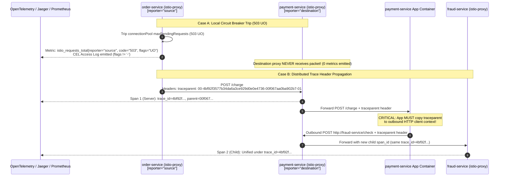

# Week 08: Production Observability, Golden Signals & Distributed Tracing

**Phase 4: Observability, Operations & Capstone** | **Schedule**: Week 08 of 10  
**Authoritative Version Baseline**: `Istio 1.32.0` | `Envoy v1.40` | `Kubernetes 1.36/1.37` | `Gateway API v1.6.1`  
**Core Curriculum Links**:
- 📖 **Technical Lecture**: [Module 07 — Observability and Telemetry (`README.md`)](../../07-observability-and-telemetry/README.md)
- 🧪 **Guided Hands-On Lab**: [Module 07 Lab — `Telemetry` API, Golden Signals, Access Logs & Distributed Tracing (`LAB.md`)](../../07-observability-and-telemetry/LAB.md)

---

## 🎯 Learning Objectives & Required Competencies

By the end of Week 08, you will be able to:
1. **Configure the Modern `telemetry.istio.io/v1` API**: Manage mesh-wide, namespace-scoped, and workload-scoped `Telemetry` resources across all three pillars (`metrics`, `accessLogging`, and `tracing`) without touching legacy `MeshConfig` restarts.
2. **Prevent Prometheus Cardinality Explosions**: Strip high-cardinality attributes, add bounded business dimensions via `tagOverrides` (CEL expressions), and distinguish `reporter="source"` vs `reporter="destination"` time-series semantics.
3. **Engineer High-Signal CEL-Filtered Access Logs**: Configure structured JSON Envoy access logging paired with CEL filters (`response.code >= 400 || response.flags != '-' || duration > duration('1s')`) to capture 100% of failure forensics while cutting log ingestion storage costs by >90%.
4. **Build Multi-Window SLO Burn-Rate Alerts**: Write production PromQL queries for Availability, Latency ($P_{50}/P_{95}/P_{99}$ via `istio_request_duration_milliseconds_bucket`), Saturation, and Traffic across service versions.
5. **Debug & Repair Broken Distributed Traces**: Diagnose orphaned 1-span traces in Jaeger/OpenTelemetry by tracing W3C (`traceparent`, `tracestate`) and B3 (`x-b3-traceid`, `x-b3-spanid`, `x-b3-sampled`) header propagation across application boundaries.

---

## 📅 Monday — Mentor Briefing & Ticket Assignment

### 🎙️ Morning Standup: Briefing from Alex Morgan (Senior Platform Engineer)

> *"Welcome to Phase 4—Production Operations. Over the past seven weeks, you built Zero-Trust security, traffic control, resilience, and progressive delivery for NovaPay. Now comes the hard question: when Black Friday hits `50,000 RPS` at 09:00 UTC, how do we see inside the mesh without blinding ourselves—or bankrupting the company on observability storage?*
>
> *Right now, we have three observability problems in staging:*
> *1. Someone turned on unfiltered text access logging across all Envoy proxies, and we are generating 4.2 TB/day of `200 OK` health-check logs while Maya's SIEM parser is choking on unstructured space-delimited strings.*
> *2. Daniel deployed our new fraud scoring microservice (`fraud-service`), and suddenly every Jaeger trace breaks in half right at `order-service`—we can't trace a slow payment end-to-end.*
> *3. Yesterday, our Prometheus server OOM-killed at 64 GB RAM because an engineer added a custom metric tag using an unbounded header (`x-transaction-id`).*
>
> *This week, you own NovaPay's `telemetry.istio.io/v1` architecture."*

---

### 💬 Peer Engineering Discussion: Cardinality Explosion & The `reporter="source"` vs `"destination"` Debate

**Sarah Chen (SRE Lead)**: *"Let's talk about yesterday's Prometheus OOM crash first. Daniel, I saw your PR adding a `tagOverride` on `istio_requests_total` extracting `request.headers['x-transaction-id']` and `request.headers['x-user-id']` so your team could 'query latency per user in Grafana.' Do you know how many active Prometheus time series that single YAML change created?"*

**Daniel Brooks (Staff Backend Engineer)**: *"Wait—it's just two extra labels on `istio_requests_total`! How bad could two labels be?"*

**Sarah Chen (SRE Lead)**: *"In Prometheus, every unique combination of label values creates a **brand-new time series** in memory and on disk! We processed `800,000` unique `x-transaction-id` values in two hours across 18 histogram buckets (`istio_request_duration_milliseconds_bucket`), 2 reporters (`source` and `destination`), and 4 pods. That is $800,000 \times 18 \times 2 \times 4 = \mathbf{115.2\text{ million active time series}}$! Prometheus is for **low-cardinality aggregated golden signals** (like `x-payment-region` with 4 values or `x-merchant-tier` with 3 values: `free`, `pro`, `enterprise`). Per-transaction or per-user debugging belongs in **Distributed Tracing (OpenTelemetry/Jaeger)** and **CEL-filtered JSON Access Logs**, NEVER in Prometheus metric labels!"*

**Maya Patel (Principal Security Engineer)**: *"And speaking of Access Logs: for PCI-DSS Requirement 10 (Audit Logging), I need structured JSON logs containing `trace_id`, `source_principal` (the verified SPIFFE ID), `response_code`, `response_flags`, and `upstream_cluster`. However, I cannot have raw credit card numbers or sensitive query strings logged, and we shouldn't drown our SIEM in `GET /healthz` `200 OK` noise. Can Istio `1.32.0`'s `Telemetry` API filter access logs dynamically?"*

**Alex Morgan (Senior Platform Engineer)**: *"Yes! Using `telemetry.istio.io/v1`, we bind our structured JSON `envoy` file access log provider in `MeshConfig` and use a `Telemetry` resource with a **CEL (`Common Expression Language`) filter**: `response.code >= 400 || response.flags != '-' || connection.mtls == false`. That way, every single HTTP error, every Envoy circuit-breaker trip (`UO`), timeout (`UT`), or mTLS failure is logged in rich JSON with 100% fidelity, while routine `200 OK` traffic with `response.flags == '-'` is dropped at the proxy with zero disk I/O!"*

**Sarah Chen (SRE Lead)**: *"One more critical detail for everyone writing SLO alerts this week: whenever a caller's circuit breaker trips (`503 UO`) or an outbound call times out before reaching the server (`503 UF` / `504 UT`), **the destination pod never sees the packet**. If your Prometheus alert only checks `reporter="destination"`, your dashboard will show **0% error rate** while customers are getting 100% `503 UO`! Always compare `reporter="source"` (client-side perspective) against `reporter="destination"` (server-side perspective)."*

---

### 🎫 Engineering Ticket: `NP-108` — Production `Telemetry` Pipeline, CEL Access Logs & Distributed Tracing

| Field | Value |
| :--- | :--- |
| **Ticket ID** | `NP-108` |
| **Title** | Implement `telemetry.istio.io/v1` Golden Signals, CEL-Filtered JSON Access Logs & End-to-End Trace Propagation |
| **Assignee** | Platform Engineering Fellow (Cohort 01) |
| **Reviewer** | Sarah Chen (SRE Lead), Maya Patel (Principal Security Engineer) & Alex Morgan |
| **Priority** | `P0 — Observability & PCI Audit Readiness` |
| **Target Environment** | `istio-system`, `novapay`, and `novapay-pci` (`Istio 1.32.0`) |

#### Business Context
NovaPay requires a high-signal, cost-efficient observability architecture that satisfies both SRE Black Friday SLO alerting and PCI-DSS Requirement 10 security auditing without causing Prometheus cardinality explosions or log storage saturation.

#### Technical Requirements & Constraints
1. **Metric Customization & Cardinality Control**:
   - Configure a `Telemetry` resource in `novapay` that adds a bounded business dimension `payment_region` extracted from `request.headers['x-payment-region']` (defaulting to `"unknown"` via CEL `has()` / ternary) to `REQUEST_COUNT` and `REQUEST_DURATION`, while removing high-cardinality or unused default tags where required.
2. **CEL-Filtered JSON Access Logging**:
   - Configure structured JSON access logs enabled **only** for abnormal traffic (`response.code >= 400 || response.flags != '-'`).
3. **Distributed Tracing Sampling & Header Propagation**:
   - Configure OpenTelemetry/Zipkin trace sampling via `Telemetry` and diagnose/fix broken trace context propagation across microservices.
4. **Source vs. Destination SLO PromQL**:
   - Author PromQL queries comparing client-reported (`reporter="source"`) vs server-reported (`reporter="destination"`) error rates and P99 latencies.

---

## 📅 Tuesday — Technical Lectures & Architecture Deep-Dive

### 📚 Assigned Core Reading
Read the complete technical lecture for Module 07 before proceeding:
👉 **[Module 07: Observability and Telemetry — Technical Lecture (`../../07-observability-and-telemetry/README.md`)](../../07-observability-and-telemetry/README.md)**

### 📝 Alex Morgan's Guided Study Notes

1. **The 3-Level `Telemetry` Inheritance Hierarchy**:
   - `telemetry.istio.io/v1` resources follow a strict 3-tier inheritance model:
     1. **Root Namespace (`istio-system`)**: Mesh-wide defaults for all namespaces.
     2. **Namespace Scope (e.g., `novapay` without `selector`)**: Overrides or extends mesh defaults for all workloads in that namespace.
     3. **Workload Scope (e.g., `novapay` with `spec.selector.matchLabels`)**: Overrides settings for specific pods (e.g., temporarily turning on `100%` trace sampling and unfiltered access logging on `payment-service-v2` during a canary rollout!).
2. **Why `reporter="source"` vs. `reporter="destination"` Diverge**:
   - Every mesh-internal HTTP call passes through **two** Envoy proxies:
     - The **Client Sidecar** emits metrics with `reporter="source"`.
     - The **Server Sidecar** emits metrics with `reporter="destination"`.
   - When `reporter="source"` shows `503` (`response_flags="UO"` or `"UF"` or `"NR"`) and `reporter="destination"` shows nothing, the failure happened **in the client proxy or on the network before reaching the server pod**!
   - Conversely, when `VirtualService` retries are enabled (`attempts: 2`) and 1st try fails with `503` on Pod-A while retry #1 succeeds (`200 OK`) on Pod-B:
     - `reporter="destination"` records **one `503` (Pod-A) and one `200` (Pod-B)** (revealing the underlying server flakiness).
     - `reporter="source"` (for the overall logical request outcome or per-attempt stats) reflects the final perceived outcome alongside Envoy's `upstream_rq_retry` counter.
3. **Why Envoy Cannot Auto-Stitch Traces Inside Your Application Binary**:
   - Envoy automatically generates a root trace ID at the Ingress Gateway and creates child spans on every inbound/outbound proxy hop—**if and only if** the application code inside the pod copies the incoming tracing headers (`traceparent`, `tracestate`, `x-request-id`, `x-b3-traceid`, `x-b3-spanid`, `x-b3-parentspanid`, `x-b3-sampled`, `x-b3-flags`) from the inbound HTTP request to every outbound HTTP/gRPC call it makes! Because Envoy has no visibility into which inbound request triggered which outbound goroutine/thread inside your Go/Java process, dropping those headers causes Envoy on the outbound side to treat the call as a brand-new root trace!

---

### 🗺️ Architectural Deep-Dive: Dual-Proxy Telemetry Emission & Trace Context Propagation



#### Istio Standard Metrics (`telemetry.istio.io/v1`) Reference Matrix

| Istio `Telemetry` Metric Enum | Prometheus Metric Name | Metric Type | Key Default Labels | Primary SRE Golden Signal |
| :--- | :--- | :--- | :--- | :--- |
| `REQUEST_COUNT` | `istio_requests_total` | `Counter` | `reporter`, `source_workload`, `destination_service_name`, `destination_version`, `response_code`, `response_flags`, `connection_security_policy` | **Traffic (RPS)** & **Error Rate (%)** |
| `REQUEST_DURATION` | `istio_request_duration_milliseconds` | `Histogram` | Same as above + `le` buckets | **Latency ($P_{50}, P_{90}, P_{99}$)** |
| `REQUEST_SIZE` / `RESPONSE_SIZE` | `istio_request_bytes` / `istio_response_bytes` | `Histogram` | Same as above + `le` buckets | **Payload Bandwidth & Saturation** |
| `TCP_OPENED_CONNECTIONS` / `TCP_CLOSED_CONNECTIONS` | `istio_tcp_connections_opened_total` / `closed_total` | `Counter` | `reporter`, `source_workload`, `destination_service_name`, `connection_security_policy` | **L4 Connection Churn & mTLS Verification** |
| `TCP_SENT_BYTES` / `TCP_RECEIVED_BYTES` | `istio_tcp_sent_bytes_total` / `received_bytes_total` | `Counter` | Same as above | **L4 Database / Kafka Throughput** |

---

## 📅 Wednesday — Guided Labs & Internal Verification

### 🔍 Pre-Flight Environment Verification
```bash
kubectl version --short 2>/dev/null || kubectl version
istioctl version
kubectl get telemetry -A
```

### 🧪 Execute the Core Module 07 Guided Lab
Open and complete all hands-on exercises in the Module 07 Lab Guide:
👉 **[Execute Module 07 Lab (`../../07-observability-and-telemetry/LAB.md`)](../../07-observability-and-telemetry/LAB.md)**

---

### 🔬 Alex Morgan's Internal Verification Checkpoints

#### Checkpoint 1: Inspect Raw Prometheus Metrics Exposed Directly by the Envoy Sidecar (`:15020/stats/prometheus`)
```bash
# Scrape the merged Envoy + Pilot-Agent Prometheus endpoint directly from a pod
kubectl exec -n novapay deploy/order-service -c istio-proxy -- \
  pilot-agent request GET /stats/prometheus | grep -E "^istio_requests_total" | head -n 10
```
*Expected Verification*: Confirm your custom `tagOverrides` (e.g., `payment_region`) and `connection_security_policy="mutual_tls"` appear on the raw time series.

#### Checkpoint 2: Verify CEL Access Log Filter Compilation in Envoy `Listener` Config
```bash
# Confirm Envoy's HTTP Connection Manager access_log filter contains your CEL expression
istioctl proxy-config log deploy/order-service -n novapay
istioctl proxy-config listeners deploy/order-service -n novapay -o json | jq '
  .. | .accessLog? | select(. != null)' | head -n 35
```

#### Checkpoint 3: Verify Trace Context Headers Received by Upstream Workloads
```bash
# Inspect exact tracing headers injected by the client Envoy proxy
kubectl exec -n novapay deploy/frontend -c istio-proxy -- \
  curl -s http://order-service.novapay.svc.cluster.local:8080/headers | grep -iE "traceparent|x-b3-|x-request-id"
```

---

## 📅 Thursday — Independent Engineering Assignment

### 🛠️ Assignment Brief: Authoring NovaPay's Production `Telemetry` & SLO Alerting Suite (`NP-108`)

Sarah and Maya need you to build the production `Telemetry` configuration for the `novapay` namespace and write the accompanying PromQL SLO queries.

#### Architectural Requirements
1. **Mesh/Namespace `Telemetry` Resource (`novapay-observability` in `novapay` namespace)**:
   - **Metrics (`metrics`)**:
     - Provider: `prometheus`
     - Override `REQUEST_COUNT` and `REQUEST_DURATION`:
       - Add tag `payment_region` with CEL value: `has(request.headers['x-payment-region']) ? request.headers['x-payment-region'] : 'unspecified'`
       - Add tag `merchant_tier` with CEL value: `has(request.headers['x-merchant-tier']) ? request.headers['x-merchant-tier'] : 'standard'`
       - Remove (`operation: REMOVE`) the `request_protocol` tag from `REQUEST_COUNT` to save series overhead.
   - **Access Logging (`accessLogging`)**:
     - Provider: `envoy`
     - Filter expression (CEL): `response.code >= 400 || response.flags != '-'` (so only HTTP `4xx`/`5xx` or requests with Envoy anomaly flags like `UO`, `UT`, `UF`, `NR`, `FI` are logged).
   - **Distributed Tracing (`tracing`)**:
     - Random sampling percentage: `15.0` (`15%` baseline sampling in `novapay`).
2. **Canary High-Resolution Workload `Telemetry` (`payment-v2-debug-telemetry` in `novapay` namespace)**:
   - Target selector: `app: payment-service`, `version: v2`
   - Override tracing `randomSamplingPercentage` to `100.0` (`100%` trace capture for canary pods!) and log all requests with latency > 500ms or errors (`response.code >= 400 || response.flags != '-' || duration > duration('500ms')`).

#### Verification Commands to Run Against Your Solution
```bash
# 1. Validate Telemetry resources
istioctl analyze -n novapay
kubectl get telemetry -n novapay

# 2. Generate traffic with custom headers
kubectl exec -n novapay deploy/frontend -c istio-proxy -- \
  curl -s -H "x-payment-region: eu-central" -H "x-merchant-tier: enterprise" \
  http://order-service.novapay.svc.cluster.local:8080/orders

# 3. Verify custom tags appear on order-service Prometheus metrics
kubectl exec -n novapay deploy/order-service -c istio-proxy -- \
  pilot-agent request GET /stats/prometheus | grep 'payment_region="eu-central"'

# 4. Verify 200 OK traffic is NOT logged, while 404/503 traffic IS logged
kubectl logs -n novapay deploy/order-service -c istio-proxy --tail=20
```

---

<details>
<summary>Click to Reveal Reference Solution & Alex's Code Review</summary>

### 📄 Reference Solution (`novapay-telemetry-solution.yaml`)

```yaml
apiVersion: telemetry.istio.io/v1
kind: Telemetry
metadata:
  name: novapay-observability
  namespace: novapay
spec:
  metrics:
    - providers:
        - name: prometheus
      overrides:
        - match:
            metric: REQUEST_COUNT
            mode: CLIENT_AND_SERVER
          tagOverrides:
            payment_region:
              operation: UPSERT
              value: "has(request.headers['x-payment-region']) ? request.headers['x-payment-region'] : 'unspecified'"
            merchant_tier:
              operation: UPSERT
              value: "has(request.headers['x-merchant-tier']) ? request.headers['x-merchant-tier'] : 'standard'"
            request_protocol:
              operation: REMOVE
        - match:
            metric: REQUEST_DURATION
            mode: CLIENT_AND_SERVER
          tagOverrides:
            payment_region:
              operation: UPSERT
              value: "has(request.headers['x-payment-region']) ? request.headers['x-payment-region'] : 'unspecified'"
            merchant_tier:
              operation: UPSERT
              value: "has(request.headers['x-merchant-tier']) ? request.headers['x-merchant-tier'] : 'standard'"
  accessLogging:
    - providers:
        - name: envoy
      filter:
        expression: "response.code >= 400 || response.flags != '-'"
  tracing:
    - randomSamplingPercentage: 15.0
---
apiVersion: telemetry.istio.io/v1
kind: Telemetry
metadata:
  name: payment-v2-debug-telemetry
  namespace: novapay
spec:
  selector:
    matchLabels:
      app: payment-service
      version: v2
  accessLogging:
    - providers:
        - name: envoy
      filter:
        expression: "response.code >= 400 || response.flags != '-' || duration > duration('500ms')"
  tracing:
    - randomSamplingPercentage: 100.0
```

### 📊 Reference PromQL Queries for Sarah Chen's SLO Dashboard

```promql
# 1. Client-Perceived Error Rate vs Server-Perceived Error Rate (Detects Circuit Breaker UO / Network Drops!)
(
  sum by (destination_service_name) (rate(istio_requests_total{reporter="source", destination_service_namespace="novapay", response_code=~"5.*"}[5m]))
  /
  sum by (destination_service_name) (rate(istio_requests_total{reporter="source", destination_service_namespace="novapay"}[5m]))
)
-
(
  sum by (destination_service_name) (rate(istio_requests_total{reporter="destination", destination_service_namespace="novapay", response_code=~"5.*"}[5m]))
  /
  sum by (destination_service_name) (rate(istio_requests_total{reporter="destination", destination_service_namespace="novapay"}[5m]))
)

# 2. P99 Latency by Merchant Tier and Canary Version (Server-Side)
histogram_quantile(0.99,
  sum by (le, destination_version, merchant_tier) (
    rate(istio_request_duration_milliseconds_bucket{
      reporter="destination",
      destination_service_namespace="novapay",
      destination_service_name="payment-service"
    }[5m])
  )
)
```

### 🔍 Alex Morgan's Code Review Notes
- **Always Guard Header Lookups with `has()` in CEL**: If a request arrives without `x-payment-region` and your CEL expression is bare `request.headers['x-payment-region']`, evaluation can fail or default unpredictably. Using `has(request.headers['x-payment-region']) ? ... : 'unspecified'` guarantees a clean, bounded fallback value.
- **Workload-Scoped `Telemetry` Overrides**: Notice how `payment-v2-debug-telemetry` uses `spec.selector.matchLabels` to boost trace sampling to `100%` *only* on `payment-service-v2` canary pods without increasing trace overhead on `v1` or `order-service`!

</details>

---

## 📅 Friday — Incident Simulation (`INC-08`)

### 🚨 PagerDuty Alert: `INC-08` — Broken Jaeger Traces & Prometheus Cardinality Alert

> **📟 PAGERDUTY TRIGGERED — SEV-2**  
> **Service**: `novapay-observability-pipeline`  
> **Incident Commander**: Sarah Chen (SRE Lead)  
> **Alert Condition**: `PrometheusTSDBHeadSeriesChurnHigh` & `JaegerOrphanedSingleSpanTraces > 65%`  
> **Message from Sarah Chen**:  
> *"Team, two observability issues just hit staging after the morning deployment:*
> *1. A junior engineer deployed a `Telemetry` resource named `broken-audit-telemetry` in `novapay`. First, it added `request.headers['x-request-id']` as a Prometheus metric tag—which will OOM Prometheus under load! Second, they tried to filter access logs for errors, but now **ZERO access logs are being emitted even when endpoints return `500` or `503`**!*
> *2. In Jaeger, every checkout request produces three disconnected 1-span traces instead of a single unified trace across `frontend` $\rightarrow$ `order-service` $\rightarrow$ `payment-service`. Inspect the broken `Telemetry` manifest and the application header forwarding code, reproduce the bug, and fix both!"*

---

### 💥 Step 1: Reproduce the Broken State

Examine and apply the broken `Telemetry` resource below:

```yaml
# apply-inc-08-broken.yaml
apiVersion: telemetry.istio.io/v1
kind: Telemetry
metadata:
  name: broken-audit-telemetry
  namespace: novapay
spec:
  metrics:
    - providers:
        - name: prometheus
      overrides:
        - match:
            metric: ALL_METRICS
          tagOverrides:
            # BUG 1: High-cardinality UUID per request!
            request_uuid:
              operation: UPSERT
              value: "request.headers['x-request-id']"
  accessLogging:
    - providers:
        - name: envoy
      # BUG 2: Why does this suppress 100% of access logs?
      disabled: true
      filter:
        expression: "response.code >= 500 && response.code < 400"
```

And inspect the outbound HTTP client snippet inside `order-service`'s handler (`order_handler.go`):
```go
// BUG 3: How order-service calls payment-service
func forwardToPaymentService( incomingReq *http.Request, payload io.Reader ) (*http.Response, error) {
    // Creates a brand-new background context and fresh HTTP request with zero incoming headers!
    outReq, _ := http.NewRequestWithContext(context.Background(), "POST", "http://payment-service.novapay.svc.cluster.local:8080/charge", payload)
    outReq.Header.Set("Content-Type", "application/json")
    return http.DefaultClient.Do(outReq)
}
```

---

### 🔍 Step 2: Diagnostic Evidence & Investigation Steps

1. **Inspect the `Telemetry` resource and test `503` access log emission**:
   ```bash
   kubectl get telemetry broken-audit-telemetry -n novapay -o yaml
   ```
2. **Look at `request_uuid` cardinality on the Envoy Prometheus endpoint**:
   ```bash
   kubectl exec -n novapay deploy/order-service -c istio-proxy -- \
     pilot-agent request GET /stats/prometheus | grep "request_uuid=" | head -n 10
   ```

---

<details>
<summary>Click to Reveal Root Cause Analysis (RCA), Remediation & Postmortem</summary>

### 🧠 Root Cause Analysis (RCA)

1. **Bug #1 — Unbounded High-Cardinality Metric Label (`request_uuid: request.headers['x-request-id']`)**:
   - Every HTTP request in Envoy has a unique UUID v4 `x-request-id`. Injecting `x-request-id` into `ALL_METRICS` (`istio_requests_total`, `istio_request_duration_milliseconds_bucket`, `istio_request_bytes_bucket`, `istio_response_bytes_bucket`) creates ~40 new Prometheus time series **per single HTTP request**, guaranteeing rapid Prometheus TSDB memory exhaustion.
2. **Bug #2 — `disabled: true` + Contradictory CEL Expression (`response.code >= 500 && response.code < 400`)**:
   - First, `accessLogging[0].disabled: true` explicitly disables the access log provider across the namespace!
   - Second, the CEL expression `response.code >= 500 && response.code < 400` is a mathematical impossibility (no integer is simultaneously $\ge 500$ AND $< 400$), so even with `disabled: false`, it evaluates to `false` for 100% of requests. It should be `response.code >= 400 || response.flags != '-'`.
3. **Bug #3 — Missing W3C/B3 Trace Context Header Propagation in `order-service`**:
   - In `order_handler.go`, `forwardToPaymentService` used `context.Background()` and created a fresh `http.Request` without copying the incoming tracing headers (`traceparent`, `tracestate`, `x-request-id`, `x-b3-traceid`, `x-b3-spanid`, `x-b3-parentspanid`, `x-b3-sampled`, `x-b3-flags`). When the outbound call hit `order-service`'s Envoy sidecar, Envoy saw no trace headers and initiated a brand-new disconnected trace ID!

### 🛠️ Remediation

1. **Fix the `Telemetry` Resource**:
```yaml
apiVersion: telemetry.istio.io/v1
kind: Telemetry
metadata:
  name: broken-audit-telemetry
  namespace: novapay
spec:
  metrics:
    - providers:
        - name: prometheus
      overrides:
        - match:
            metric: ALL_METRICS
          tagOverrides:
            # Remove unbounded tag if previously injected or replace with bounded header
            merchant_tier:
              operation: UPSERT
              value: "has(request.headers['x-merchant-tier']) ? request.headers['x-merchant-tier'] : 'standard'"
  accessLogging:
    - providers:
        - name: envoy
      disabled: false
      filter:
        expression: "response.code >= 400 || response.flags != '-'"
```

2. **Propagate Trace Context Headers in Application Code (`order_handler.go`)**:
```go
var traceHeaders = []string{
    "x-request-id",
    "traceparent",
    "tracestate",
    "x-b3-traceid",
    "x-b3-spanid",
    "x-b3-parentspanid",
    "x-b3-sampled",
    "x-b3-flags",
}

func forwardToPaymentService(incomingReq *http.Request, payload io.Reader) (*http.Response, error) {
    outReq, err := http.NewRequestWithContext(incomingReq.Context(), "POST", "http://payment-service.novapay.svc.cluster.local:8080/charge", payload)
    if err != nil {
        return nil, err
    }
    outReq.Header.Set("Content-Type", "application/json")
    for _, h := range traceHeaders {
        if val := incomingReq.Header.Get(h); val != "" {
            outReq.Header.Set(h, val)
        }
    }
    return http.DefaultClient.Do(outReq)
}
```

</details>

---

## 📅 Saturday — Architecture Review & Mentor Office Hours

### 🏛️ Weekly Architecture Defense Questions

1. **Alex Morgan (Envoy Internals)**: *"When you query `istio_requests_total` in Prometheus, every normal mesh-internal request appears **twice**—once with `reporter="source"` and once with `reporter="destination"`. If an engineer writes `sum(rate(istio_requests_total{destination_service_name="payment-service"}[5m]))` without filtering on `reporter`, what mistake did they just make?"*
2. **Sarah Chen (SRE & Alerting)**: *"Suppose our `payment-service` P99 latency alert fires on `reporter="source"` (`1.8s`), but `reporter="destination"` shows P99 latency is only `45ms`. Give me three concrete root causes that explain a `1,755ms` gap between client-side and server-side Envoy histograms."*
3. **Daniel Brooks (Backend Engineering)**: *"Why do I have to write code in my Go/Java microservices to forward 8 tracing headers when we already have an Istio Envoy sidecar in every pod? Why can't Envoy correlate inbound and outbound requests automatically?"*
4. **Maya Patel (Security & Compliance)**: *"In `istio_requests_total`, what label proves to our PCI-DSS auditor that 100% of traffic arriving at `payment-service` in `novapay-pci` was encrypted with mutual TLS, and what label proves the cryptographic SPIFFE identity of the caller?"*

---

### ☕ Alex Morgan's Office Hours Q&A

**Q1: *"Alex, what are the three concrete causes for `reporter="source"` latency being `1.8s` while `reporter="destination"` latency is `45ms`?"***  
> **Alex**: *"This is one of my favorite Staff-level interview questions! Here are the three classic culprits:*
> 1. ***Envoy Retries / Timeout on First Try**: Try #1 from the caller hit a blackholed/unresponsive pod or dropped SYN packet and timed out after `1.5s` (`perTryTimeout`), never reaching a destination Envoy HTTP filter, and Retry #1 succeeded on a healthy pod in `45ms`. The destination histogram only recorded the `45ms` success, while the source histogram recorded the total end-to-end client wait time (`1.5s + backoff + 45ms`)!*
> 2. ***Connection Pool Queuing (`http1MaxPendingRequests`) + mTLS Handshake Latency**: The request sat in the client Envoy's pending connection queue waiting for an active slot to free up, or waited on initial TCP + mTLS handshake establishment before the HTTP request headers were ever transmitted to the server sidecar.*
> 3. ***Client-Side Fault Injection (`VirtualService.fault.delay`)**: A `fixedDelay` fault rule was evaluated on the client sidecar before sending the request over the wire."*

**Q2: *"Which Prometheus labels verify mTLS and SPIFFE principals for Maya's PCI audit?"***  
> **Alex**: *"`connection_security_policy="mutual_tls"` (on `reporter="destination"`) proves the inbound connection was terminated via strict mTLS, and `source_principal="spiffe://cluster.local/ns/novapay/sa/order-service-sa"` alongside `destination_principal="spiffe://cluster.local/ns/novapay-pci/sa/payment-service-sa"` proves the exact X.509 SAN identities!"*

---

## 📅 Sunday — Weekly Assessment & Reflection

### 📝 Week 08 Competency Assessment

#### Question 1: `reporter="source"` vs `reporter="destination"` Forensics
During an incident, `order-service` calls `payment-service`. Every request is rejected locally by `order-service`'s Envoy sidecar because `payment-service`'s `DestinationRule` circuit breaker (`http2MaxRequests`) is full (`503 UO`).
1. What HTTP status code and `response_flags` will appear in `istio_requests_total{reporter="source"}`?
2. What will appear in `istio_requests_total{reporter="destination"}` for those rejected requests?

#### Question 2: CEL Access Log Filtering
Write a valid CEL `filter.expression` for a `Telemetry` resource that logs an Envoy access log entry **if and only if**:
- The HTTP status code is `400` or higher, **OR**
- The Envoy response flags are not `'-'`, **OR**
- The request took longer than `1.5 seconds` (`1500ms`).

#### Question 3: Distributed Tracing Header Propagation
List the W3C Trace Context headers and the B3 multi-header propagation headers that an application must forward from inbound HTTP requests to outbound HTTP requests to maintain unbroken trace trees in Istio `1.32.0`.

#### Question 4: Cardinality Calculation
A service receives `5,000 RPS`. An engineer adds a `tagOverride` on `istio_request_duration_milliseconds` (which has **20 histogram buckets**) using `request.headers['x-session-id']`. If `100,000` unique user sessions hit the service across `5` pod replicas (`2` reporters: `source` and `destination`), how many new Prometheus time series are created by this single histogram metric?

#### Question 5: `Telemetry` Scope Precedence
You have a root-namespace `Telemetry` in `istio-system` setting `randomSamplingPercentage: 1.0`. You create a namespace-wide `Telemetry` in `novapay` setting `randomSamplingPercentage: 10.0` and an `accessLogging` CEL filter. Then you create a workload-scoped `Telemetry` (matching `app: payment-service`) in `novapay` that *only* sets `randomSamplingPercentage: 100.0` (and omits `accessLogging`). What is the effective `randomSamplingPercentage` and `accessLogging` configuration for `payment-service` pods?

---

<details>
<summary>Assessment Answer Key</summary>

1. **Question 1 Answer**:
   - **(1)** `reporter="source"` increments `istio_requests_total` with `response_code="503"` and `response_flags="UO"`.
   - **(2)** `reporter="destination"` records **nothing** (`0` increments) for those rejected requests because `503 UO` short-circuits locally inside the client Envoy proxy before any packet leaves the source pod.

2. **Question 2 Answer**:
   ```cel
   response.code >= 400 || response.flags != '-' || duration > duration('1500ms')
   ```

3. **Question 3 Answer**:
   - **W3C Trace Context**: `traceparent`, `tracestate`
   - **Envoy Request Correlation**: `x-request-id`
   - **B3 Headers (Zipkin/Jaeger)**: `x-b3-traceid`, `x-b3-spanid`, `x-b3-parentspanid`, `x-b3-sampled`, `x-b3-flags` (plus single-header `b3` if used).

4. **Question 4 Answer**:
   - $100,000 \text{ sessions} \times 20 \text{ buckets} \times 5 \text{ pods} \times 2 \text{ reporters} = \mathbf{20,000,000 \text{ (20 million) new time series}}$.

5. **Question 5 Answer**:
   - `Telemetry` merges across scopes per feature domain (`metrics`, `accessLogging`, `tracing`). Therefore, `payment-service` pods get `randomSamplingPercentage: 100.0` from the workload-scoped `Telemetry` AND inherit the `accessLogging` CEL filter from the `novapay` namespace-scoped `Telemetry`!

</details>

---

### ✅ Weekly Competency Sign-Off Checklist

- [ ] Read [Module 07 `README.md`](../../07-observability-and-telemetry/README.md) and mastered `telemetry.istio.io/v1` inheritance and golden signals.
- [ ] Completed all exercises in [Module 07 `LAB.md`](../../07-observability-and-telemetry/LAB.md) on `Istio 1.32.0`.
- [ ] Verified custom Prometheus tags and CEL access log filtering via `:15020/stats/prometheus` and `kubectl logs`.
- [ ] Authored and validated the `NP-108` `Telemetry` manifests and SLO PromQL queries.
- [ ] Resolved `INC-08` (Cardinality explosion, `disabled: true` / broken CEL log filter, and missing trace context headers).
- [ ] Updated your progress tracker in [`../../PROGRESSION_DASHBOARD.md`](../../PROGRESSION_DASHBOARD.md).

### 💭 Weekly Retrospective Prompts
1. *If you look at your current Prometheus server's top 10 highest-cardinality metrics (`tsdb-status`), which labels are contributing the most series churn?*
2. *Do all of your internal microservices use a shared HTTP/gRPC middleware library that automatically forwards W3C `traceparent` and `x-request-id` headers?*
