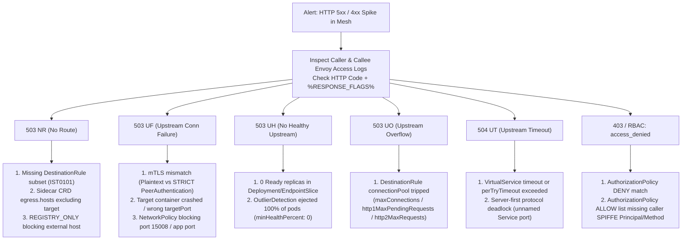

[Fellowship Portal](../../README.md) · [Handbook](../../FELLOWSHIP_HANDBOOK.md) · [Progression Dashboard](../../PROGRESSION_DASHBOARD.md) · [<- Previous Week](../week-08-observability-and-golden-signals/WEEK.md) · **Week 09 of 10** · [Next Week ->](../week-10-capstone-and-graduation-defense/WEEK.md)

# Week 09: Incident Response, Deep xDS Debugging & Zero-Downtime Control Plane Upgrades

**Phase 4: Observability, Operations & Capstone** | **Schedule**: Week 09 of 10  
**Authoritative Version Baseline**: `Istio 1.32.0` (with `1.31.0` as $N-1$ Canary Baseline) | `Envoy v1.40` | `Kubernetes 1.36/1.37` | `Gateway API v1.6.1`  
**Core Curriculum Links**:
- 📖 **Technical Lecture 1**: [Module 08 — Debugging, Troubleshooting & Production Operations (`README.md`)](../../08-debugging-and-production-operations/README.md)
- 📖 **Technical Lecture 2**: [Module 09 — Production Checklists & Architectural Reference (`README.md`)](../../09-production-checklists-and-reference/README.md)
- 🧪 **Guided Hands-On Lab**: [Module 08 Lab — The 5-Scenario Diagnostic Gauntlet & Revision Canary Upgrade (`LAB.md`)](../../08-debugging-and-production-operations/LAB.md)

> [!NOTE]
> ### Where You Are & What You Need Before Starting
> - **Current Phase**: Phase 4 — Observability, Operations & Capstone (Week 09 of 10)
> - **Prerequisites**: Completed Weeks 01–08 (xDS internals, traffic routing, mTLS/RBAC, resilience, progressive delivery, and `Telemetry`)
> - **Estimated Time**: ~6–8 hours
> - **Tangible Weekly Deliverable**: Resolution of the 5-Scenario Game-Day Troubleshooting Gauntlet, zero-downtime `1-31-0 -> 1-32-0` revision-based canary control-plane upgrade, and Day-2 pod lifecycle hardening (`NP-109`)

---

## 🎯 Learning Objectives & Required Competencies

By the end of Week 09, you will be able to:
1. **Execute the Systematic 5-Step Istio Triage Runbook**: Diagnose any data-plane or control-plane failure in under 5 minutes using `istioctl proxy-status`, `istioctl analyze`, Envoy access log `%RESPONSE_FLAGS%`, `istioctl proxy-config (listeners|routes|clusters|endpoints|secret)`, and Envoy `:15000` admin diagnostics.
2. **Execute Zero-Downtime Revision-Based Canary Control Plane Upgrades**: Upgrade `istiod` from `1.31.0` (`revision: 1-31-0`) to `1.32.0` (`revision: 1-32-0`), migrate namespaces via `istio.io/rev` labels (or `istioctl tag`), and roll back cleanly without dropping a single in-flight payment transaction.
3. **Eliminate Pod Startup & Shutdown Race Conditions**: Configure Kubernetes `1.36+` Native Sidecars (`ENABLE_NATIVE_SIDECARS=true`), `holdApplicationUntilProxyStarts: true` for legacy init flows, `EXIT_ON_ZERO_ACTIVE_CONNECTIONS=true` for zero-503 pod termination, and clean `Job`/`CronJob` completion (`POST /quitquitquit` or native sidecar lifecycle).
4. **Prevent `istiod` Control Plane OOMs & xDS Push Storms**: Scope every namespace with explicit `Sidecar` resources (`egress.hosts`) and monitor `pilot_xds_pushes`, `pilot_proxy_convergence_time`, and `pilot_conflict_*` metrics.
5. **Audit Pre-Production Mesh Configurations**: Run comprehensive pre-launch readiness audits using the Module 09 Day-0, Day-1, and Day-2 Production Checklists.

---

## 📅 Monday — Mentor Briefing & Ticket Assignment

### 🎙️ Morning Standup: Briefing from Alex Morgan (Senior Platform Engineer)

> *"Welcome to Week 09—our final operational training week before next week's Capstone Graduation Board. Up to now, you've engineered individual subsystems when you knew which topic we were studying. In real life, PagerDuty doesn't wake you up at 03:00 AM with a helpful label saying 'This is a Module 04 mTLS bug' or 'This is a Module 03 VirtualService bug.' It wakes you up with: **`Checkout 503 rate at 42% — Fix it NOW`***
>
> *This week has two major operational pillars:*
> *1. **The Game-Day War-Room Gauntlet**: We are throwing 5 simultaneous mystery production failures at you across routing, mTLS, circuit breaking, `Sidecar` egress scoping, and Kubernetes `Service` port protocol sniffing.*
> *2. **Zero-Downtime Control Plane Upgrade (`1.31.0` $\rightarrow$ `1.32.0`)**: Next Monday is our production freeze before Black Friday. We must upgrade our production control plane from `1.31.0` to `1.32.0` to pick up a critical Envoy CVE patch—with **zero dropped packets** and an instant rollback path."*

---

### 💬 Peer Engineering Discussion: In-Place Upgrades vs. Revision Canary Upgrades & Pod Drain Races

**Daniel Brooks (Staff Backend Engineer)**: *"Alex, why are we making the `1.31.0` to `1.32.0` upgrade so complicated with revisions (`istio.io/rev=1-32-0`)? In our dev cluster, I just ran `istioctl upgrade -y` in-place and it finished in 45 seconds!"*

**Sarah Chen (SRE Lead)**: *"Daniel, do you remember what happened in production 18 months ago when we ran an in-place control plane upgrade across 600 pods? The in-place upgrade overwrote the single `istiod` deployment in `istio-system`. Unfortunately, a subtle Envoy filter deprecation broke our custom Lua header filter. Because there was only one `istiod` in the cluster, **all 600 pods received the broken xDS configuration push simultaneously inside 3 seconds**, taking down 100% of NovaPay globally! Rolling back took 22 minutes of frantic Helm state recovery."*

**Alex Morgan (Senior Platform Engineer)**: *"With a **Revision-Based Canary Upgrade**, we never overwrite the running control plane. We install `istiod-1-32-0` **side-by-side** with `istiod-1-31-0` in `istio-system`. At that moment, 100% of existing pods are still connected to `istiod-1-31-0`—blast radius is **zero**. Then we relabel a single non-critical namespace (or one canary deployment) from `istio.io/rev=1-31-0` to `istio.io/rev=1-32-0` and perform a rolling restart. Only those pods inject the `1.32.0` Envoy proxy and connect to `istiod-1-32-0`. If anything goes wrong, we flip the namespace label back to `1-31-0`, restart the deployment, and we are back on stable `1.31.0` in 30 seconds."*

**Maya Patel (Principal Security Engineer)**: *"Wait—when `istiod-1-31-0` and `istiod-1-32-0` are running side-by-side in `istio-system`, can a pod managed by `istiod-1-31-0` still establish `STRICT` mTLS with a pod managed by `istiod-1-32-0`?"*

**Alex Morgan (Senior Platform Engineer)**: *"Yes, **because both revisions share the exact same Root CA secret (`cacerts` / `istio-ca-secret`) in `istio-system` and the same `trustDomain` (`cluster.local`)**! That means workloads on `1-31-0` and workloads on `1-32-0` communicate seamlessly over `STRICT` mTLS during the entire multi-day migration window."*

**Daniel Brooks (Staff Backend Engineer)**: *"One more operational pain point my team hits every day: whenever Kubernetes scales down a `payment-service` pod or rolls a new deployment, we see 5 to 10 seconds of `503 UC` / connection reset errors, AND our nightly settlement `CronJob` pods hang forever in `NotReady (1/2)` after the Go binary exits `0` because `istio-proxy` stays alive! Can we fix both this week?"*

**Alex Morgan (Senior Platform Engineer)**: *"We are fixing both in Ticket `NP-109`. In Kubernetes `1.36+` with Istio `1.32.0`, enabling `ENABLE_NATIVE_SIDECARS=true` runs `istio-proxy` as a native Kubernetes sidecar container (`restartPolicy: Always` inside `initContainers`). Kubernetes guarantees `istio-proxy` starts *before* your app container starts, and automatically terminates `istio-proxy` the moment your `Job` container exits! Pair that with `EXIT_ON_ZERO_ACTIVE_CONNECTIONS="true"` and a `preStop` sleep hook, and pod termination `503`s drop to zero."*

---

### 🎫 Engineering Ticket: `NP-109` — Game-Day Diagnostic Gauntlet, Lifecycle Hardening & `1.31.0` $\rightarrow$ `1.32.0` Upgrade

| Field | Value |
| :--- | :--- |
| **Ticket ID** | `NP-109` |
| **Title** | Resolve 5 Production Outage Scenarios, Harden Pod Lifecycle (`Jobs`/Drains), and Execute Revision Canary Upgrade (`1-31-0` $\rightarrow$ `1-32-0`) |
| **Assignee** | Platform Engineering Fellow (Cohort 01) |
| **Reviewer** | Alex Morgan (Senior Platform Engineer) & Sarah Chen (SRE Lead) |
| **Priority** | `P0 — Pre-Black Friday Production Readiness` |
| **Target Environment** | `istio-system`, `novapay`, and `novapay-pci` (`Istio 1.31.0` $\rightarrow$ `1.32.0`) |

#### Business Context
Before final production freeze, every NovaPay Platform Engineer must pass the 5-Scenario Game-Day Troubleshooting Gauntlet, eliminate pod lifecycle race conditions (`CronJob` hangs and rolling-update `503`s), and execute a zero-downtime control plane upgrade from `1.31.0` to `1.32.0`.

#### Technical Requirements & Constraints
1. **Complete the 5-Scenario Diagnostic Gauntlet** in Module 08 `LAB.md` (`503 NR`, `503 UF`, `503 UO`, Sidecar Egress Blackhole, and Service Port Protocol Sniffing Mismatch).
2. **Execute the Revision-Based Canary Upgrade** (`1-31-0` $\rightarrow$ `1-32-0`) and verify xDS convergence across revisions.
3. **Pod Lifecycle & Pre-Production Audit**: Configure zero-downtime pod draining (`EXIT_ON_ZERO_ACTIVE_CONNECTIONS`) and Kubernetes `Job` sidecar lifecycle termination, and audit manifests against Module 09 checklists.

---

## 📅 Tuesday — Technical Lectures & Architecture Deep-Dive

### 📚 Assigned Core Reading & Modular Lessons
Study the complete operational references and progressive lessons in Modules 08 and 09 before proceeding:
- 👉 **Core Module 08 Overview**: **[Module 08: Debugging, Troubleshooting & Production Operations (`../../08-debugging-and-production-operations/README.md`)](../../08-debugging-and-production-operations/README.md)**
- **Modular Deep-Dive Lessons**:
  1. [Lesson 08.1: The 5-Step Debugging Methodology & Envoy Response Flags](../../08-debugging-and-production-operations/lessons/01-systematic-debugging-and-response-flags.md)
  2. [Lesson 08.2: Production Operational Pitfalls & Canary Control Plane Upgrades](../../08-debugging-and-production-operations/lessons/02-production-pitfalls-and-canary-control-plane-upgrades.md)
- 👉 **Core Module 09 Reference**: **[Module 09: Production Readiness Checklists & Quick Reference (`../../09-production-checklists-and-reference/README.md`)](../../09-production-checklists-and-reference/README.md)**

### 📝 Alex Morgan's Guided Study Notes

1. **The 5-Step Systematic xDS Triage Methodology**:
   - Never guess or randomly delete pods! Always follow the deterministic chain:
     - **Step 1 (`istioctl proxy-status`)**: Are all proxies `SYNCED` with `istiod`? If a proxy says `STALE`, `istiod` is overloaded, network-blocked on port `15012`, or the pod is orphaned on a deleted revision.
     - **Step 2 (`istioctl analyze -A`)**: Catch schema conflicts, missing `DestinationRule` subsets (`IST0101`), multiple `VirtualService` definitions for the same host (`IST0109`), or conflicting namespace injection labels (`IST0135`).
     - **Step 3 (Envoy Access Log `%RESPONSE_FLAGS%`)**: Read the exact failure code (`NR`, `UF`, `UH`, `UO`, `UT`, `UC`, `DC`, `URX`, `NC`).
     - **Step 4 (`istioctl proxy-config listener|route|cluster|endpoint|secret`)**: Walk the packet path inside Envoy (`Listener` $\rightarrow$ `RouteConfiguration` $\rightarrow$ `Cluster` $\rightarrow$ `ClusterLoadAssignment/Endpoints` $\rightarrow$ `SDS Secret`).
     - **Step 5 (Envoy `:15000` Admin API / `istioctl experimental describe pod`)**: Inspect live counters, RBAC policies, and mTLS status.
2. **Why Missing Service Port Naming Causes Protocol Sniffing Disasters**:
   - If a Kubernetes `Service` port is named `port: 8080, name: custom-port` (instead of `http-api` or `grpc-orders` or `tcp-redis`, or setting `appProtocol: http`), Envoy falls back to **protocol sniffing** (waiting for the client to send the first bytes to guess HTTP vs TCP).
   - For **Server-First protocols** (like MySQL, SMTP, MongoDB, or custom TCP protocols where the *server* speaks first after TCP handshake), protocol sniffing causes a **deadlock timeout** because Envoy waits for the client to send bytes while the client waits for the server's greeting banner! Always explicitly name every `Service` port (`<protocol>[-<suffix>]`) or set `appProtocol`.
3. **Why Graceful Pod Termination Fails Without Coordination**:
   - When Kubernetes deletes a pod, it sends `SIGTERM` to `istio-proxy` and your application container **at the exact same time**, while asynchronously removing the pod IP from `EndpointSlice` across the cluster (which takes 1–3 seconds to reach remote Envoy sidecars via `istiod` EDS pushes).
   - If `istio-proxy` exits immediately or stops accepting connections in `<1s`, in-flight requests from remote pods that haven't received the EDS removal push yet hit a closed socket (`503 UF` / `503 UC`).
   - Setting `EXIT_ON_ZERO_ACTIVE_CONNECTIONS: "true"` in `proxyMetadata` plus `terminationDrainDuration: 15s` ensures Envoy stays alive until all active connections drain cleanly!

---

### 🗺️ Architectural Deep-Dive: Master Envoy `%RESPONSE_FLAGS%` Diagnostic Decision Tree



---

## 📅 Wednesday — Guided Labs & Internal Verification

### 🔍 Pre-Flight Environment Verification
```bash
kubectl version --short 2>/dev/null || kubectl version
istioctl version
istioctl proxy-status
```

### 🧪 Execute the Core Module 08 Guided Lab
Open and complete all hands-on exercises in the Module 08 Lab Guide (including the 5-Scenario Diagnostic Gauntlet and the Canary Control Plane Upgrade):
👉 **[Execute Module 08 Lab (`../../08-debugging-and-production-operations/LAB.md`)](../../08-debugging-and-production-operations/LAB.md)**

---

### 🔬 Alex Morgan's Internal Verification Checkpoints

#### Checkpoint 1: Verify `istiod` Control Plane Health & xDS Push Latency
```bash
# Inspect istiod internal metrics for push errors, conflicts, and convergence time
kubectl exec -n istio-system deploy/istiod -c discovery -- \
  pilot-agent request GET /metrics | grep -E "^(pilot_xds_pushes|pilot_conflict_|pilot_k8s_cfg_events)"
```

#### Checkpoint 2: Verify Revision Ownership During Canary Control Plane Upgrade (`1-31-0` vs `1-32-0`)
```bash
# Confirm which istiod revision manages each proxy in the cluster
istioctl proxy-status
```
*Expected Verification*: Look at the `ISTIOOD` column in `istioctl proxy-status`—migrated workloads must bind to `istiod-1-32-0-...` while un-migrated workloads remain bound to `istiod-1-31-0-...`.

#### Checkpoint 3: Use `istioctl experimental describe pod` for Instant End-to-End Pod Diagnostics
```bash
istioctl experimental describe pod -n novapay $(kubectl get pod -n novapay -l app=payment-service -o jsonpath='{.items[0].metadata.name}')
```

---

## 📅 Thursday — Independent Engineering Assignment

### 🛠️ Assignment Brief: Pod Lifecycle Hardening, `Sidecar` Scoping & Revision Migration (`NP-109`)

Alex and Sarah need you to create the production operations manifest bundle (`novapay-ops-hardening.yaml`) that solves three critical Day-2 production issues in `novapay`:

#### Architectural Requirements
1. **Control Plane xDS Memory Scoping (`Sidecar: novapay-default-sidecar`)**:
   - Create a namespace-wide `Sidecar` resource in `novapay` (no `workloadSelector`) that restricts outbound xDS configuration (`egress.hosts`) so proxies in `novapay` **only** receive Envoy clusters/endpoints for:
     - `./*` (all services in `novapay`)
     - `novapay-pci/*` (services in `novapay-pci`, like `payment-service`)
     - `istio-system/*` (control plane & telemetry collectors)
   - Set `outboundTrafficPolicy.mode: REGISTRY_ONLY` to block undeclared external internet egress at the proxy layer.
2. **Zero-Downtime Pod Drain & Graceful Termination (`Deployment: payment-service-v1`)**:
   - Configure pod template annotations (`proxy.istio.io/config`) on `payment-service-v1` so that:
     - `holdApplicationUntilProxyStarts: true` ensures the Go payment binary never attempts an outbound DB/mesh connection before Envoy is `Ready`.
     - `terminationDrainDuration: 20s` and `proxyMetadata.EXIT_ON_ZERO_ACTIVE_CONNECTIONS: "true"` ensure Envoy drains active payment streams cleanly during rolling updates before exiting.
3. **Kubernetes `Job` Clean Completion (`Job: nightly-ledger-reconciliation`)**:
   - Write a Kubernetes `Job` manifest in `novapay` that runs a batch reconciliation command (`curl` to `order-service`) and cleanly terminates the pod (`Completed 0/2`) using either Kubernetes 1.36+ Native Sidecars or an explicit `POST http://127.0.0.1:15020/quitquitquit` trap hook so the `Job` never hangs indefinitely!

#### Verification Commands to Run Against Your Solution
```bash
# 1. Verify Sidecar CRD reduced outbound clusters on frontend proxy
istioctl proxy-config clusters deploy/frontend -n novapay | wc -l

# 2. Verify proxy.istio.io/config lifecycle settings on payment-service pod
kubectl get pod -n novapay -l app=payment-service -o jsonpath='{.items[0].metadata.annotations.proxy\.istio\.io/config}{"\n"}'

# 3. Verify the reconciliation Job reaches Completed status (and does not hang at 1/2 Ready)
kubectl get job nightly-ledger-reconciliation -n novapay
```

---

<details>
<summary>Need a Hint from Alex Morgan? (Click before revealing the full answer)</summary>

> **Alex's Coaching Hints**:
> 1. **`Sidecar` Egress & Outbound Lockdown**: In `Sidecar/novapay-default-sidecar`, set `spec.outboundTrafficPolicy.mode: REGISTRY_ONLY` and `spec.egress[0].hosts: ["./*", "novapay-pci/*", "istio-system/*"]`.
> 2. **Graceful Pod Drain Timing**: In `Deployment/payment-service-v1`, set `proxy.istio.io/config` with `holdApplicationUntilProxyStarts: true`, `terminationDrainDuration: 20s`, and `proxyMetadata.EXIT_ON_ZERO_ACTIVE_CONNECTIONS: "true"`. Make sure the pod's `terminationGracePeriodSeconds` (`35`) is strictly larger than `20s`, and add a `lifecycle.preStop` `sleep 5` hook on the app container so EDS endpoint removal propagates before connections close!
> 3. **Clean Batch `Job` Exit**: In `Job/nightly-ledger-reconciliation`, add `trap 'curl -sf -X POST http://127.0.0.1:15020/quitquitquit' EXIT` to the shell script (or rely on K8s 1.36+ native sidecar lifecycle) so `pilot-agent` shuts down `istio-proxy` as soon as the batch job finishes.

</details>

<details>
<summary>Click to Reveal Reference Solution & Alex's Code Review</summary>

### 📄 Reference Solution (`novapay-ops-hardening-solution.yaml`)

```yaml
apiVersion: networking.istio.io/v1
kind: Sidecar
metadata:
  name: novapay-default-sidecar
  namespace: novapay
spec:
  outboundTrafficPolicy:
    mode: REGISTRY_ONLY
  egress:
    - hosts:
        - "./*"
        - "novapay-pci/*"
        - "istio-system/*"
---
apiVersion: apps/v1
kind: Deployment
metadata:
  name: payment-service-v1
  namespace: novapay
spec:
  replicas: 2
  selector:
    matchLabels:
      app: payment-service
      version: v1
  template:
    metadata:
      labels:
        app: payment-service
        version: v1
      annotations:
        proxy.istio.io/config: |
          holdApplicationUntilProxyStarts: true
          terminationDrainDuration: 20s
          proxyMetadata:
            EXIT_ON_ZERO_ACTIVE_CONNECTIONS: "true"
    spec:
      terminationGracePeriodSeconds: 35
      serviceAccountName: payment-service-sa
      containers:
        - name: payment-service
          image: curlimages/curl:8.10.1
          command: ["/bin/sh", "-c", "sleep infinity"]
          lifecycle:
            preStop:
              exec:
                command: ["/bin/sh", "-c", "sleep 5"]
---
apiVersion: batch/v1
kind: Job
metadata:
  name: nightly-ledger-reconciliation
  namespace: novapay
spec:
  backoffLimit: 1
  template:
    metadata:
      labels:
        app: ledger-reconciler
      annotations:
        proxy.istio.io/config: |
          holdApplicationUntilProxyStarts: true
    spec:
      restartPolicy: Never
      containers:
        - name: reconciler
          image: curlimages/curl:8.10.1
          command:
            - /bin/sh
            - -c
            - |
              trap 'curl -sf -X POST http://127.0.0.1:15020/quitquitquit' EXIT
              echo "Starting nightly NovaPay ledger reconciliation..."
              curl -sf http://order-service.novapay.svc.cluster.local:8080/orders
              echo "Reconciliation complete."
```

### 🔍 Alex Morgan's Code Review Notes
1. **Why `trap 'curl -sf -X POST http://127.0.0.1:15020/quitquitquit' EXIT` Works Every Time**:
   - Even if the batch script inside `reconciler` exits with a non-zero error code halfway through, the shell `EXIT` trap guarantees `POST http://127.0.0.1:15020/quitquitquit` is sent to `pilot-agent`, cleanly shutting down `istio-proxy` so Kubernetes can mark the pod `Completed` or failed and schedule retries (`backoffLimit`). (And when `ENABLE_NATIVE_SIDECARS=true` is enabled on `istiod`, Kubernetes 1.36+ handles native sidecar termination automatically!)
2. **Why `terminationGracePeriodSeconds: 35` > `terminationDrainDuration: 20s`**:
   - Always set the Kubernetes pod's `terminationGracePeriodSeconds` (`35s`) strictly greater than Envoy's `terminationDrainDuration` (`20s`) so `kubelet` does not send a brutal `SIGKILL` (`kill -9`) to Envoy while it is still draining active connections!

</details>

---

## 📅 Friday — Incident Simulation (`INC-09`)

### 🚨 PagerDuty Alert: `INC-09` — Botched Canary Control Plane Upgrade (`STALE` Proxies & Conflicting Webhook Labels)

> **📟 PAGERDUTY TRIGGERED — SEV-1**  
> **Service**: `istiod` Control Plane & `novapay` Data Plane  
> **Incident Commander**: Sarah Chen (SRE Lead)  
> **Alert Condition**: `IstioProxyXdsDisconnected > 0` & `WebhookInjectionConflictWarning (IST0135)`  
> **Message from Sarah Chen**:  
> *"Team, an engineer attempted the `1-31-0` to `1-32-0` control plane upgrade in staging without following the runbook! Here is the mess they left behind:*
> *1. On the `novapay` namespace, they added `istio.io/rev=1-32-0` **WITHOUT removing the old `istio-injection=enabled` label**! Now new pods aren't getting the `1-32-0` sidecar as expected.*
> *2. Worse: they scaled `istiod-1-31-0` down to `0` replicas (or deleted it) **BEFORE** rolling the existing `order-service` and `payment-service` deployments! Those pods are now completely orphaned—they cannot receive new `VirtualService` or `EndpointSlice` updates!*
> *3. Finally, someone edited the `order-service` Kubernetes `Service` and renamed the port from `name: http-orders` to `name: orders-port` while setting `VirtualService` to match HTTP headers, causing HTTP routing rules to silently stop applying! Diagnose all three issues and restore the cluster!"*

---

### 💥 Step 1: Reproduce the Broken State

Inspect the broken namespace labels and `Service` manifest below:

```yaml
# apply-inc-09-broken.yaml
apiVersion: v1
kind: Namespace
metadata:
  name: novapay
  labels:
    # BUG 1: Both legacy injection label AND revision label present simultaneously!
    istio-injection: enabled
    istio.io/rev: 1-32-0
---
apiVersion: v1
kind: Service
metadata:
  name: order-service
  namespace: novapay
spec:
  selector:
    app: order-service
  ports:
    # BUG 3: Non-standard port name without appProtocol breaks explicit HTTP listener classification!
    - name: custom-orders-port
      port: 8080
      targetPort: 8080
```

---

### 🔍 Step 2: Diagnostic Evidence & Investigation Steps

1. **Run `istioctl analyze -n novapay` to detect the webhook label conflict and port naming warning**:
   ```bash
   istioctl analyze -n novapay
   ```
   *(Look for `IST0135: Namespace novapay has both istio-injection and istio.io/rev labels` and `IST0118: Port name custom-orders-port ... doesn't follow Istio naming convention`!)*
2. **Check `istioctl proxy-status` for disconnected/orphaned proxies**:
   ```bash
   istioctl proxy-status
   ```
3. **Check the Envoy listener protocol classification on `order-service`**:
   ```bash
   istioctl proxy-config listener deploy/frontend -n novapay --port 8080
   ```

---

<details>
<summary>Need a Hint from Alex Morgan? (Click before revealing the full answer)</summary>

> **Alex's Diagnostic Hints**:
> 1. **Dual Injection Labels (`IST0135`)**: `Namespace/novapay` has **both** `istio-injection: enabled` and `istio.io/rev: 1-32-0`. Remove the legacy label (`kubectl label ns novapay istio-injection-`).
> 2. **Orphaned Proxies After Control Plane Removal**: Relabeling a namespace does **not** restart existing pods! You must run `kubectl rollout restart deployment -n novapay` so pods re-inject with the `1-32-0` sidecar and connect to `istiod-1-32-0`.
> 3. **Unrecognized Port Name (`IST0118`)**: Rename `custom-orders-port` on `Service/order-service` to `http-orders` and set `appProtocol: http`.

</details>

<details>
<summary>Click to Reveal Root Cause Analysis (RCA), Remediation & Postmortem</summary>

### 🧠 Root Cause Analysis (RCA)

1. **Bug #1 — Conflicting Namespace Injection Labels (`istio-injection=enabled` + `istio.io/rev=1-32-0` $\rightarrow$ `IST0135`)**:
   - In Istio's MutatingWebhookConfiguration, `istio-injection=enabled` takes precedence (or conflicts) with `istio.io/rev=<revision>`. When transitioning to revision-based canary upgrades, you **must remove `istio-injection`** (`istio-injection-`) when setting `istio.io/rev=1-32-0`.
2. **Bug #2 — Premature Decommissioning of Old `istiod-1-31-0` Revision Before Workload Rollout**:
   - Changing a namespace label (`istio.io/rev=1-32-0`) only affects **newly created pods** via the mutating admission webhook. Existing running pods (`order-service`, `payment-service`) still run the `1-31-0` sidecar binary and maintain their gRPC ADS xDS connection to `istiod-1-31-0.istio-system.svc:15012`. Scaling down or deleting `istiod-1-31-0` before executing `kubectl rollout restart deployment -n novapay` leaves all existing pods with frozen, stale xDS state (`STALE` / disconnected).
3. **Bug #3 — Invalid Service Port Name (`name: custom-orders-port` without `appProtocol` $\rightarrow$ `IST0118`)**:
   - Renaming the port from `http-orders` to `custom-orders-port` without specifying `appProtocol: http` caused Istio to treat port `8080` as raw opaque TCP (or fall back to sniffing) instead of building an explicit HTTP `RouteConfiguration`, breaking HTTP-specific `VirtualService` rules on opaque paths.

### 🛠️ Remediation Commands & Manifest

```bash
# 1. Remove the conflicting legacy istio-injection label while keeping istio.io/rev=1-32-0
kubectl label namespace novapay istio-injection- istio.io/rev=1-32-0 --overwrite

# 2. Fix the Service port naming and appProtocol
kubectl apply -f - <<EOF
apiVersion: v1
kind: Service
metadata:
  name: order-service
  namespace: novapay
spec:
  selector:
    app: order-service
  ports:
    - name: http-orders
      appProtocol: http
      port: 8080
      targetPort: 8080
EOF

# 3. Rolling-restart all deployments in novapay so pods re-inject with the 1-32-0 proxy and connect to istiod-1-32-0
kubectl rollout restart deployment -n novapay
kubectl rollout status deployment -n novapay

# 4. Verify 100% of proxies are SYNCED to istiod-1-32-0 and zero warnings remain
istioctl proxy-status
istioctl analyze -n novapay
```

### 📋 Postmortem Action Items
- Never decommission the $N-1$ `istiod` revision until `istioctl proxy-status | grep istiod-1-31-0` returns **zero** connected proxies across the entire cluster.
- Use **Revision Tags** (`istioctl tag set prod-stable --revision 1-32-0 --overwrite`) so namespaces keep a stable label (`istio.io/rev=prod-stable`) and never need manual label edits during upgrades.

</details>

---

## 📅 Saturday — Architecture Review & Mentor Office Hours

### 🏛️ Weekly Architecture Defense Questions

1. **Alex Morgan (Control Plane Scaling)**: *"In a cluster with 2,500 pods and 400 Services across 40 namespaces, `istiod` memory usage is spiking to 12 GB and every `EndpointSlice` change triggers a 4-second xDS push delay (`pilot_proxy_convergence_time`). Without adding more RAM to `istiod`, what single Istio resource cuts `istiod` CPU/bandwidth and Envoy memory by >80%, and how does it work?"*
2. **Sarah Chen (SRE & Upgrades)**: *"Explain the advantage of using **Istio Revision Tags** (`istio.io/rev=prod-canary` and `istio.io/rev=prod-stable` via `istioctl tag set`) compared to relabeling 40 namespaces from `istio.io/rev=1-31-0` to `istio.io/rev=1-32-0` in GitOps during an upgrade."*
3. **Daniel Brooks (Backend Engineering)**: *"My team added a new Redis cache (`port: 6379`) and a MySQL instance (`port: 3306`) inside the mesh, and suddenly connections hang for 5–10 seconds before failing. Why does protocol sniffing fail on MySQL, and what is the exact fix?"*
4. **Maya Patel (Security & Compliance)**: *"During a control plane upgrade when `istiod-1-31-0` fails or is temporarily unreachable for 10 minutes, what happens to existing in-flight payment traffic between pods, and what happens if a pod's workload X.509 certificate approaches expiration while `istiod` is down?"*

---

### ☕ Alex Morgan's Office Hours Q&A

**Q1: *"Alex, what happens to data plane traffic if `istiod` goes completely down for 10 minutes?"***  
> **Alex**: *"Because Istio's data plane (Envoy) is completely decoupled from the control plane (`istiod`), **existing running pods continue routing and encrypting mTLS traffic at 100% speed with zero impact** using their last known good in-memory xDS snapshot! However, three things cannot happen while `istiod` is down:*
> 1. *New pods cannot start (because the MutatingWebhook / SDS initial certificate CSR requires `istiod`).*
> 2. *Endpoint changes (new pod IPs scaling up/down) and `VirtualService` changes won't propagate.*
> 3. *Workload X.509 certificates (default 24h TTL, rotated at ~12h) cannot renew until `istiod` comes back—which gives you a ~12-hour survival buffer for existing pods while you restore `istiod`!"*

**Q2: *"Why are Revision Tags (`istioctl tag set`) so much cleaner for GitOps than direct revision labels?"***  
> **Alex**: *"If your 40 application teams manage their own namespace YAML in GitOps, forcing 40 teams to submit PRs changing `istio.io/rev: 1-31-0` to `istio.io/rev: 1-32-0` takes weeks. With Revision Tags, every namespace is permanently labeled `istio.io/rev: prod-stable` (or `prod-canary`). The Platform team simply runs `istioctl tag set prod-stable --revision 1-32-0 --overwrite` to repoint the webhook tag alias at the new `istiod-1-32-0` control plane, and any subsequent pod rollout automatically gets `1.32.0` with zero namespace YAML churn!"*

---

## 📅 Sunday — Weekly Assessment & Reflection

### 📝 Week 09 Competency Assessment

#### Question 1: The 5-Step xDS Diagnostic Chain
Match each `istioctl proxy-config` subcommand (`listener`, `route`, `cluster`, `endpoint`, `secret`) to the exact Envoy xDS API (`LDS`, `RDS`, `CDS`, `EDS`, `SDS`) and state what specific failure you check in each.

#### Question 2: Revision Tag Canary Upgrade Workflow
List the exact sequence of commands to:
1. Point the `prod-canary` revision tag to revision `1-32-0`.
2. Restart workloads in the `novapay-canary` namespace (which carries label `istio.io/rev=prod-canary`).
3. Verify that all pods in `novapay-canary` are now connected to `istiod-1-32-0`.

#### Question 3: Server-First Protocol Deadlock
Why does a MySQL (`3306`) or SMTP (`25`) service inside an Istio mesh hang when its Kubernetes `Service` port is named `name: db-port` with no `appProtocol` set? Give two ways to fix the `Service` definition.

#### Question 4: `Sidecar` Resource Egress Scoping
In the `Sidecar` resource below:
```yaml
spec:
  egress:
    - hosts:
        - "./*"
        - "istio-system/*"
```
If `order-service` in namespace `novapay` tries to call `payment-service.novapay-pci.svc.cluster.local:8080`, what happens when `outboundTrafficPolicy.mode` is set to `REGISTRY_ONLY`, and what Envoy response flag is logged?

#### Question 5: Zero-Downtime Pod Termination Sequence
Explain the exact interaction between `terminationGracePeriodSeconds`, `terminationDrainDuration`, `EXIT_ON_ZERO_ACTIVE_CONNECTIONS: "true"`, and a container `preStop: sleep 5` hook during a Kubernetes `Deployment` rolling update.

---

<details>
<summary>Assessment Answer Key</summary>

1. **Question 1 Answer**:
   - `proxy-config listener` (**LDS — Listener Discovery Service**): Verifies inbound/outbound IP:Port interception (`0.0.0.0_8080`, `virtualInbound`, `virtualOutbound`) and filter chains (HTTP vs TCP, mTLS enforcement).
   - `proxy-config route` (**RDS — Route Discovery Service**): Verifies HTTP `VirtualHost` matching, rule ordering, weighted canary splits, timeouts, retries, and fault injection.
   - `proxy-config cluster` (**CDS — Cluster Discovery Service**): Verifies upstream service/subset definitions, load balancing policy, `circuitBreakers`, `outlierDetection`, and upstream TLS origination contexts.
   - `proxy-config endpoint` (**EDS — Endpoint Discovery Service**): Verifies the actual pod IP:Port list and health status (`HEALTHY` vs `UNHEALTHY` ejected) for a given cluster.
   - `proxy-config secret` (**SDS — Secret Discovery Service**): Verifies workload SPIFFE X.509 certificates (`default`), `ROOTCA` trust bundles, and Gateway TLS certificates are valid and active.

2. **Question 2 Answer**:
   ```bash
   istioctl tag set prod-canary --revision 1-32-0 --overwrite
   kubectl rollout restart deployment -n novapay-canary
   kubectl rollout status deployment -n novapay-canary
   istioctl proxy-status -n novapay-canary
   ```

3. **Question 3 Answer**:
   - MySQL and SMTP are **Server-First protocols**: upon TCP connection establishment, the client waits silently for the server to send an initial greeting packet. When the `Service` port is named `db-port` without `appProtocol`, Envoy initiates protocol sniffing and buffers the connection waiting for the *client* to send the first bytes (e.g., an HTTP verb or TLS ClientHello), creating a mutual deadlock until the connection times out.
   - **Two Fixes**: (1) Name the port `name: mysql-db` or `name: tcp-db`, OR (2) set `appProtocol: mysql` / `appProtocol: tcp` on the `Service` port specification.

4. **Question 4 Answer**:
   - Because `"novapay-pci/*"` is omitted from `egress.hosts`, `istiod` strips the `payment-service.novapay-pci.svc.cluster.local` cluster from `order-service`'s xDS configuration. With `outboundTrafficPolicy.mode: REGISTRY_ONLY`, Envoy rejects the unrecognized destination with `502`/`503` (or blackholes via `BlackHoleCluster`) and logs response flag **`NR` (`No Route`)** (or routes to `BlackHoleCluster` with `UH`/`NR`).

5. **Question 5 Answer**:
   - When the pod is terminated, Kubernetes simultaneously sends `SIGTERM` to `istio-proxy` (starting Envoy's `terminationDrainDuration` window and listener drain) and triggers the application container's `preStop: sleep 5` hook while removing the pod IP from `EndpointSlice`s across the cluster.
   - During those first 5 seconds, remote Envoy proxies receive the EDS update removing the terminating pod IP, so new incoming connections stop arriving.
   - Meanwhile, `EXIT_ON_ZERO_ACTIVE_CONNECTIONS: "true"` keeps `istio-proxy` alive until all remaining in-flight requests finish (up to `terminationDrainDuration: 20s`), and `terminationGracePeriodSeconds: 35s` ensures `kubelet` waits until the entire drain finishes before sending `SIGKILL`.

</details>

---

### ✅ Weekly Competency Sign-Off Checklist

- [ ] Read [Module 08 `README.md`](../../08-debugging-and-production-operations/README.md) and [Module 09 `README.md`](../../09-production-checklists-and-reference/README.md).
- [ ] Solved all 5 outage scenarios in [Module 08 `LAB.md`](../../08-debugging-and-production-operations/LAB.md).
- [ ] Executed the Revision-Based Canary Upgrade (`1-31-0` $\rightarrow$ `1-32-0`) and verified zero-downtime migration.
- [ ] Authored and validated the `NP-109` operational hardening manifests (`Sidecar`, graceful pod drain, and `Job` `/quitquitquit` termination).
- [ ] Resolved `INC-09` (Conflicting injection labels `IST0135`, orphaned revision proxies, and `IST0118` port naming bug).
- [ ] Updated your progress tracker in [`../../PROGRESSION_DASHBOARD.md`](../../PROGRESSION_DASHBOARD.md).

### 💭 Weekly Retrospective Prompts
1. *When an incident hits your cluster today, what is the first command you run—and how does the 5-step xDS triage chain change your workflow?*
2. *Are your Kubernetes `Service` ports across all namespaces explicitly named (`http-*`, `grpc-*`, `tcp-*`) or annotated with `appProtocol`?*
