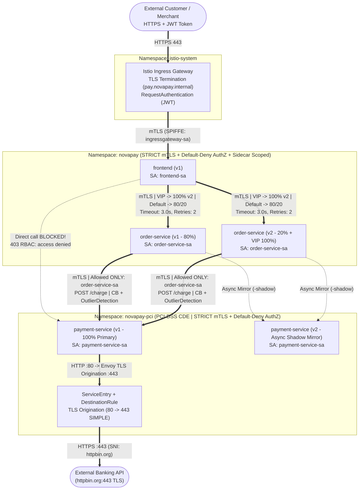

[Fellowship Portal](../../README.md) · [Handbook](../../FELLOWSHIP_HANDBOOK.md) · [Progression Dashboard](../../PROGRESSION_DASHBOARD.md) · [<- Previous Week](../week-09-incident-response-and-control-plane-ops/WEEK.md) · **Week 10 of 10 (Final Graduation Week)**

# Week 10: NovaPay Production Cutover Capstone & Fellowship Graduation Defense

**Phase 4: Observability, Operations & Capstone** | **Schedule**: Week 10 of 10 (Final Graduation Week)  
**Authoritative Version Baseline**: `Istio 1.32.0` | `Envoy v1.40` | `Kubernetes 1.36/1.37` | `Gateway API v1.6.1`  
**Core Curriculum Links**:
- 📖 **Capstone Architecture Specification**: [Module 10 — Capstone Project (`README.md`)](../../10-capstone-project/README.md)
- 📁 **Reference Production Manifests**: [Module 10 Manifests (`manifests/`)](../../10-capstone-project/manifests/)
- 🤖 **Automated 6-Pillar Verification Suite**: [Capstone Grader (`verify-capstone.sh`)](../../10-capstone-project/verify-capstone.sh)
- 📊 **Cohort Progression Tracker**: [Fellowship Progression Dashboard (`PROGRESSION_DASHBOARD.md`)](../../PROGRESSION_DASHBOARD.md)

> [!NOTE]
> ### Where You Are & What You Need Before Starting
> - **Current Phase**: Phase 4 — Observability, Operations & Capstone (Week 10 of 10 — Final Graduation Week)
> - **Prerequisites**: Completed Weeks 01–09 (Mastery across all 6 Service Mesh Pillars: Onboarding, Zero-Trust Security, Edge/Egress, Resilience, Progressive Delivery, and Observability/Operations)
> - **Estimated Time**: ~8–10 hours
> - **Tangible Weekly Deliverable**: Complete 6-pillar multi-namespace NovaPay production mesh (`novapay` + `novapay-pci`) passing `verify-capstone.sh` at `100%`, resolution of `INC-10`, and completion of the 8-Prompt Graduation Defense Board (`NP-110`)

---

## 🎯 Learning Objectives & Required Graduation Competencies

To graduate from the **Istio Service Mesh Engineering Fellowship — Cohort 01**, you will demonstrate end-to-end Staff-level mastery by architecting, deploying, defending, and verifying the complete multi-namespace **NovaPay Production Service Mesh** (`novapay` + `novapay-pci`) across all **6 Architectural Pillars**:

1. **Pillar 1 — Mesh Onboarding & Control Plane Scoping**: Multi-namespace topology (`novapay` general workloads + `novapay-pci` cardholder data environment) with explicit `Sidecar` egress scoping (`egress.hosts`) and `REGISTRY_ONLY` outbound lockdown.
2. **Pillar 2 — Zero-Trust Security & PCI-DSS Isolation**: Namespace-wide `STRICT` `PeerAuthentication`, default-deny (`spec: {}`) `AuthorizationPolicy` in both namespaces, least-privilege SPIFFE `principals` allow-listing (`order-service-sa` $\rightarrow$ `payment-service-sa` ONLY on `POST /charge`), and JWT `RequestAuthentication` enforcement.
3. **Pillar 3 — North-South TLS Ingress & Controlled Egress Origination**: HTTPS TLS termination at the Ingress Gateway (`pay.novapay.internal`) plus controlled external egress to `httpbin.org` (simulating `api.stripe.com`) via `ServiceEntry` + `DestinationRule` TLS origination (`80` $\rightarrow$ `443` `SIMPLE` TLS).
4. **Pillar 4 — Multi-Tier Resilience & Circuit Breaking**: Hierarchical timeout and retry budgets, `DestinationRule` `connectionPool` limits, and `outlierDetection` pod ejection.
5. **Pillar 5 — Progressive Delivery**: `80/20` weighted canary split between `order-service` `v1` and `v2`, `100%` `v2` VIP header routing (`x-user-tier: vip`), and asynchronous shadow traffic mirroring to `payment-service-v2`.
6. **Pillar 6 — Production Observability**: `telemetry.istio.io/v1` CEL-filtered JSON access logging and custom Prometheus metric tags (`merchant_tier` / `user_tier`).

---

## 📅 Monday — Mentor Briefing & Final Cutover Ticket (`NP-110`)

### 🎙️ Morning Standup: Final Cutover Briefing from Alex Morgan (Senior Platform Engineer)

> *"Good morning, and welcome to Week 10. Nine weeks ago, you joined NovaPay when our service communication was unencrypted HTTP, a single slow pod caused cascading `25x` retry meltdowns, and our PCI-DSS auditor flagged flat cluster networking as a critical blocker.*
>
> *This week is **Production Cutover Week**. On Friday afternoon, our external PCI-DSS Qualified Security Assessor (QSA) and our Black Friday Readiness Board convene to sign off on the `novapay` and `novapay-pci` service mesh architecture. You are the Lead Platform Architect driving Ticket `NP-110`.*
>
> *There are no isolated toy exercises this week. Every policy you write interacts with every other policy: your `Sidecar` egress list must allow `novapay` to see `novapay-pci` AND the external `ServiceEntry`; your `AuthorizationPolicy` default-deny in `novapay-pci` must explicitly permit `spiffe://cluster.local/ns/novapay/sa/order-service-sa`; and your resilience timeouts must coexist cleanly with your `80/20` canary routes and `Telemetry` filters. Let's bring this home."*

---

### 💬 Peer Engineering Discussion: Final Pre-Cutover Alignment

**Maya Patel (Principal Security Engineer)**: *"For the PCI-DSS Level 1 audit sign-off on `novapay-pci`, I will personally run two negative security tests during Wednesday's verification:*
1. *I will exec into `frontend` (`spiffe://cluster.local/ns/novapay/sa/frontend-sa`) and attempt to call `http://payment-service.novapay-pci.svc.cluster.local:8080/charge` directly, bypassing `order-service`. Envoy **must** block that request with **`HTTP 403 RBAC: access denied`**.*
2. *I will exec into `payment-service` inside `novapay-pci` and attempt to `curl https://example.com` (an unregistered external domain). Because `outboundTrafficPolicy.mode: REGISTRY_ONLY` is enforced, Envoy **must** block the egress attempt while allowing `http://httpbin.org` (our simulated external banking gateway) to transparently originate TLS on port `443`."*

**Sarah Chen (SRE Lead)**: *"And for Black Friday SRE sign-off, I am running `verify-capstone.sh` plus our Friday Multi-Fault Chaos Drill (`INC-10`). Every proxy in `novapay` and `novapay-pci` must report `SYNCED` in `istioctl proxy-status`, `istioctl analyze` must return zero errors across both namespaces, and `payment-service` must have active `connectionPool` and `outlierDetection` policies."*

**Daniel Brooks (Staff Backend Engineer)**: *"From the product side, our VIP merchants (`x-user-tier: vip`) need 100% routing to `order-service-v2`, general users need the `80/20` `v1`/`v2` split, and `payment-service-v1` needs shadow mirroring to `payment-service-v2` so we can validate the new multi-currency settlement path under live traffic."*

---

### 🎫 Engineering Ticket: `NP-110` — NovaPay Production Mesh Cutover (All 6 Pillars)

| Field | Value |
| :--- | :--- |
| **Ticket ID** | `NP-110` |
| **Title** | Architect, Deploy & Validate the Complete 6-Pillar NovaPay Production Service Mesh (`novapay` & `novapay-pci`) |
| **Assignee** | Platform Engineering Fellow (Cohort 01) |
| **Review Board** | Alex Morgan, Sarah Chen, Daniel Brooks & Maya Patel |
| **Priority** | `P0 — Final Production Go-Live & PCI-DSS Audit Gate` |
| **Target Environment** | `novapay` & `novapay-pci` Namespaces (`Istio 1.32.0` / `Envoy v1.40` / `Gateway API v1.6.1`) |

#### Acceptance Criteria & Deliverables
1. Study the complete Capstone Architecture Specification in [`../../10-capstone-project/README.md`](../../10-capstone-project/README.md).
2. Author (or review and deploy) all 6 pillar manifests across `novapay` and `novapay-pci`.
3. Execute [`../../10-capstone-project/verify-capstone.sh`](../../10-capstone-project/verify-capstone.sh) and achieve **100% (`PASS` on all checks)**.
4. Resolve Friday's Multi-Fault Pre-Launch Outage (`INC-10`) and pass Saturday's **Fellowship Graduation Defense Board**.

---

## 📅 Tuesday — Capstone Architecture Deep-Dive & Cross-Pillar Interactions

### 📚 Assigned Core Reading & Capstone Pillar Blueprints
Review the complete Capstone specification and the 6 reference pillar manifests before deploying:
- 👉 **Capstone Architecture Specification**: **[Module 10: NovaPay Capstone Architecture Specification (`../../10-capstone-project/README.md`)](../../10-capstone-project/README.md)**
- **6-Pillar Production Manifest Blueprints**:
  1. [Pillar 1 — Namespaces & Sidecar Scoping (`01-namespaces-and-sidecars.yaml`)](../../10-capstone-project/manifests/01-namespaces-and-sidecars.yaml)
  2. [Pillar 2 — Multi-Namespace Workloads (`02-workloads.yaml`)](../../10-capstone-project/manifests/02-workloads.yaml)
  3. [Pillar 3 — Zero-Trust Security, mTLS & RBAC (`03-zero-trust-security.yaml`)](../../10-capstone-project/manifests/03-zero-trust-security.yaml)
  4. [Pillar 4 — Ingress & Egress Gateways + TLS Origination (`04-ingress-egress-gateways.yaml`)](../../10-capstone-project/manifests/04-ingress-egress-gateways.yaml)
  5. [Pillar 5 — Resilience, Circuit Breaking & Canary Routing (`05-resilience-and-routing.yaml`)](../../10-capstone-project/manifests/05-resilience-and-routing.yaml)
  6. [Pillar 6 — Telemetry, CEL Access Logs & Tracing (`06-telemetry-and-observability.yaml`)](../../10-capstone-project/manifests/06-telemetry-and-observability.yaml)

### 📝 Alex Morgan's Cross-Pillar Integration Notes

When combining all 6 pillars into a single cohesive production mesh, watch out for these **four subtle cross-pillar interactions**:

1. **Interaction 1: `Sidecar` Egress Hosts vs. External `ServiceEntry`**:
   - In `novapay-pci`, your `Sidecar` resource scopes `egress.hosts` to minimize Envoy memory. If `payment-service` in `novapay-pci` needs to call `httpbin.org` (defined by a `ServiceEntry` in `novapay-pci`), your `Sidecar` resource in `novapay-pci` **must include `./*` (or `./httpbin.org`)** in `egress.hosts`! Otherwise, the `Sidecar` CRD filters out the `ServiceEntry` cluster and causes `503 NR`.
2. **Interaction 2: Ingress Gateway $\rightarrow$ `frontend` vs. `novapay` Default-Deny `AuthorizationPolicy`**:
   - When you apply `allow-nothing` (`spec: {}`) in `novapay`, **inbound traffic from `istio-ingressgateway` to `frontend` will immediately fail with `403 RBAC: access denied`** unless you explicitly create an `ALLOW` `AuthorizationPolicy` for `frontend` permitting `principals: ["cluster.local/ns/istio-system/sa/istio-ingressgateway-service-account"]` (or the Gateway pod's service account in `novapay` / `istio-system`)!
3. **Interaction 3: External TLS Origination (`Port 80` $\rightarrow$ `Port 443`)**:
   - The application container calls `http://httpbin.org/status/200` on plaintext port `80`.
   - The `ServiceEntry` exposes port `80` (`name: http-port`) and port `443` (`name: https-port`).
   - A `VirtualService` intercepts port `80` and rewrites the destination `port.number: 443`, while a `DestinationRule` for `httpbin.org` applies `portLevelSettings` on port `443` with `tls.mode: SIMPLE` and `sni: httpbin.org`.
4. **Interaction 4: Single Consolidated `VirtualService` & `DestinationRule` Per Host**:
   - Do **not** create separate `VirtualService` YAML files for Pillar 4 (Resilience timeouts/retries) and Pillar 5 (Progressive Delivery `80/20` canary + VIP routing) targeting the same host (`order-service.novapay.svc.cluster.local`). Consolidate timeouts, retries, VIP header matching, and weighted subset routing into **one authoritative `VirtualService` per host**!

---

### 🗺️ Master End-to-End NovaPay Capstone Topology (`novapay` + `novapay-pci`)



---

## 📅 Wednesday — Guided Capstone Deployment & Automated Verification

### 🔍 Pre-Flight Environment Check
```bash
kubectl version --short 2>/dev/null || kubectl version
istioctl version
istioctl proxy-status
```

### 🚀 Step-by-Step Capstone Deployment & Verification
1. Inspect the reference architecture and requirements in **[`../../10-capstone-project/README.md`](../../10-capstone-project/README.md)**.
2. Review or deploy the 6 pillar manifests in **[`../../10-capstone-project/manifests/`](../../10-capstone-project/manifests/)**:
   - [`01-namespaces-and-sidecars.yaml`](../../10-capstone-project/manifests/01-namespaces-and-sidecars.yaml)
   - [`02-workloads.yaml`](../../10-capstone-project/manifests/02-workloads.yaml)
   - [`03-zero-trust-security.yaml`](../../10-capstone-project/manifests/03-zero-trust-security.yaml)
   - [`04-ingress-egress-gateways.yaml`](../../10-capstone-project/manifests/04-ingress-egress-gateways.yaml)
   - [`05-resilience-and-routing.yaml`](../../10-capstone-project/manifests/05-resilience-and-routing.yaml)
   - [`06-telemetry-and-observability.yaml`](../../10-capstone-project/manifests/06-telemetry-and-observability.yaml)
3. Run the automated Capstone Verification Suite to validate all 6 pillars end-to-end:
   ```bash
   chmod +x ../../10-capstone-project/verify-capstone.sh
   ../../10-capstone-project/verify-capstone.sh
   ```

---

### 🔬 Alex Morgan's Deep xDS Verification Checkpoints

Even after `verify-capstone.sh` reports `PASS`, verify the underlying Envoy state across the PCI boundary:

```bash
# 1. Verify STRICT mTLS and RBAC filters on payment-service inbound listener in novapay-pci
istioctl proxy-config listeners deploy/payment-service-v1 -n novapay-pci --port 15006 -o json | grep -E "envoy.filters.http.rbac|transport_socket" | head -n 20

# 2. Verify TLS origination cluster for httpbin.org on payment-service-v1
istioctl proxy-config cluster deploy/payment-service-v1 -n novapay-pci --fqdn httpbin.org -o json | jq '.[].transportSocket'

# 3. Verify zero configuration warnings across the entire mesh
istioctl analyze -n novapay
istioctl analyze -n novapay-pci
```

---

## 📅 Thursday — Independent Capstone Enhancement Challenge

### 🛠️ Assignment Brief: Adding JWT Claim-to-Header Routing & Egress Mutual TLS Readiness (`NP-110-EXT`)

Before Friday's chaos drill, Maya and Alex want you to design an advanced extension overlay (`novapay-capstone-extension.yaml`) for the Capstone environment that satisfies two additional audit requirements:

#### Architectural Requirements
1. **Verified JWT Claim Extraction to Upstream Header (`RequestAuthentication` + `AuthorizationPolicy`)**:
   - On `frontend` in `novapay`, configure `RequestAuthentication` with `outputPayloadToHeader: x-jwt-payload` (or require a valid JWT for `/checkout` while allowing `/healthz` unauthenticated via `AuthorizationPolicy`).
   - In the `AuthorizationPolicy` for `frontend`, allow requests to `/checkout` **only** if `request.auth.claims[iss]` equals `"https://auth.novapay.io"` AND `request.auth.claims[scope]` contains `"payments:execute"`.
2. **Hardened PCI Egress `Sidecar` + Circuit-Broken Banking Gateway (`novapay-pci`)**:
   - Ensure the `DestinationRule` for `httpbin.org` in `novapay-pci` not only originates `SIMPLE` TLS on port `443` with `sni: httpbin.org`, but also enforces a `connectionPool` (`maxConnections: 50`, `connectTimeout: 2s`) and `outlierDetection` (`consecutiveGatewayErrors: 3`, `baseEjectionTime: 30s`) so a slow external banking API cannot exhaust `payment-service` worker threads!

---

<details>
<summary>Need a Hint from Alex Morgan? (Click before revealing the full answer)</summary>

> **Alex's Coaching Hints**:
> 1. **Forwarding Verified JWT Claims**: In `RequestAuthentication/frontend-jwt-authn`, set `outputPayloadToHeader: x-jwt-payload` and `forwardOriginalToken: true`.
> 2. **Exempting `/healthz` While Protecting `/checkout`**: In `AuthorizationPolicy/frontend-jwt-claim-authz`, create two rules under `spec.rules`: Rule 1 allowing unauthenticated `GET` to `["/healthz", "/readyz"]`, and Rule 2 requiring both `source.principals` (`istio-ingressgateway-service-account`) AND `source.requestPrincipals` (`https://auth.novapay.io/*`) plus `when` checks on `request.auth.claims[iss]` and `request.auth.claims[scope]`.
> 3. **Combining Egress Circuit Breaking + Port-Level TLS Origination**: In `DestinationRule/external-stripe-httpbin-tls-cb`, put `connectionPool` and `outlierDetection` under `spec.trafficPolicy`, and put `tls: { mode: SIMPLE, sni: httpbin.org }` inside `spec.trafficPolicy.portLevelSettings` for `port.number: 443`!

</details>

<details>
<summary>Click to Reveal Reference Solution & Alex's Code Review</summary>

### 📄 Reference Solution (`novapay-capstone-extension.yaml`)

```yaml
apiVersion: security.istio.io/v1
kind: RequestAuthentication
metadata:
  name: frontend-jwt-authn
  namespace: novapay
spec:
  selector:
    matchLabels:
      app: frontend
  jwtRules:
    - issuer: "https://auth.novapay.io"
      jwks: |
        {"keys":[{"kty":"RSA","alg":"RS256","use":"sig","kid":"novapay-key-1","n":"0vx7agoebGcQSuuPiLJXZptN9nndrQmbXEps2aiAFbWhM78LhWx4cbbfAAtVT86zwu1RK7aPFFxuhDR1L6tSoc_BJECPebWKRXjBZCiFV4n3oknjhMstn64tZ_2W-5JsGY4Hc5n9yBXArwl93lqt7_RN5w6Cf0h4QyQ5v-65YGjQR0_FDW2QvzqY368QQMicAtaSqzs8KJZgnYb9c7d0zgdAZHzu6qMQvRL5hajrn1n91CbOpbISD08qNLyrdkt-bFTWhAI4vMQFh6WeZu0fM4lFd2NcRwr3XPksINHaQ-G_xBniIqbw0Ls1jF44-csFCur-kEgU8awapJzKnqDKgw","e":"AQAB"}]}
      forwardOriginalToken: true
      outputPayloadToHeader: x-jwt-payload
---
apiVersion: security.istio.io/v1
kind: AuthorizationPolicy
metadata:
  name: frontend-jwt-claim-authz
  namespace: novapay
spec:
  selector:
    matchLabels:
      app: frontend
  action: ALLOW
  rules:
    # Rule 1: Allow health checks without JWT
    - to:
        - operation:
            paths: ["/healthz", "/readyz"]
            methods: ["GET"]
    # Rule 2: Require verified Ingress Gateway SPIFFE ID + Valid JWT Claims on /checkout
    - from:
        - source:
            principals: ["cluster.local/ns/istio-system/sa/istio-ingressgateway-service-account"]
            requestPrincipals: ["https://auth.novapay.io/*"]
      to:
        - operation:
            paths: ["/checkout", "/orders*"]
            methods: ["GET", "POST"]
      when:
        - key: request.auth.claims[iss]
          values: ["https://auth.novapay.io"]
        - key: request.auth.claims[scope]
          values: ["*payments:execute*"]
---
apiVersion: networking.istio.io/v1
kind: DestinationRule
metadata:
  name: external-stripe-httpbin-tls-cb
  namespace: novapay-pci
spec:
  host: httpbin.org
  trafficPolicy:
    connectionPool:
      tcp:
        maxConnections: 50
        connectTimeout: 2s
      http:
        http1MaxPendingRequests: 20
        http2MaxRequests: 50
    outlierDetection:
      consecutiveGatewayErrors: 3
      interval: 10s
      baseEjectionTime: 30s
      maxEjectionPercent: 100
    portLevelSettings:
      - port:
          number: 443
        tls:
          mode: SIMPLE
          sni: httpbin.org
```

### 🔍 Alex Morgan's Code Review Notes
- **Combining `principals` (mTLS L4 identity) + `requestPrincipals` (JWT L7 identity)**: Notice how Rule 2 in `frontend-jwt-claim-authz` requires **both** `principals` (proving the packet came over mTLS from `istio-ingressgateway`) AND `requestPrincipals` + `request.auth.claims` (proving the end-user carries a cryptographically signed JWT from `https://auth.novapay.io`). That is defense-in-depth at its finest.
- **External `ServiceEntry` Circuit Breaking**: Applying `connectionPool` and `outlierDetection` on an external `ServiceEntry`'s `DestinationRule` protects your internal pods when a third-party SaaS API (like Stripe or Twilio) suffers an outage!

</details>

---

## 📅 Friday — Final Pre-Graduation Multi-Fault Chaos Drill (`INC-10`)

### 🚨 PagerDuty Alert: `INC-10` — Total Payment Pipeline Blackout (`403 RBAC` + `503 UO` + External Egress Failure)

> **📟 PAGERDUTY TRIGGERED — SEV-0 (FINAL GRADUATION DRILL)**  
> **Service**: `novapay` & `novapay-pci` Production Cutover Environment  
> **Incident Commander**: Sarah Chen (SRE Lead) & Maya Patel (Principal Security Engineer)  
> **Alert Condition**: `CheckoutSuccessRate == 0%` | `PCI_AuthZ_Deny_Spike` | `ExternalBankingEgress_503`  
> **Message from Sarah Chen**:  
> *"This is your final live-fire incident drill before tomorrow's Graduation Defense Board. A bad GitOps merge just introduced **three simultaneous production faults** across `novapay` and `novapay-pci`:*
> *1. Calls from `order-service` (`novapay`) to `payment-service` (`novapay-pci`) are failing with **`403 RBAC: access denied`**.*
> *2. Even when `AuthorizationPolicy` is bypassed locally, calls from `order-service` to `payment-service` trip immediate **`503 UO` (`Upstream Overflow`)** under >1 concurrent request!*
> *3. Inside `novapay-pci`, `payment-service`'s outbound calls to `http://httpbin.org:80` are failing with **`503 UH` / DNS resolution failure** because the `ServiceEntry` resolution mode was corrupted!*
>
> *Apply the chaos manifest below, diagnose all three faults using your 5-step runbook, restore 100% green traffic, and re-run `verify-capstone.sh`!"*

---

### 💥 Step 1: Inject the Triple-Fault Chaos State

```yaml
# apply-inc-10-chaos.yaml
# FAULT 1: Typo in SPIFFE Principal & Method in novapay-pci AuthorizationPolicy
apiVersion: security.istio.io/v1
kind: AuthorizationPolicy
metadata:
  name: allow-order-to-payment
  namespace: novapay-pci
spec:
  selector:
    matchLabels:
      app: payment-service
  action: ALLOW
  rules:
    - from:
        - source:
            # BUG 1A: Wrong namespace in SPIFFE URI! (order-service lives in 'novapay', not 'novapay-pci')
            principals: ["cluster.local/ns/novapay-pci/sa/order-service-sa"]
      to:
        - operation:
            # BUG 1B: Only allows GET, blocking POST /charge!
            methods: ["GET"]
            paths: ["/charge*"]
---
# FAULT 2: Crushed Connection Pool on payment-service DestinationRule
apiVersion: networking.istio.io/v1
kind: DestinationRule
metadata:
  name: payment-service-dr
  namespace: novapay-pci
spec:
  host: payment-service.novapay-pci.svc.cluster.local
  trafficPolicy:
    connectionPool:
      tcp:
        # BUG 2: Set to 1 connection with 1 pending request and 1ms connectTimeout!
        maxConnections: 1
        connectTimeout: 1ms
      http:
        http1MaxPendingRequests: 1
        http2MaxRequests: 1
---
# FAULT 3: Broken ServiceEntry Resolution Mode for External Host
apiVersion: networking.istio.io/v1
kind: ServiceEntry
metadata:
  name: external-httpbin
  namespace: novapay-pci
spec:
  hosts:
    - httpbin.org
  ports:
    - number: 80
      name: http-port
      protocol: HTTP
    - number: 443
      name: https-port
      protocol: HTTPS
  # BUG 3: STATIC resolution with 0 endpoints causes immediate 503 UH (No Healthy Upstream) for a DNS hostname!
  resolution: STATIC
  location: MESH_EXTERNAL
```

---

### 🔍 Step 2: Diagnostic Investigation Commands

```bash
# 1. Catch static analysis warnings (notice IST0104 / ServiceEntry / RBAC clues)
istioctl analyze -n novapay -n novapay-pci

# 2. Inspect RBAC policy evaluation on payment-service
istioctl proxy-config listener deploy/payment-service-v1 -n novapay-pci --port 15006 -o json | jq '.. | .rbac? | select(. != null)'

# 3. Inspect circuit breaker connectTimeout and maxConnections on order-service
istioctl proxy-config cluster deploy/order-service-v1 -n novapay --fqdn payment-service.novapay-pci.svc.cluster.local -o json | jq '.[].circuitBreakers'

# 4. Inspect endpoints for httpbin.org on payment-service-v1 (Notice 0 endpoints due to STATIC!)
istioctl proxy-config endpoints deploy/payment-service-v1 -n novapay-pci --cluster "outbound|443||httpbin.org"
```

---

<details>
<summary>Need a Hint from Alex Morgan? (Click before revealing the full answer)</summary>

> **Alex's Diagnostic Hints**:
> 1. **Fault 1 (`403 RBAC: access denied`)**: Look at `principals` in `AuthorizationPolicy/allow-order-to-payment`: it says `cluster.local/ns/novapay-pci/sa/order-service-sa`. Which namespace does `order-service` actually run in (`novapay` or `novapay-pci`)? Also check `methods`—does `["GET"]` allow `POST /charge`?
> 2. **Fault 2 (`503 UO` / `503 UF`)**: Look at `DestinationRule/payment-service-dr`: `maxConnections: 1`, `http2MaxRequests: 1`, and `connectTimeout: 1ms` immediately trip the circuit breaker (`UO`) or time out TCP+mTLS handshakes (`UF`).
> 3. **Fault 3 (`503 UH` on `httpbin.org`)**: `ServiceEntry/external-httpbin` has `resolution: STATIC` with no `endpoints` IP list! Change `resolution: STATIC` back to `resolution: DNS`.

</details>

<details>
<summary>Click to Reveal Root Cause Analysis (RCA) & Complete Remediation</summary>

### 🧠 Root Cause Analysis (RCA)

1. **Fault #1 (`403 RBAC: access denied` at `payment-service`)**:
   - `AuthorizationPolicy/allow-order-to-payment` in `novapay-pci` specified `principals: ["cluster.local/ns/novapay-pci/sa/order-service-sa"]` instead of `cluster.local/ns/novapay/sa/order-service-sa` (wrong source namespace in the SPIFFE ID!), and restricted `methods` to `["GET"]` instead of `["POST", "GET"]`.
2. **Fault #2 (`503 UO` / `503 UF` on `payment-service` calls)**:
   - `DestinationRule/payment-service-dr` configured `connectTimeout: 1ms` (too short for cross-node TCP + mTLS handshake under load) and `maxConnections: 1` / `http2MaxRequests: 1`, causing immediate `503 UO` (`Upstream Overflow`) and `503 UF` (`Upstream Connection Failure`).
3. **Fault #3 (`503 UH` on external `httpbin.org` egress)**:
   - `ServiceEntry/external-httpbin` changed `resolution: DNS` to `resolution: STATIC` without defining any `endpoints: []` IP addresses. Envoy created a `STATIC` cluster with `0` healthy endpoints, causing every outbound call to `httpbin.org` to fail immediately with `503 UH` (`No Healthy Upstream`).

### 🛠️ Remediation Manifest

```yaml
apiVersion: security.istio.io/v1
kind: AuthorizationPolicy
metadata:
  name: allow-order-to-payment
  namespace: novapay-pci
spec:
  selector:
    matchLabels:
      app: payment-service
  action: ALLOW
  rules:
    - from:
        - source:
            principals: ["cluster.local/ns/novapay/sa/order-service-sa"]
      to:
        - operation:
            methods: ["POST", "GET"]
            paths: ["/charge*", "/payments*", "/status/*", "/headers"]
---
apiVersion: networking.istio.io/v1
kind: DestinationRule
metadata:
  name: payment-service-dr
  namespace: novapay-pci
spec:
  host: payment-service.novapay-pci.svc.cluster.local
  trafficPolicy:
    connectionPool:
      tcp:
        maxConnections: 100
        connectTimeout: 500ms
      http:
        http1MaxPendingRequests: 25
        http2MaxRequests: 100
    outlierDetection:
      consecutive5xxErrors: 3
      interval: 5s
      baseEjectionTime: 30s
      maxEjectionPercent: 50
  subsets:
    - name: v1
      labels:
        version: v1
    - name: v2
      labels:
        version: v2
---
apiVersion: networking.istio.io/v1
kind: ServiceEntry
metadata:
  name: external-httpbin
  namespace: novapay-pci
spec:
  hosts:
    - httpbin.org
  ports:
    - number: 80
      name: http-port
      protocol: HTTP
    - number: 443
      name: https-port
      protocol: HTTPS
  resolution: DNS
  location: MESH_EXTERNAL
```

After applying the remediation, run `../../10-capstone-project/verify-capstone.sh` to confirm 100% of Capstone checks pass!

</details>

---

## 📅 Saturday — Fellowship Graduation Defense Board

### 🎓 Welcome to the Cohort 01 Final Architecture Defense

Today you stand before the **NovaPay Production Readiness & Architecture Review Board**:
- **Alex Morgan** (Senior Platform Engineer — Envoy Internals & Control Plane Architecture)
- **Sarah Chen** (SRE Lead — Resilience, Golden Signals & Zero-Downtime Operations)
- **Daniel Brooks** (Staff Backend Engineer — Progressive Delivery & Developer Experience)
- **Maya Patel** (Principal Security Engineer — Zero-Trust Cryptography & PCI-DSS Compliance)

Formulate your verbal or written defense to each of the **8 Graduation Board Prompts** below before expanding the model Staff-level responses.

---

### 🏛️ Defense Prompt 1 — Alex Morgan (Life of a Packet & xDS Internals)
> *"Walk the board step-by-step through the exact path of an HTTP `POST /checkout` packet from the moment it enters a `frontend` pod's network namespace to the moment it leaves `order-service` toward `payment-service`. Include the exact `iptables`/eBPF interception ports (`15006`, `15001`), the Envoy xDS objects (`LDS` $\rightarrow$ `RDS` $\rightarrow$ `CDS` $\rightarrow$ `EDS` $\rightarrow$ `SDS`) consulted at each stage, and how HBONE (`15008`) differs if we migrate a namespace to Ambient Mode."*

<details>
<summary>Click to Reveal Model Staff-Level Defense Response</summary>

1. **Inbound Interception (`frontend` Pod)**:
   - Packet arrives at `frontend` pod eth0 (`:8080`). Kernel `iptables` `PREROUTING`/`OUTPUT` rules (programmed by `istio-init` or `istio-cni`) redirect inbound TCP traffic to Envoy's **`virtualInbound` listener on port `15006`**.
2. **Inbound Envoy Processing (`LDS` + `SDS`)**:
   - Envoy matches the destination IP:Port (`8080`) on `15006` via its **LDS (`Listener`)** filter chain, terminates the incoming mTLS connection using the workload's X.509 certificate provisioned via **SDS (`Secret Discovery Service`)** from `pilot-agent`/`istiod`, verifies the caller's SPIFFE SAN against `PeerAuthentication` (`STRICT`) and `AuthorizationPolicy` (RBAC filter), and forwards the plaintext request over `lo` (`127.0.0.1:8080`) to the `frontend` application container.
3. **Outbound Interception (`frontend` $\rightarrow$ `order-service`)**:
   - `frontend` opens a TCP connection to `order-service.novapay.svc.cluster.local:8080` (ClusterIP). `iptables` redirects the outbound packet (excluding UID `1337` so Envoy doesn't loop on itself) to Envoy's **`virtualOutbound` listener on port `15001`**.
4. **Outbound xDS Chain (`LDS` $\rightarrow$ `RDS` $\rightarrow$ `CDS` $\rightarrow$ `EDS` $\rightarrow$ `SDS`)**:
   - **LDS**: Matches outbound listener `0.0.0.0_8080`.
   - **RDS (`RouteConfiguration`)**: Evaluates `VirtualService` rules for `order-service` (checking `x-user-tier: vip` header first, then falling through to the `80/20` weighted split, applying `timeout` and `retryPolicy`).
   - **CDS (`Cluster`)**: Selects `outbound|8080|v1|order-service.novapay.svc.cluster.local`, checking `DestinationRule` `circuitBreakers` (`connectionPool`) and `tls: ISTIO_MUTUAL`.
   - **EDS (`ClusterLoadAssignment`)**: Picks a healthy pod IP from the subset endpoint pool (excluding any pods quarantined by `outlierDetection`).
   - **SDS**: Wraps the outbound stream in mTLS using `frontend-sa`'s client certificate and validates `order-service-sa`'s SAN against the `cluster.local` Root CA.
5. **Ambient Mode Comparison**:
   - In Ambient Mode, pods have no sidecar containers. Node-level **ztunnel** intercepts traffic via in-pod netns sockets and tunnels L4 mTLS over **HBONE (HTTP-Based Overlay Network Environment) on port `15008`** using HTTP/2 `CONNECT`. If L7 policy (`VirtualService` or L7 `AuthorizationPolicy`) is required for `order-service`, ztunnel forwards the HBONE tunnel to the namespace's **Waypoint Proxy** before delivering to the target node's ztunnel.

</details>

---

### 🏛️ Defense Prompt 2 — Maya Patel (Zero-Trust Cryptography & PCI-DSS Defense-in-Depth)
> *"Our PCI-DSS auditor asks: 'Why isn't Kubernetes `NetworkPolicy` enough to isolate `novapay-pci`? And if an attacker compromises the `frontend` pod and steals its ServiceAccount token or spoofs the `Host: payment-service` header, why can't they call `payment-service` in `novapay-pci`?' Defend your Zero-Trust architecture."*

<details>
<summary>Click to Reveal Model Staff-Level Defense Response</summary>

1. **Why Kubernetes `NetworkPolicy` Alone Fails PCI-DSS Zero-Trust**:
   - Standard CNI `NetworkPolicy` operates only at **L3/L4 (IP addresses and TCP/UDP ports)**. It provides **zero encryption in transit** (failing PCI-DSS Req 4.2 for untrusted networks), cannot validate **cryptographic workload identity** (if a pod IP is recycled or spoofed), and has **zero L7 visibility** (it cannot allow `POST /charge` while blocking `DELETE /ledger` on the same port `8080`).
2. **Why Compromising `frontend` Cannot Bypass `payment-service` AuthZ**:
   - Even if an attacker achieves Remote Code Execution (RCE) inside `frontend`, they only possess the X.509 certificate for `spiffe://cluster.local/ns/novapay/sa/frontend-sa` (held in memory by `istio-proxy`, never written to disk).
   - They cannot forge a certificate for `spiffe://cluster.local/ns/novapay/sa/order-service-sa` because `istiod` validates the Kubernetes Pod's bound ServiceAccount JWT against the Kubernetes API server before signing any CSR.
   - When `frontend` attempts to connect to `payment-service` in `novapay-pci`, `payment-service`'s inbound Envoy RBAC filter inspects the cryptographically verified TLS peer certificate SAN (`frontend-sa`), evaluates `allow-nothing` + `allow-order-to-payment` (which requires `order-service-sa`), and rejects the request at the Envoy filter layer with `403 RBAC: access denied` before a single byte reaches the `payment-service` application binary.

</details>

---

### 🏛️ Defense Prompt 3 — Maya Patel (AuthorizationPolicy Precedence Pitfalls)
> *"Suppose we have 4 `AuthorizationPolicy` resources matching `payment-service`: a `CUSTOM` ext_authz policy, a `DENY` policy, an `ALLOW` policy, and an `AUDIT` policy. In what exact order does Envoy evaluate them, and what is the tragic difference between `spec: {}` and `spec: { rules: [{}] }`?"*

<details>
<summary>Click to Reveal Model Staff-Level Defense Response</summary>

1. **Exact Evaluation Order**:
   - **`CUSTOM` $\rightarrow$ `DENY` $\rightarrow$ `ALLOW` $\rightarrow$ `AUDIT`** (Note: `AUDIT` policies evaluate whether a request should be flagged for security audit logging without altering the allow/deny decision; for access control enforcement: `CUSTOM` runs first, then `DENY` policies, then `ALLOW` policies).
   - Specifically:
     1. If any **`CUSTOM`** policy denies the request $\rightarrow$ **Deny**.
     2. If any **`DENY`** policy matches the request $\rightarrow$ **Deny** (overrides all `ALLOW` policies!).
     3. If **no `ALLOW`** policies exist for the workload $\rightarrow$ **Allow** (by default).
     4. If **one or more `ALLOW`** policies exist: if any `ALLOW` policy matches $\rightarrow$ **Allow**; if none match $\rightarrow$ **Deny (`403`)**.
2. **`spec: {}` vs `spec: { rules: [{}] }` with `action: ALLOW`**:
   - `spec: {}` has **no `rules` field** — it matches **zero** requests, establishing a **Default-Deny (`allow-nothing`)** posture where traffic is blocked unless matched by another explicit `ALLOW` policy.
   - `spec: { rules: [{}] }` contains an **empty rule `{}`** inside `rules`, which acts as a **wildcard match-all** — it **ALLOWS 100% of all traffic from all sources to all paths**, completely disabling access control in that namespace!

</details>

---

### 🏛️ Defense Prompt 4 — Sarah Chen (Multi-Hop Timeout & Retry Amplification Defense)
> *"During Black Friday, `payment-service` P99 latency degrades from `80ms` to `950ms`. Explain how your Capstone configuration prevents a retry storm, why `minHealthPercent: 50` is set on `outlierDetection`, and how you know from Prometheus within 15 seconds whether errors are caused by circuit breaking (`UO`) vs application crashes (`500`)."*

<details>
<summary>Click to Reveal Model Staff-Level Defense Response</summary>

1. **Preventing Retry Storms**:
   - Application-level retries are disabled (`0`), leaving Envoy as the single retry layer.
   - `retryOn` is scoped strictly to `connect-failure,refused-stream,unavailable,cancelled,503` (bounded to `attempts: 2`), and our timeout hierarchy (`Gateway > frontend 3.5s > order-service 2.5s > payment-service perTryTimeout 1.0s`) ensures upstream attempts terminate cleanly before downstream callers time out and re-issue duplicate requests.
2. **Role of `minHealthPercent: 50`**:
   - If a systemic database slowdown causes more than 50% of `payment-service` replicas to fail `consecutive5xxErrors`, ejecting all of them would leave `0` healthy endpoints (`503 UH`). `minHealthPercent: 50` engages Envoy's panic threshold so load balancing continues across all pods rather than blackholing the entire service.
3. **15-Second Prometheus Triage (`UO` vs `500`)**:
   - A local circuit breaker trip increments `istio_requests_total{reporter="source", response_code="503", response_flags="UO"}` while `reporter="destination"` does not see the dropped requests.
   - An application crash increments **both** `reporter="source"` and `reporter="destination"` with `response_code="500"` and `response_flags="-"`.

</details>

---

### 🏛️ Defense Prompt 5 — Daniel Brooks (Safe Progressive Delivery & Stateful Mirroring)
> *"Why did you configure traffic mirroring (`mirrorPercentage`) to append `-shadow` and why did we restrict how `payment-service-v2` handles mirrored requests? Furthermore, if we migrate our ingress and mesh routing from `VirtualService` to Kubernetes Gateway API `v1.6.1` `HTTPRoute`, what changes in how we model subsets?"*

<details>
<summary>Click to Reveal Model Staff-Level Defense Response</summary>

1. **Mirroring & Stateful Side Effects**:
   - Envoy clones the request asynchronously, rewrites `:authority` (`Host`) to `<host>-shadow`, and discards the response from `payment-service-v2`. Because `payment-service-v2` actually executes the request handler, mirroring mutating requests against a live production database or live Stripe API key would cause duplicate database rows and double credit-card charges unless `v2` detects the `-shadow` host header (or runs in dry-run/sandbox mode).
2. **`VirtualService` Subsets vs. Gateway API `v1.6.1` `HTTPRoute` `backendRefs`**:
   - Istio `VirtualService` routes to a single Kubernetes `Service` (`order-service`) and relies on `DestinationRule.subsets[]` (`v1`, `v2`) for pod label selection.
   - Gateway API `v1.6.1` `HTTPRoute` models traffic splitting natively using separate Kubernetes `Service` objects (`order-service-v1` and `order-service-v2`) referenced directly in `spec.rules[].backendRefs[]` with `weight: 80` and `weight: 20`.

</details>

---

### 🏛️ Defense Prompt 6 — Maya Patel (Egress Control: `REGISTRY_ONLY` + TLS Origination vs. Passthrough)
> *"A rogue dependency inside `payment-service` attempts to exfiltrate cardholder data to `https://evil-collector.io:443` or via raw IP `curl https://198.51.100.42 --resolve ...`. Explain how `outboundTrafficPolicy.mode: REGISTRY_ONLY`, our `Sidecar` resource, and our TLS origination pattern work together, and where a pure Envoy `REGISTRY_ONLY` policy still needs a CNI `NetworkPolicy` or Dedicated Egress Gateway for defense-in-depth."*

<details>
<summary>Click to Reveal Model Staff-Level Defense Response</summary>

1. **What `REGISTRY_ONLY` + TLS Origination Achieves**:
   - With `outboundTrafficPolicy.mode: REGISTRY_ONLY`, Envoy drops any outbound HTTP `Host` or TLS `SNI` that is not registered in the mesh service registry or an explicit `ServiceEntry` (`BlackHoleCluster` $\rightarrow$ `502`/`503`).
   - By forcing the application to speak plaintext HTTP on port `80` to `http://httpbin.org` and letting the local Envoy sidecar (or Egress Gateway) originate `SIMPLE` (or `MUTUAL`) TLS on port `443` with pinned `sni: httpbin.org` and CA verification, the application never holds external TLS credentials and Envoy can inspect L7 paths/headers before encrypting.
2. **Why Defense-in-Depth Requires Egress Gateway + `NetworkPolicy`**:
   - Because Envoy routes TLS passthrough traffic based on the client-supplied **SNI header**, a malicious process inside a pod could spoof `SNI: httpbin.org` while connecting to an attacker's IP address if DNS resolution isn't enforced at an Egress Gateway!
   - Therefore, for strict PCI-DSS environments, we combine `REGISTRY_ONLY` with a Kubernetes `NetworkPolicy` on `novapay-pci` that blocks all direct pod-to-internet egress and forces external traffic through a hardened `istio-egressgateway` (or DNS-proxied `ServiceEntry` with `ISTIO_META_DNS_CAPTURE: "true"`).

</details>

---

### 🏛️ Defense Prompt 7 — Sarah Chen (Observability: Cardinality, CEL Logs & Missing Spans)
> *"Summarize how our Capstone `Telemetry` configuration achieves 100% failure visibility while cutting log volume by >90%, why `ISTIO_META_DNS_CAPTURE` helps both reliability and telemetry for external `ServiceEntry` hosts, and what you check first when Jaeger shows broken traces."*

<details>
<summary>Click to Reveal Model Staff-Level Defense Response</summary>

1. **High-Signal Observability (`telemetry.istio.io/v1`)**:
   - We use a CEL filter (`response.code >= 400 || response.flags != '-'`) on the `envoy` JSON access log provider so every `4xx`/`5xx` error and every Envoy anomaly (`UO`, `UT`, `UF`, `NR`, `FI`) is logged with full SPIFFE principal and trace ID metadata, while high-volume `200 OK` requests are only aggregated as low-cardinality Prometheus metrics (`istio_requests_total`, `istio_request_duration_milliseconds`).
2. **`ISTIO_META_DNS_CAPTURE: "true"`**:
   - Enabling DNS capture in `pilot-agent` resolves `ServiceEntry` (`resolution: DNS`) and mesh hostnames locally inside the pod's proxy, preventing CoreDNS UDP conntrack races and ensuring external synthetic IPs (`autoAllocateIp`) map cleanly in Envoy telemetry.
3. **Broken Jaeger Traces**:
   - Check whether the intermediate microservice forwards W3C (`traceparent`, `tracestate`), `x-request-id`, and B3 (`x-b3-*`) headers from inbound requests to outbound HTTP calls.

</details>

---

### 🏛️ Defense Prompt 8 — Alex Morgan (Day-2 Operations: Control Plane Upgrades & Scale)
> *"Next quarter, NovaPay scales from 50 services to 1,500 services across 80 namespaces, and we need to upgrade from Istio `1.32.0` to `1.33.0`. Summarize the complete Day-2 runbook that guarantees `istiod` never OOMs during scaling and zero requests drop during the `1.32` $\rightarrow$ `1.33` upgrade."*

<details>
<summary>Click to Reveal Model Staff-Level Defense Response</summary>

1. **Scaling to 1,500 Services (`Sidecar` Scoping & Discovery Selectors)**:
   - Deploy a default `Sidecar` resource in every namespace restricting `egress.hosts` to `./*`, `istio-system/*`, and explicit upstream namespaces so Envoy proxies only hold clusters for services they actually call (reducing Envoy RAM and `istiod` xDS push payloads by 80–90%).
   - Configure `MeshConfig.discoverySelectors` so `istiod` ignores non-mesh namespaces (CI runners, batch jobs).
   - Ensure all Kubernetes `Service` ports follow strict protocol naming (`http-*`, `grpc-*`, `tcp-*`) or `appProtocol`.
2. **Zero-Downtime `1.32.0` $\rightarrow$ `1.33.0` Canary Upgrade**:
   - Pre-check with `istioctl x precheck` and `istioctl analyze -A`.
   - Deploy `istiod-1-33-0` side-by-side in `istio-system` using `revision: 1-33-0`.
   - Repoint the `prod-canary` revision tag (`istioctl tag set prod-canary --revision 1-33-0 --overwrite`), roll canary namespaces with `EXIT_ON_ZERO_ACTIVE_CONNECTIONS: "true"` enabled, and monitor golden signals (`reporter="source"` vs `"destination"`).
   - Once validated, repoint `prod-stable` (`istioctl tag set prod-stable --revision 1-33-0 --overwrite`), roll remaining namespaces in waves, verify `istioctl proxy-status` shows zero proxies on `1-32-0`, and decommission `istiod-1-32-0`.

</details>

---

## 📅 Sunday — Final Graduation Assessment & Fellowship Sign-Off

### 📝 Final Graduation Exam (Comprehensive Synthesis)

Complete these 5 final synthesis questions to conclude your Fellowship coursework:

1. **Cross-Namespace Zero-Trust Debugging**: `order-service` in `novapay` calls `payment-service` in `novapay-pci` and receives **`503 NR`** in `0ms`. Name two distinct Istio CRDs (one in `novapay`, one in `novapay-pci`) that could cause `503 NR` and explain why neither of them is an `AuthorizationPolicy`.
2. **Resilience + Canary Interaction**: In `VirtualService/order-service`, `x-user-tier: vip` routes `100%` to `v2`, and the default route splits `80% v1 / 20% v2` with `retries: { attempts: 2, retryOn: 503 }`. If a general user request lands on `v2` (the 20% weight) and that `v2` pod returns `503`, how does Envoy choose whether the retry goes to `v1` or `v2`?
3. **Egress TLS Origination**: Why must the `DestinationRule` for `httpbin.org` specify `tls.mode: SIMPLE` under `portLevelSettings` for port `443` while the application sends plaintext HTTP to port `80`? What happens if the application sends `https://httpbin.org:443` directly while Envoy is also configured to originate TLS on port `443`?
4. **Telemetry & Security Forensics**: Write the `kubectl logs` + `jq` command to extract all JSON access log entries from `payment-service-v1` in `novapay-pci` where `response_code >= 400`, displaying the timestamp, HTTP status, `response_flags`, and caller SPIFFE principal.
5. **Control Plane Disaster Recovery**: If all replicas of `istiod` in `istio-system` crash simultaneously during peak Black Friday traffic (`50,000 RPS`), state (a) the immediate impact on existing pod-to-pod payment traffic, (b) the impact on HorizontalPodAutoscaler (HPA) scaling up new pods, and (c) the maximum time window before existing mTLS connections begin failing due to certificate expiry under default settings.

---

<details>
<summary>Assessment Answer Key</summary>

1. **Answer 1**:
   - `AuthorizationPolicy` rejections return **`403 Forbidden`** (or TCP `RBAC: access_denied`), **never `503 NR`**.
   - `503 NR` (`No Route`) is caused by:
     1. A **`Sidecar`** resource in `novapay` whose `egress.hosts` omits `"novapay-pci/*"`, stripping the destination cluster from `order-service`'s Envoy config.
     2. A **`VirtualService`** referencing a `subset` (`v1`/`v2`) that is missing from the **`DestinationRule`** for `payment-service` (or a `DestinationRule`/`Service` with `exportTo: ["."]` in `novapay-pci` that hides the service from `novapay`!).

2. **Answer 2**:
   - On each retry of a weighted route (`weightedClusters`), Envoy re-evaluates the weighted cluster selection (`80% v1 / 20% v2`), so the retry has an 80% probability of routing to `v1` and a 20% probability of routing to `v2` (and if `outlierDetection` ejected the failing `v2` pod, any retry landing in `v2` routes to healthy `v2` pods).

3. **Answer 3**:
   - The `VirtualService` matches plaintext HTTP on port `80` and forwards it to the `httpbin.org:443` cluster, where the `DestinationRule`'s `portLevelSettings` (`port: 443`, `tls.mode: SIMPLE`) instructs Envoy to wrap the plaintext HTTP stream in TLS (`SNI: httpbin.org`).
   - If the application already encrypts the traffic with HTTPS before sending it, and Envoy *also* originates TLS (`double TLS` / TLS-over-TLS), the upstream server will fail to parse the inner ciphertext as HTTP after terminating the outer TLS layer, resulting in protocol/handshake errors.

4. **Answer 4**:
   ```bash
   kubectl logs -n novapay-pci deploy/payment-service-v1 -c istio-proxy | \
     jq -R 'fromjson? | select(.response_code >= 400) | {time: .start_time, status: .response_code, flags: .response_flags, caller: .downstream_peer_uri_san}'
   ```

5. **Answer 5**:
   - **(a) Immediate Traffic Impact**: **Zero** — existing Envoy proxies continue routing and encrypting mTLS traffic using their cached xDS configuration and in-memory certificates.
   - **(b) HPA Pod Scale-Up Impact**: **Fails / Blocked** — newly scheduled pods cannot complete sidecar injection (if webhook `failurePolicy: Fail`) or cannot fetch their initial SDS workload X.509 certificate from `istiod`, staying `0/2 NotReady`, and existing proxies will not receive EDS updates for new pod IPs.
   - **(c) Certificate Expiry Window**: Default workload certificate TTL is **`24 hours`** (with rotation attempted at ~50% lifetime / 12 hours), giving operators between **12 and 24 hours** to restore `istiod` before existing workload certs expire.

</details>

---

## 🏆 Final Fellowship Graduation Checklist & Sign-Off

Congratulations on completing the 10-Week **Istio Service Mesh Engineering Fellowship — Cohort 01**! Complete these final steps to record your graduation:

- [ ] **Run the Automated Capstone Grader**:
  ```bash
  cd /home/chan/Documents/Istio/10-capstone-project
  ./verify-capstone.sh
  ```
- [ ] **Confirm 100% Pass Across All 6 Pillars**:
  - [x] Pillar 1: Mesh Onboarding & `Sidecar` Scoping (`novapay` & `novapay-pci`)
  - [x] Pillar 2: Zero-Trust `STRICT` mTLS & Least-Privilege `AuthorizationPolicy`
  - [x] Pillar 3: TLS Ingress & External `ServiceEntry` TLS Origination
  - [x] Pillar 4: Multi-Tier Timeouts, Circuit Breaking & Outlier Detection
  - [x] Pillar 5: `80/20` Canary, VIP Header Routing & Shadow Mirroring
  - [x] Pillar 6: `Telemetry` JSON Access Logs & Custom Prometheus Tags
- [ ] **Complete Your Fellowship Progression Dashboard**:
  - Open **[`../../PROGRESSION_DASHBOARD.md`](../../PROGRESSION_DASHBOARD.md)**, check off **Weeks 06 through 10**, record your Capstone verification score, and sign off on your Cohort 01 Graduation!

> *"From the entire NovaPay Platform, SRE, Backend, and Security leadership team—congratulations, Staff Service Mesh Architect. See you in production."*  
> — **Alex Morgan, Sarah Chen, Daniel Brooks & Maya Patel**
